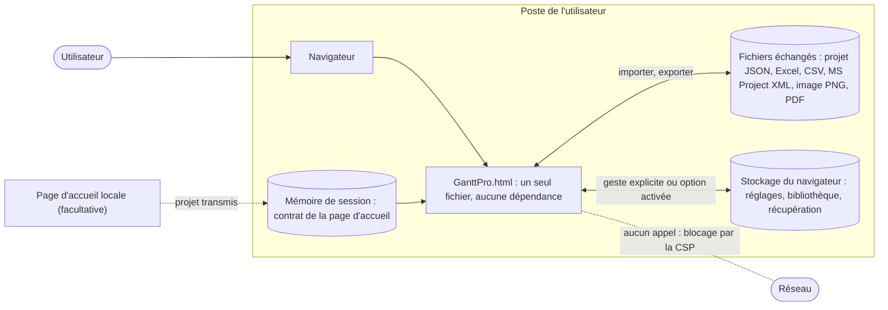
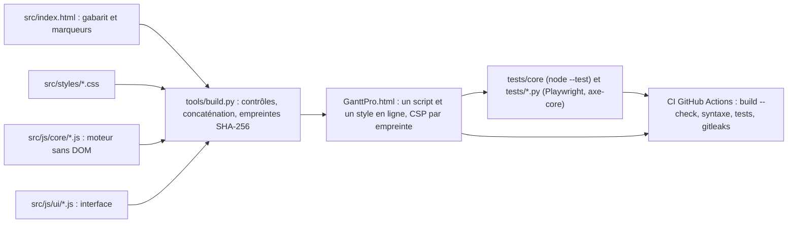
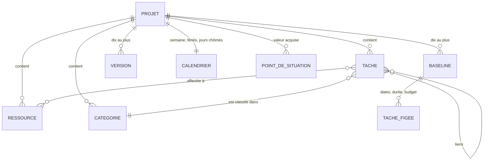
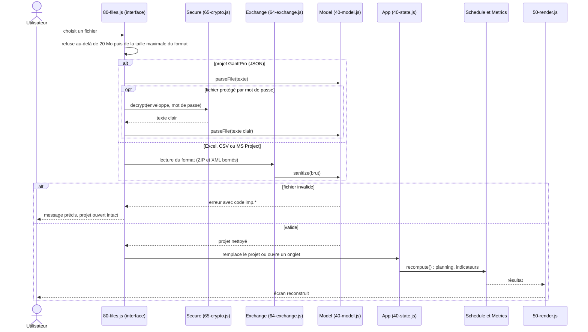
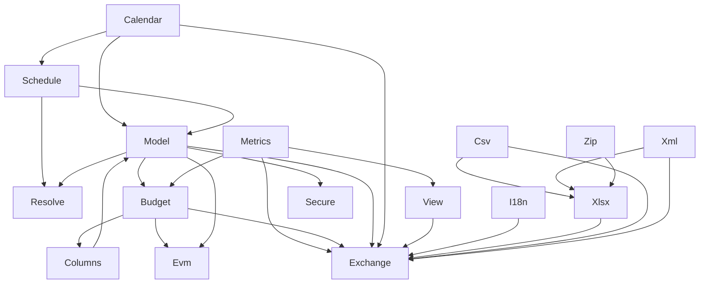

# Architecture de GanttPro

Ce document va du général au détaillé : contexte, fabrication, briques, données, flux, puis modules. Il permet de
reprendre le projet sans l'historique des conversations. Les exigences fonctionnelles sont dans
[Specs_fonctionnelles.md](Specs_fonctionnelles.md) (source unique), la continuité dans [PCA.md](PCA.md), les règles de
développement dans [CLAUDE.md](CLAUDE.md).

Les schémas sont en Mermaid (rendus par GitHub). Les dépendances entre modules ci-dessous ont été calculées par analyse
des sources le 2 novembre 2026, pas écrites de mémoire. Les dépendances au niveau des fonctions sont l'objet du
rétrofit des commentaires décidé le 2 novembre 2026 (Specs_fonctionnelles.md, annexe C.1) ; tant qu'il n'est pas
fusionné, elles ne sont pas décrites ici.

## 1. Contexte

GanttPro est **une application locale** : un seul fichier HTML ouvert dans un navigateur. Il n'y a ni serveur, ni
compte, ni base de données, ni appel réseau. Les données de l'utilisateur ne quittent le navigateur que par un export
qu'il déclenche lui-même.

Menaces et mesures : [SECURITY.md](SECURITY.md). Le principal vecteur est un fichier de projet malveillant importé
(section 5 du présent document).

## 2. Fabrication et livraison

Le fichier livré est **généré** : on ne le modifie jamais à la main. `tools/build.py` assemble les sources, refuse les
constructions dangereuses (`eval`, gestionnaires en ligne, appels réseau, `console.*`, accès au stockage hors de
`src/js/ui/10-storage.js`) et calcule la politique de sécurité du contenu (CSP) avec l'empreinte SHA-256 exacte du script
et de la feuille de style. Sans `'unsafe-inline'`, un script ou un style injecté est bloqué par le navigateur.

Ordre de chargement : les fichiers sont concaténés dans l'ordre alphabétique, `core` avant `ui`, dans **une seule
fonction exécutée immédiatement, en mode strict** : aucun nom n'est exposé sur `window`. Le préfixe numérique des noms
de fichiers fait donc l'ordre de définition : au moment de sa définition, un module ne peut utiliser qu'un module de
préfixe inférieur ; un appel vers un module de préfixe supérieur n'a lieu qu'à l'exécution.

## 3. Briques

| Brique | Dossier | Rôle | Touche au DOM ? |
|---|---|---|---|
| Moteur (`core`) | `src/js/core/` | Dates, calendrier, ordonnancement, indicateurs, budget et valeur acquise, colonnes, filtres, traductions, lecture et écriture des formats, chiffrement, validation des fichiers | Non |
| Interface (`ui`) | `src/js/ui/` | Rendu, fenêtres, gestes, fichiers, stockage, démarrage | Oui |
| Styles | `src/styles/` | Polices intégrées (base64) et feuille de style, thèmes clair et sombre | — |
| Gabarit | `src/index.html` | Squelette de la page, zones, marqueurs de construction | — |
| Outils | `tools/build.py` | Assemblage, contrôles, CSP | — |
| Tests | `tests/` | Moteur (`core/`), bout en bout (`test_v3*.py`), fichiers d'essai fictifs (`fixtures/`) | — |

Règle de séparation : le moteur ne lit ni n'écrit rien d'extérieur ; il reçoit un projet et rend un résultat. L'interface
ne calcule pas : elle appelle le moteur. Ainsi les scénarios chiffrés de la recette se testent sans navigateur.

## 4. Données

Un projet est un objet unique, validé à chaque entrée. Les montants sont des **entiers de centimes**. Les identifiants
de tâche sont des chaînes `[A-Z0-9._-]` de 1 à 12 caractères, jamais convertis en nombres. Le détail des champs et des
limites est dans Specs_fonctionnelles.md, section 3.

Lecture du schéma : le parent est une tâche récapitulative (5 niveaux au plus) ; les liens sont de type FD, DD, FF ou DF avec un
délai ; une affectation porte un taux de 1 à 100 % de la capacité de la ressource.

Champs facultatifs du format 3, ajoutés sans changer son numéro : montants (`budget`, `actual`, provision), `evmGreen`,
`evmRed`, `etc`, `baselineRef`, `statusPoints`, `columns`.

Trois lieux de conservation, tous contrôlés par `src/js/ui/10-storage.js` (le seul module autorisé à y toucher) :

| Lieu | Contenu | Quand |
|---|---|---|
| `localStorage`, préfixe `ganttpro.settings.` | Réglages : langue, thème, raccourcis, masquage des montants, sauvegarde automatique, message de première utilisation | Réglage modifié |
| `localStorage`, préfixes `ganttpro.lib.` et `ganttpro.rec.` | Bibliothèque (projets et modèles) ; emplacements de récupération | Geste explicite ; sauvegarde automatique, désactivée par défaut |
| `sessionStorage` (`gantt_project`, `gantt_saved_project`, `gantt_home_url`) | Contrat avec une page d'accueil (section 8.4 des spécifications) | Lu au démarrage ; le projet transmis est supprimé après lecture |

« Réglages > Effacer toutes les données » supprime tout ce qui porte le préfixe `ganttpro.`.

## 5. Flux : d'un fichier importé à l'écran

Tout ce qui entre est **non fiable** : le fichier est contrôlé **en entier avant** tout changement ; s'il est refusé, le
projet ouvert reste intact. Le même contrôle (`Model.sanitize` par `Model.parseFile`) s'applique aux versions
restaurées, à la bibliothèque, à la récupération et à la page d'accueil.

### Flux d'une modification

Toute modification de données passe par `commit(mutate)` (`40-state.js`) : un pas d'annulation, indicateur « modifié »,
recalcul du planning par `recompute()` puis reconstruction de l'écran par `renderAll()` (déterministe, moins de 100 ms
pour 1 000 tâches). L'interface n'écrit jamais dans `App.project` autrement.

## 6. Modules du moteur (`src/js/core/`)

| Fichier | Module | Rôle |
|---|---|---|
| `00-dates.js` | `Dates` | Jour = entier (nombre de jours depuis le 01/01/1970), jamais de fuseau |
| `10-calendar.js` | `Calendar` | Jours ouvrés, fériés par pays, jours chômés (RG-01 à RG-03) |
| `20-schedule.js` | `Schedule` | Ordonnancement, chemin critique, modes de charge (RG-04 à RG-12, RG-23 à RG-25, RG-33) |
| `30-metrics.js` | `Metrics` | Statuts, écarts, avancement, courbe en S, occupation (RG-13 à RG-20) |
| `35-resolve.js` | `Resolve` | Propositions de résolution des conflits, simulées sur une copie (EF-31, RG-34) |
| `40-model.js` | `Model` | Limites, validation par liste blanche, lecture et écriture du format 3 |
| `42-budget.js` | `Budget` | Budget, coût réel, provision, BAC, courbe des coûts, entiers de centimes (RG-35 à RG-43) |
| `43-evm.js` | `Evm` | Valeur acquise : PV, EV, AC, CV, SV, CPI, SPI, EAC, VAC, points de situation |
| `44-columns.js` | `Columns` | Colonnes affichées et leur ordre (EF-143 à EF-146) |
| `45-view.js` | `View` | Recherche, filtres, regroupements : affichage seulement |
| `50-i18n.js` | `I18n` | Catalogues français et anglais, pluriels, messages d'erreur |
| `60-xml.js` | `Xml` | Lecteur XML minimal sans DOCTYPE ni entités |
| `61-zip.js` | `Zip` | Écriture sans compression, lecture bornée (200 fichiers, 50 Mo) |
| `62-csv.js` | `Csv` | CSV et texte tabulé, neutralisation des formules |
| `63-xlsx.js` | `Xlsx` | Écriture et lecture de classeurs Excel, sans formule |
| `64-exchange.js` | `Exchange` | Export et import tableur et MS Project ; tout passe par `Model.sanitize` |
| `65-crypto.js` | `Secure` | PBKDF2-SHA256 (600 000 itérations) et AES-256-GCM par Web Crypto |

Dépendances entre modules (appels à l'exécution). `Dates`, utilisé par presque tous, n'est pas dessiné. `Model`,
`Budget` et `Columns` se référencent en cercle : c'est sans danger, car chacun n'appelle l'autre qu'à l'exécution,
jamais pendant sa définition.

Lecture : `A --> B` signifie « B utilise A ».

## 7. Modules de l'interface (`src/js/ui/`)

| Fichier | Rôle |
|---|---|
| `00-dom.js` | `h()` et `svg()` : construction du DOM sans `innerHTML` |
| `10-storage.js` | `Settings`, `Store`, mémoire de session : seul accès au stockage |
| `20-actions.js` | Table `ACTIONS` : un écouteur par type d'événement relie `data-click`, `data-change`, `data-input`, `data-submit` aux actions |
| `30-dialog.js` | `Dialog.open`, `message`, `confirm` : fenêtres natives titrées, focus piégé |
| `40-state.js` | `App` (état), `commit()`, `recompute()`, annulation (50 pas) |
| `41-money.js` | Affichage des montants, masquage |
| `50-render.js` | Barre du haut, chiffres, alertes, liste, grille, légende ; `render()` et `renderAll()` |
| `52-viewbar.js`, `55-tooltip.js` | Recherche et filtres ; infobulles |
| `60-editor.js` à `66-layout.js` | Panneau d'édition, raccourcis, sélection, actions groupées, gestes, mise en page |
| `70-windows.js` à `74-columns.js` | Fenêtres projet, ressources, catégories, baselines, calendrier, colonnes |
| `75-dashboard.js`, `76-budget.js`, `76-load.js` | Tableau de bord, onglet Budget et valeur acquise, charge |
| `77-report.js`, `78-print.js` | Rapport d'état, impression |
| `79-versions.js` à `87-settings.js` | Versions, fichiers, presse-papiers, onglets, bibliothèque, récupération, réglages |
| `88-ofl.js` | Texte de licence des polices (généré depuis `THIRD_PARTY_LICENSES.md`) |
| `99-main.js` | Actions de l'écran principal et démarrage |

Dépendance de l'interface vers le moteur : l'interface appelle le moteur, jamais l'inverse. Le tableau ci-dessous donne,
pour les fichiers qui parlent le plus au moteur, les modules qu'ils utilisent (calculé le 2 novembre 2026).

| Fichier d'interface | Modules du moteur utilisés |
|---|---|
| `50-render.js` | `Budget`, `Columns`, `Dates`, `I18n`, `Metrics` |
| `60-editor.js` | `Budget`, `Dates`, `I18n`, `Model`, `Schedule` |
| `70-windows.js` | `Budget`, `Dates`, `I18n`, `Model`, `Resolve` |
| `72-baselines.js`, `76-budget.js` | `Budget`, `Dates`, `Evm`, `I18n`, `Model` |
| `80-files.js` | `Csv`, `Dates`, `Exchange`, `I18n`, `Metrics`, `Model`, `Schedule`, `Secure`, `Xlsx` |
| `85-library.js`, `86-recovery.js`, `87-settings.js` | `Model`, `Secure`, `I18n` |

## 8. Sécurité intégrée à l'architecture

Défense en profondeur : aucune mesure n'est le seul rempart.

| Couche | Mesure | Où |
|---|---|---|
| Construction | Motifs interdits refusés au build | `tools/build.py` |
| Contenu | CSP par empreinte, `connect-src 'none'` | `GanttPro.html` (généré) |
| Entrée | Liste blanche de champs, types, longueurs, identifiants ; fichier refusé en entier | `Model.sanitize`, `Model.parseFile` |
| Formats | ZIP et XML bornés, formules neutralisées | `Zip`, `Xml`, `Csv`, `Xlsx` |
| Affichage | `textContent` seul, jamais `innerHTML`, couleurs filtrées | `00-dom.js` |
| Repos | Chiffrement facultatif par mot de passe | `Secure` |
| Stockage | Un seul module, clés validées, effaçable | `10-storage.js` |
| Livraison | Détection de secrets, fichier à jour, revue avant fusion | CI et protection de `main` |

## 9. Tenir ce document à jour

Ce fichier est modifié dans la **même modification** que le code quand une brique, un fichier, une dépendance ou un flux
change (CLAUDE.md §7 et §8). Pour recalculer les dépendances entre modules, relancer l'analyse des sources ; ne pas se
fier à la mémoire.
