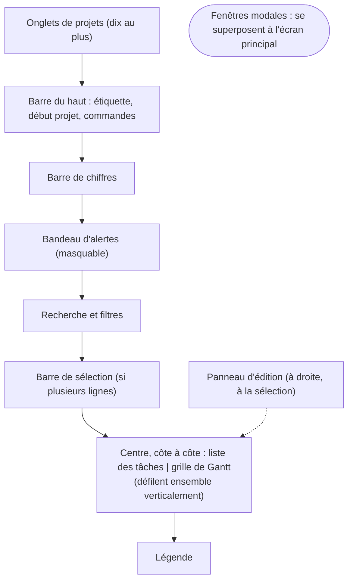

# GanttPro – Cahier des charges fonctionnel

Dernière mise à jour : 2 novembre 2026

> **Statut de ce fichier.** `Specs_fonctionnelles.md` est la **source unique** des spécifications de GanttPro (annexe C, ligne du 2 novembre 2026). Il reprend le contenu du cahier des charges tenu en ligne jusqu'à sa révision 192, figé à cette date ; seuls ont changé la ligne de signature (donnée personnelle retirée) et le schéma de la section 4, redessiné en Mermaid. Toute modification de fonction, de règle ou d'arbitrage se fait ici, dans la même modification que le code. Documents liés : `Architecture.md` (structure), `PCA.md` (continuité), `docs/recette-manuelle.md` (validation), `docs/guide-utilisateur.md` (usage).

## 1. Objet, périmètre et principes

GanttPro est un éditeur de diagramme de Gantt qui s'utilise seul, dans un navigateur, sans compte ni serveur. Ce document décrit ce que l'application doit faire, du point de vue de l'utilisateur, avec assez de précision pour la reconstruire sans lire le code existant. Il part de la version 2.3 de l'application, en corrige les défauts et y ajoute des améliorations ; l'annexe A donne la liste des écarts et la décision prise pour chacun.

**Comment lire ce document.** Chaque exigence porte un identifiant : EF-xx pour une fonctionnalité (section 5), RG-xx pour une règle de gestion (section 6), EX-xx pour une exigence transversale (section 7). Chacune porte une priorité selon la méthode MoSCoW : **Must** indispensable (sans elle l'application ne remplit pas sa mission), **Should** importante (attendue de la première version), **Could** souhaitable (peut suivre dans une version ultérieure), **Won't** exclue de la version en cours et consignée pour plus tard (aucune exigence n'est classée ainsi pour l'instant). Ces quatre niveaux remplacent les anciens I, M et S. Les formules « doit » et « est » décrivent le comportement attendu. Les exemples chiffrés de la section 9 servent de référence : une reconstruction est conforme quand elle les reproduit.

**Limite.** Aucun utilisateur ni responsable de produit n'a encore validé ces exigences. Les points qui relèvent d'un choix (priorités, améliorations ajoutées) sont à confirmer avant tout engagement contractuel.

### 1.1 Utilisateurs et besoin

Le public visé est un chef de projet, ou un responsable d'équipe, qui planifie un projet en jours ouvrés français, suit son avancement et rend compte de ses écarts, sans outil lourd. L'interface est entièrement en français. L'application est mono-utilisateur : un seul projet est ouvert à la fois, sans rôles ni droits.

### 1.2 Cas d'usage couverts

1. Construire un planning : saisir des tâches, des durées et des dépendances, puis lire les dates calculées.
2. Affecter des ressources et obtenir un planning où une même personne n'a jamais deux tâches en même temps.
3. Repérer le chemin critique, c'est-à-dire les tâches dont le retard retarde la fin du projet.
4. Suivre l'avancement : pourcentage, dates réelles, écarts, statuts, courbe en S.
5. Figer un planning de référence (baseline) et le comparer au planning courant.
6. Conserver et transmettre un projet dans un fichier, le rouvrir plus tard, revenir à un état antérieur.

### 1.3 Hors périmètre

- Travail collaboratif en ligne, comptes, synchronisation ou stockage dans un service distant : tout reste sur l'appareil de l'utilisateur.
- Charge de travail en heures : la durée se mesure en jours ouvrés et l'affectation en pourcentage de temps. Le budget par tâche est dans le périmètre (5.21) ; la valeur acquise (étape B, EX-39) et les taux de ressource (étape C, EX-41) sont décrits dans les exigences d'exploitation ; les types de dépenses, les années et les lignes hors tâche restent à rédiger.
- Calendriers d'heures (horaires, demi-journées) : la plus petite unité est le jour ouvré.
- Jours fériés d'autres pays ou régions que ceux proposés ; l'utilisateur les ajoute en jours chômés.
- Langues autres que le français et l'anglais.
- Dépendances entre projets différents, et pièces jointes de fichiers aux tâches.
- Formats d'échange propriétaires autres que ceux de la section 5.18.

### 1.4 Principes directeurs

| Principe | Conséquence attendue |
| --- | --- |
| Autonomie | L'application fonctionne ouverte depuis un fichier local, hors ligne, sans installation. |
| Confidentialité | Aucune donnée ne quitte l'appareil de l'utilisateur ; aucun suivi d'usage, aucun cookie. |
| Prévisibilité | Mêmes données, mêmes dates : le calcul du planning est déterministe et ne dépend pas de l'ordre dans lequel l'utilisateur a fait ses modifications. |
| Aucune correction silencieuse | Toute valeur refusée ou corrigée est signalée à l'utilisateur avec la raison et la valeur acceptable. L'application n'invente jamais une donnée à sa place. |
| Accessibilité | Tout ce qui peut se faire à la souris peut se faire au clavier ; l'application vise la conformité WCAG 2.1 niveau AA et le RGAA. |
| Sûreté des fichiers | Un fichier reçu d'un tiers ne peut ni exécuter de code ni altérer l'application : il est contrôlé avant d'être chargé. |

## 2. Vocabulaire

Ces termes sont employés avec le même sens dans tout le document et dans l'interface.

| Terme | Définition |
| --- | --- |
| Projet | Ensemble de tâches, de ressources, de catégories et de références, avec un nom, une description, un emoji et une date de début. |
| Tâche | Travail à réaliser : un identifiant court, un nom, une durée en jours ouvrés, des prédécesseurs, une ressource, une catégorie. |
| Jalon | Événement de durée nulle (un livrable, une étape de décision). Il se place sur une date et s'affiche en losange. |
| Jour ouvré | Jour travaillé du calendrier du projet : par défaut du lundi au vendredi, hors jours fériés français. Toutes les durées se comptent en jours ouvrés. |
| Dépendance | Relation d'ordre entre une tâche (le successeur) et une autre (le prédécesseur), exprimée par un lien. |
| Date imposée | Date de début choisie par l'utilisateur pour une tâche, qui l'emporte sur le calcul. |
| Planning | Dates de début et de fin de chaque tâche, calculées par l'application. Elles ne se saisissent pas, sauf par une date imposée. |
| Ressource | Personne ou équipe qui réalise des tâches. Elle travaille dans la limite de sa capacité. |
| Catégorie | Famille de tâches (étude, réalisation, essais…) qui donne sa couleur à la barre. |
| Conflit de ressource | Jour de surcharge ou de présence d'une charge pendant une absence, pour une ressource. |
| Nivellement | Décalage automatique d'une tâche pour qu'une ressource ne dépasse pas sa capacité. |
| Marge | Nombre de jours ouvrés dont une tâche peut glisser sans retarder la fin du projet. |
| Chemin critique | Chaîne de tâches sans marge : tout retard sur l'une d'elles retarde la fin du projet. |
| Avancement | Pourcentage réalisé d'une tâche, de 0 à 100 %. |
| Dates réelles | Date réelle de début et de fin d'une tâche, saisies par l'utilisateur. |
| Statut | État calculé d'une tâche : Terminé, En cours, En retard, Pas démarré ou À venir. |
| Baseline | Photographie nommée du planning à un instant, conservée pour comparer plus tard. |
| Version | Sauvegarde nommée de l'état complet du projet, que l'on peut restaurer. |
| Courbe en S | Courbe cumulée de l'avancement prévu et de l'avancement réel au fil du temps. |
| Aujourd'hui | Date du jour de l'ordinateur de l'utilisateur, dans son fuseau horaire. |
| Tâche récapitulative | Tâche qui regroupe d'autres tâches (ses enfants) ; ses dates et son avancement se déduisent des leurs. |
| Lien | Relation entre un prédécesseur et un successeur, avec un type (fin-début FD, début-début DD, fin-fin FF, début-fin DF) et un délai en jours ouvrés. |
| Délai | Décalage en jours ouvrés ajouté à un lien : positif pour attendre, négatif pour chevaucher. |
| Affectation | Association d'une ressource à une tâche avec un taux d'occupation de 1 à 100 %. |
| Capacité | Part de son temps qu'une ressource peut consacrer au projet, de 1 à 100 %. |
| Absence | Plage de dates pendant laquelle une ressource n'est pas disponible. |
| Surcharge | Jour où la charge d'une ressource dépasse sa capacité, ou jour de présence d'une charge pendant une absence. |
| Calendrier du projet | Semaine de travail, jours fériés choisis, jours chômés ajoutés et jours travaillés exceptionnels qui définissent les jours ouvrés. |
| Contrainte de date | « Ne pas commencer avant » une date, ou échéance de fin souhaitée. |
| Étiquette | Mot-clé libre attaché à une tâche pour la retrouver et la filtrer. |
| Filtre, groupe | Façons de n'afficher qu'une partie des tâches, ou de les regrouper par ressource, catégorie ou statut, sans rien changer au planning. |
| Rapport d'état | Page de synthèse imprimable : avancement, retards, prochaines échéances, alertes et commentaire. |
| Bibliothèque, modèle | Projets et modèles que l'utilisateur enregistre volontairement sur son appareil ; un modèle sert de point de départ à de nouveaux projets. |
| Budget, coût réel | Montants saisis sur une tâche : le budget est ce que la tâche doit coûter, le coût réel cumulé ce qui est engagé ou payé à ce jour. Saisis à la main : l'application ne les calcule pas et ne remplace pas une comptabilité de projet (5.21). |
| BAC, provision, budget total | Le BAC est la somme des budgets des tâches ; la provision est une réserve globale qui n'appartient à aucune tâche ; le budget total est le BAC plus la provision (RG-37). |
| Masquage des montants | Remplacement de tout montant affiché par « •••• », à l'écran seulement ; il ne change ni les données ni les fichiers (EF-126, RG-41). |

## 3. Données

Un projet se compose de plusieurs familles de données. Les dates de début et de fin planifiées d'une tâche ne sont pas des données saisies : elles sont calculées à chaque affichage (section 6), sauf dans une baseline qui les fige. Les dates se saisissent et s'enregistrent au format AAAA-MM-JJ ; elles s'affichent selon la langue choisie (RG-32), par exemple « lun. 05 janv. 2026 » en français. Les tableaux ci-dessous indiquent, pour chaque champ, ce que l'utilisateur peut saisir ; tout ce qui sort de ces limites est refusé avec un message (EX-06).

### 3.1 Projet

| Champ | Règle | Défaut |
| --- | --- | --- |
| Nom | Obligatoire, 1 à 60 caractères | « Nouveau projet » |
| Description | Facultative, 500 caractères au plus | vide |
| Emoji | Un parmi 20 proposés, plus 📁 (défaut) | 📁 |
| Début du projet | Obligatoire, date valide. Un jour non travaillé est accepté : les tâches commencent alors au premier jour ouvré suivant. | date du jour, dans le fuseau de l'utilisateur |
| Calendrier | Semaine de travail, jeu de jours fériés, jours chômés et jours travaillés exceptionnels (3.9) | lundi au vendredi, France métropolitaine |
| Gestion de la charge | Nivellement automatique, lissage dans la marge ou sans nivellement (RG-08, RG-33, EF-105) | lissage dans la marge (nivellement automatique pour un fichier de la version 2.3) |
| Note du rapport d'état | Texte libre de 2 000 caractères au plus, repris dans le rapport (EF-88) | vide |
| Devise | Symbole de 1 à 5 caractères, unique pour le projet, sans conversion (EF-114) | € |
| Provision | Montant de 0 à 50 000 000 000,00 (RG-35), inclus dans le budget total (RG-37) | 0 |

### 3.2 Tâche, jalon et récapitulative

| Champ | Règle | Défaut à l'ajout |
| --- | --- | --- |
| Identifiant | 1 à 12 caractères parmi A-Z, 0-9, point, tiret et tiret bas ; saisi en majuscules ; unique dans le projet. Il s'affiche dans la colonne N° et dans le chemin critique. | prochain libre dans la suite A, B, … Z, AA, AB… |
| Nom | Obligatoire, 1 à 200 caractères | « Nouvelle tâche » |
| Type | Tâche, jalon ou récapitulative | tâche |
| Parent | Identifiant d'une récapitulative du projet, ou aucun ; 5 niveaux au plus ; jamais la tâche elle-même ni l'un de ses descendants | aucun |
| Durée | Entier de 1 à 3 650 jours ouvrés pour une tâche ; toujours 0 pour un jalon ; calculée pour une récapitulative | 5 |
| Liens vers les prédécesseurs | Jusqu'à 50 liens ; chacun désigne une autre tâche ou un autre jalon (jamais une récapitulative, ni un ancêtre ou un descendant), a un type FD, DD, FF ou DF (RG-06) et un délai entier de −365 à 365 jours ouvrés ; un seul lien par prédécesseur ; pas de boucle (RG-09) | aucun |
| Affectations | Jusqu'à 10 ; chacune associe une ressource du projet et un taux de 1 à 100 %, sans dépasser la capacité de la ressource ; une ressource une seule fois. Ni jalon ni récapitulative n'en ont. | aucune |
| Catégorie | Une catégorie du projet | première de la liste |
| Date imposée | Date de début facultative | aucune |
| Ne pas commencer avant | Date facultative (RG-24) | aucune |
| Échéance | Date de fin souhaitée, facultative (RG-24) | aucune |
| Avancement | Entier de 0 à 100 (pour cent) ; un jalon vaut 0 ou 100 ; calculé pour une récapitulative | 0 |
| Début réel, fin réelle | Dates facultatives ; la fin réelle ne peut pas précéder le début réel | vides |
| Étiquettes | Jusqu'à 10 mots-clés de 1 à 30 caractères, sans doublon à la casse près | aucune |
| Notes | Texte libre de 2 000 caractères au plus | vide |
| Commentaires | Jusqu'à 50 entrées datées de 1 à 500 caractères | aucun |
| Repliée | Récapitulative seulement : ses enfants sont masqués dans la liste et la grille | non |
| Budget | Montant (RG-35) ; toujours 0 pour un jalon ; somme de ses enfants pour une récapitulative, sans saisie (RG-36) | 0 |
| Coût réel | Montant cumulé dépensé, engagé compris (EF-113) ; toujours 0 pour un jalon ; somme de ses enfants pour une récapitulative, sans saisie (RG-36) | 0 |

La tâche référence ses ressources et sa catégorie par leur identité, non par leur nom : renommer une ressource ou une catégorie ne casse donc aucune affectation.

### 3.3 Ressource

| Champ | Règle | Défaut |
| --- | --- | --- |
| Nom | Obligatoire, 1 à 100 caractères, unique sans tenir compte de la casse, à l'ajout comme au renommage | — |
| Rôle | Facultatif, 100 caractères | vide |
| Couleur | Une des 10 teintes de la palette | première teinte libre |
| Capacité | Entier de 1 à 100 %, non inférieur à aucune de ses affectations | 100 |
| Absences | Jusqu'à 100 plages, chacune avec date de début, date de fin (non antérieure au début) et libellé facultatif de 100 caractères | aucune |
| Avatar | Deux initiales tirées du nom, calculées | — |

### 3.4 Catégorie

| Champ | Règle |
| --- | --- |
| Nom | Obligatoire, 1 à 100 caractères, unique sans tenir compte de la casse |
| Couleur | Une couleur au choix ; elle donne sa teinte à la barre des tâches de la catégorie |

### 3.5 Baseline

| Champ | Règle |
| --- | --- |
| Nom | Obligatoire, 1 à 100 caractères |
| Couleur | Une des 6 teintes proposées |
| Contenu | Date de capture, début du projet à ce moment, et pour chaque tâche : identifiant, nom, durée, prédécesseurs, catégorie, début et fin planifiés, budget ; et, pour le projet, la provision (RG-39) |
| Affichage | Deux indicateurs indépendants : afficher sur le Gantt, afficher sur la courbe en S |

### 3.6 Version

Une version est une copie nommée et datée de l'état complet du projet (tout sauf les autres versions). Son nom est obligatoire, 100 caractères au plus.

### 3.7 Limites

| Élément | Maximum |
| --- | --- |
| Tâches, jalons et récapitulatives, ensemble | 1 000 |
| Niveaux de récapitulatives | 5 |
| Ressources | 100 |
| Catégories | 100 |
| Liens vers les prédécesseurs d'une tâche | 50 |
| Affectations d'une tâche | 10 |
| Étiquettes d'une tâche, étiquettes distinctes du projet | 10, 200 |
| Commentaires d'une tâche | 50 |
| Absences d'une ressource | 100 |
| Jours chômés ajoutés, jours travaillés exceptionnels | 366 chacun |
| Baselines | 3 |
| Versions | 10 |
| Projets ouverts à la fois | 10 |
| Entrées de la bibliothèque (projets et modèles) | 50 |
| Lignes d'un tableur importé | 1 000 |
| Taille d'un fichier importé | 5 Mo |
| Montant (budget, coût réel, provision) | 50 000 000 000,00, avec deux décimales |
| Symbole de la devise | 5 caractères |

Quand une limite est atteinte, l'action est refusée avec un message qui nomme la limite et propose de supprimer un élément.

### 3.8 Projet initial

Au premier lancement, ou après « Nouveau projet », l'application propose un projet minimal : nom « Nouveau projet », début à la date du jour, calendrier par défaut, une tâche A de 10 jours nommée « Renommer cette tâche… » sans ressource, une ressource nommée « Ressource », une catégorie « Général », aucune baseline, aucune version.

### 3.9 Calendrier du projet

| Champ | Règle | Défaut |
| --- | --- | --- |
| Semaine de travail | Sept cases, du lundi au dimanche, dont une au moins est cochée | lundi à vendredi |
| Jours fériés | Un jeu parmi : France métropolitaine, France Alsace-Moselle, Belgique, Allemagne (jours nationaux), Royaume-Uni (Angleterre et pays de Galles), États-Unis (jours fédéraux), Suisse, Aucun (RG-02) | France métropolitaine |
| Jours chômés ajoutés | Dates seules ou plages, avec un libellé de 100 caractères au plus (fermeture, pont, jour férié d'un autre pays) | aucun |
| Jours travaillés exceptionnels | Dates seules ou plages, avec libellé ; ils l'emportent sur tout (RG-01) | aucun |

Une même date ne peut pas être à la fois chômée et travaillée exceptionnellement : l'ajout est refusé. Tout changement du calendrier recalcule le planning.

### 3.10 Réglages de l'appareil

Ces réglages ne font pas partie d'un projet et ne sont pas exportés. Ils restent sur l'appareil de l'utilisateur (EX-10, EX-22).

| Élément | Règle | Défaut |
| --- | --- | --- |
| Langue | Français ou anglais | langue du navigateur si elle est l'une des deux, sinon français |
| Thème | Système, clair ou sombre | système |
| Sauvegarde automatique | Activée ou non (EF-101) | non |
| Bibliothèque | Projets et modèles enregistrés par l'utilisateur : nom, date, nombre de tâches (EF-99, EF-100) | vide |
| Récupération | Un emplacement par projet ouvert, rempli par la sauvegarde automatique | vide |

## 4. Organisation de l'écran

L'application tient sur un seul écran principal ; les fenêtres s'y superposent. Le centre est occupé par la liste des tâches et la grille de Gantt, qui défilent ensemble verticalement.

### 4.1 Zones de l'écran principal

| Zone | Contenu | Comportement |
| --- | --- | --- |
| Barre du haut | Retour à l'accueil (si une page d'accueil est fournie), étiquette du projet, champ « Début projet », commandes (4.2) | Passe sur plusieurs lignes sur un écran étroit |
| Barre de chiffres | Durée, début et fin du planning, jours fériés de la période, chemin critique, avancement global avec sa barre de progression | Mise à jour après chaque modification |
| Bandeau d'alertes | Conflits de ressource et dates impossibles (EF-30, EF-18), avec les tâches concernées | Masquable par une croix ; rouvert par le badge de la barre du haut |
| Liste des tâches | Une ligne par tâche ou jalon : N°, activité, durée, dépendances, ressource, statut | Repliable ; colonnes ajustables (EF-43, EF-44) |
| Grille de Gantt | En-tête de semaines ou de mois, une barre par tâche, un losange par jalon, flèches, ligne « aujourd'hui » | Zoom de 20 à 300 % (EF-41) |
| Édition | Formulaire de la tâche sélectionnée (EF-04) | Apparaît à droite à la sélection, se ferme par « Annuler » ou Échap |
| Légende | Couleurs des catégories et des ressources, symboles, statuts | Toujours visible sous le Gantt |
| Onglets de projets | Un onglet par projet ouvert avec une pastille « modifié », et « + » pour en ouvrir un | Dix projets au plus ; chaque onglet garde zoom, filtres, sélection, historique (EF-98) |
| Recherche et filtres | Champ de recherche, bouton « Filtres », liste « Grouper par », compteur de lignes affichées | Ne change jamais le planning (EF-84 à EF-86) |
| Barre de sélection | « n tâches sélectionnées » et actions groupées | N'apparaît que si plusieurs lignes sont sélectionnées (EF-81, EF-82) |

### 4.2 Commandes de la barre du haut

| Libellé | Action | Référence |
| --- | --- | --- |
| ← Accueil | Revient à la page d'accueil fournie ; absent si aucune n'est fournie | EF-56 |
| Étiquette du projet (emoji et nom) | Ouvre la fenêtre de modification du projet | EF-48 |
| Début projet | Champ date : recalcule le planning | EF-12 |
| + Ajouter tâche, + Ajouter jalon | Créent une tâche ou un jalon | EF-01, EF-02 |
| Trier | Range la liste selon les dépendances (barre de recherche, avec « Tout replier », « Tout déplier » et « Replier la liste ») | EF-09 |
| Ressources, Catégories, Baselines | Ouvrent les fenêtres de gestion | EF-24, EF-27, EF-33 |
| Tableau de bord | Ouvre indicateurs, courbe en S, charge des ressources et tableau de suivi | EF-37 à EF-40, EF-87 |
| Liens : ON/OFF | Affiche ou masque les flèches de dépendance | EF-45 |
| −, niveau de zoom, +, ↺ | Zoom de la grille | EF-41 |
| Annuler, Rétablir | Annulent ou rétablissent la dernière modification | EF-55 |
| Versions | Ouvre l'historique des versions | EF-54 |
| n conflit(s), Résoudre… | Badge d'alerte et correction automatique | EF-30, EF-31 |
| Charge des ressources | Liste : nivellement automatique, lissage dans la marge, sans nivellement | EF-105 |
| Nouveau, Importer, Exporter | Gestion du fichier du projet | EF-49, EF-52, EF-92, EF-96 |
| Sauvegarder | Sauvegarde le projet pour la page d'accueil ; absent si aucune n'est fournie | EF-56 |
| Thème, Aide | Bascule clair ou sombre ; ouvre l'aide | EF-47, EF-57 |
| + Ajouter récapitulative | Crée une tâche récapitulative | EF-59 |
| Mettre en retrait, Remonter | Change le niveau de la tâche ou de la sélection dans la hiérarchie (boutons de l'édition et de la barre de sélection) | EF-60 |
| Dupliquer | Copie la tâche ou la sélection (édition, barre de sélection, Ctrl + D) | EF-80 |
| Calendrier | Ouvre le calendrier du projet | EF-69 |
| Rapport d'état, Imprimer le Gantt | Ouvrent l'aperçu du rapport et l'impression du Gantt | EF-88, EF-89 |
| Bibliothèque | Ouvre les projets et modèles enregistrés sur l'appareil | EF-99, EF-100 |
| Réglages (engrenage) | Langue, thème, sauvegarde automatique, effacement des données | EF-104 |
| Étiquettes | Ouvre la liste des étiquettes du projet (renommer, supprimer partout) | EF-91 |
| Masquer les montants | Bouton à bascule : remplace tous les montants affichés à l'écran par « •••• » ; sans effet sur les fichiers, l'impression et la copie | EF-126, RG-41 |

### 4.3 Fenêtres et messages

Toutes les fenêtres sont des fenêtres de l'application, pas celles du navigateur : y compris les confirmations, les messages d'erreur et les saisies de nom. Chaque fenêtre bloque l'arrière-plan, place le focus clavier à l'intérieur, le garde dans la fenêtre (Tab n'en sort pas), se ferme par Échap, puis rend le focus à l'élément qui l'avait ouverte. Une confirmation de suppression nomme ce qui sera supprimé et propose « Annuler » en action par défaut.

### 4.4 Écrans étroits et thèmes

Sous 900 pixels de large, les zones s'empilent : barre du haut sur plusieurs lignes, liste puis grille l'une sous l'autre, édition en plein écran. L'application existe en thème sombre et en thème clair ; le choix initial suit la préférence du système, puis celle de l'utilisateur. Les deux thèmes respectent le contraste décrit en EX-03.

## 5. Fonctionnalités

Chaque fonctionnalité décrit ce que l'utilisateur peut faire et ce qu'il doit obtenir. Les calculs sont définis par les règles de gestion de la section 6. Sauf mention contraire, une modification de données est prise en compte immédiatement dans tout l'affichage.

### 5.1 Tâches et jalons

| ID | Exigence | Prio |
| --- | --- | --- |
| EF-01 | **Ajouter une tâche** (« + Ajouter tâche »). La tâche est créée aussitôt avec les valeurs par défaut de la section 3.2 (identifiant, nom, durée, catégorie), placée en fin de liste (ou en fin de la récapitulative sélectionnée), sélectionnée, et son édition s'ouvre, nom sélectionné pour être saisi. « Annuler » (Ctrl + Z) retire la tâche créée. | Must |
| EF-02 | **Ajouter un jalon** (« + Ajouter jalon ») : même démarche, sans durée ni ressource. Le jalon se place sur la fin de ses prédécesseurs (RG-10). | Should |
| EF-03 | **Sélectionner** une tâche par un clic sur sa ligne, sur sa barre ou sur son jalon, ou au clavier (Tab puis Entrée ou Espace). La ligne et la barre sont mises en évidence et l'édition s'ouvre. | Must |
| EF-04 | **Modifier une tâche** dans le panneau d'édition : identifiant, nom, durée, prédécesseurs, catégorie, ressource, date imposée, avancement, dates réelles. Rien n'est appliqué avant « Enregistrer ». « Enregistrer » contrôle tous les champs : si l'un est invalide, rien n'est enregistré, le message précis s'affiche sous le champ et le focus y va. « Annuler » ferme sans rien changer. | Must |
| EF-05 | **Renommer l'identifiant** : l'identifiant reste unique ; le renommage met à jour les prédécesseurs des autres tâches et les références des baselines. | Must |
| EF-06 | **Supprimer une tâche** après une confirmation qui la nomme (pour une sélection, les cinq premières puis le nombre des autres) et indique combien de tâches perdent un prédécesseur. La tâche est retirée des prédécesseurs de toutes les autres. Les baselines conservent leur copie. | Must |
| EF-07 | **Choisir les prédécesseurs** dans une liste déroulante des autres tâches et jalons éligibles (on la parcourt en tapant l'identifiant ou le nom), puis « Ajouter le prédécesseur » ; un nouveau lien est de type fin-début sans délai, réglable ensuite (EF-65). Une liaison qui créerait une boucle est refusée avec le message « Cette dépendance créerait la boucle A → B → A » (RG-09). | Must |
| EF-08 | **Imposer une date de début** : un interrupteur et une date. La barre porte alors le repère 📌. Une date imposée l'emporte sur les dépendances et le nivellement (RG-07) mais déclenche un avertissement quand elle les contredit (EF-18). | Must |
| EF-09 | **Trier** (« Trier ») : range la liste pour que chaque prédécesseur soit avant ses successeurs, en gardant sinon l'ordre actuel. Une confirmation prévient que l'ordre de la liste fixe la priorité du nivellement (RG-08). | Should |
| EF-10 | **Réordonner** une tâche : boutons « Monter » et « Descendre » dans son édition, et glisser-déposer dans la liste. Ils remplacent toute saisie d'un numéro d'ordre. | Could |
| EF-11 | **Jalons automatiques** : « Jalon Début » (date de début du projet) en tête et « Jalon Fin » (date de fin du planning) en pied de la liste. Ils ne se modifient pas, ne se suppriment pas et ne comptent ni dans les indicateurs ni dans les limites. | Should |

### 5.2 Planification

| ID | Exigence | Prio |
| --- | --- | --- |
| EF-12 | **Début du projet** : le champ « Début projet » fixe le point de départ ; toute modification recalcule tout le planning. | Must |
| EF-13 | **Recalcul automatique** : le planning est recalculé après chaque modification de début, durée, dépendance, ressource, date imposée ou ordre de la liste, selon RG-04 à RG-10. | Must |
| EF-14 | **Barre de chiffres** : durée totale en jours ouvrés, date de début, date de fin, nombre de jours fériés et chômés de la période tombant un jour normalement travaillé, chemin critique sous la forme « C → E → G » dans l'ordre du planning, avancement global (RG-16) avec sa barre de progression. | Must |
| EF-15 | **Marquage du chemin critique** (RG-11) : les tâches critiques portent le signe ●, une barre rouge et un halo, et leur ligne « critique » est annoncée aux lecteurs d'écran. La couleur n'est jamais le seul signal. | Must |
| EF-16 | **Repères de temps** : une ligne verticale marque aujourd'hui ; les semaines qui contiennent un jour férié sont surlignées et le nom du jour férié apparaît au survol et au focus de l'en-tête. | Should |
| EF-17 | **Fenêtre de temps de la grille** : elle commence à la plus ancienne et finit à la plus récente de toutes les dates affichées (début du projet, débuts et fins planifiés, dates réelles, baselines affichées). Aucune barre ne peut être hors de la grille. | Must |
| EF-18 | **Avertissements de planning** : quand une date imposée place une tâche de façon à contredire un de ses liens (RG-06), par exemple avant la fin d'un prédécesseur lié en fin-début, la ligne porte ⚠ et le bandeau dit, par exemple, « B commence le 06/01 avant la fin de A (09/01) ». Le planning respecte quand même la date imposée. | Should |

### 5.3 Suivi de l'avancement

| ID | Exigence | Prio |
| --- | --- | --- |
| EF-19 | **Saisir l'avancement** de 0 à 100 % par un curseur et par un champ numérique liés ; pour un jalon, une case « Atteint ». | Must |
| EF-20 | **Saisir les dates réelles** de début et de fin. Renseigner une fin réelle porte l'avancement à 100 %. Ramener l'avancement sous 100 % efface la fin réelle, avec un message. Un début réel après la fin réelle est refusé. | Must |
| EF-21 | **Barres** : un motif rayé montre la part réalisée ; une bande « dates réelles », de la couleur de la ressource, apparaît sous la barre ; un jalon atteint est un losange plein, sinon creux ; une récapitulative est un crochet (EF-62). | Must |
| EF-22 | **Statut** affiché en texte sur chaque ligne : Terminé, En cours, En retard, Pas démarré ou À venir (RG-14). Le même statut sert partout : liste, tableau de bord, infobulle. | Must |
| EF-23 | **Infobulle** au survol et au focus clavier d'une barre : nom, dates prévues et réelles, durée, avancement, statut, prédécesseurs, ressource. Échap la ferme. Ces informations sont aussi toutes dans le panneau d'édition. | Should |

### 5.4 Ressources

| ID | Exigence | Prio |
| --- | --- | --- |
| EF-24 | **Gérer les ressources** dans une fenêtre « Ressources » : ajouter (nom obligatoire, rôle, couleur), renommer, modifier le rôle et la couleur (palette de 10 teintes, choisie au clavier comme à la souris), supprimer. Un nom déjà pris, à la casse près, est refusé avec un message, à l'ajout comme au renommage. | Must |
| EF-25 | **Renommer ou supprimer** : renommer une ressource se répercute partout, sans perdre une affectation. Supprimer une ressource utilisée demande une confirmation qui indique le nombre de tâches concernées ; elle est retirée des affectations de ces tâches, et une tâche sans autre affectation devient « sans ressource » et n'est plus nivelée. | Must |
| EF-26 | **Fiche de ressource** : avatar à deux initiales dans sa couleur, rôle, liste de ses tâches avec leurs dates planifiées, sa charge totale en jours-personne, sa capacité et ses absences (EF-71). | Should |

### 5.5 Catégories

| ID | Exigence | Prio |
| --- | --- | --- |
| EF-27 | **Gérer les catégories** dans une fenêtre « Catégories » : ajouter (nom unique, couleur), renommer, changer la couleur, supprimer. Le nombre de tâches de chaque catégorie est affiché. | Must |
| EF-28 | **Supprimer une catégorie** utilisée demande une confirmation ; ses tâches passent dans la première autre catégorie. La dernière catégorie ne peut pas être supprimée : un message l'explique. | Must |
| EF-29 | **Couleur des barres** : la couleur de la catégorie donne sa teinte (dégradé) à la barre de chaque tâche. La légende reprend les catégories, avec leur nom en texte. | Should |

### 5.6 Conflits et alertes

| ID | Exigence | Prio |
| --- | --- | --- |
| EF-30 | **Signaler les conflits** de ressource (RG-12) : les lignes et barres concernées portent le signe ⚠ et la mention « en conflit », en plus de la couleur rouge. Un badge « n conflit(s) » apparaît dans la barre du haut ; le bandeau liste chaque cas, par exemple « Alice est à 200 % du 08/01 au 09/01 (A, B) ». L'effet d'attention (clignotement) est remplacé par un simple contour si l'utilisateur demande moins d'animation. | Must |
| EF-31 | **Résoudre les conflits** (bouton « Résoudre… », visible dès qu'il y a un conflit) : ouvre une fenêtre qui liste chaque conflit avec des propositions de correction calculées selon RG-34 — déplacer la date imposée en cause au premier jour où ses ressources sont libres, confier la tâche à une autre ressource libre sur toute sa période, lever la date imposée, arbitrer en faisant passer une tâche avant l'autre (« Arbitrer : faire passer A avant B », enregistré comme un lien fin-début A → B visible et retirable), ou, pour tout le projet, passer en nivellement automatique. C'est l'utilisateur qui arbitre : aucune de ces corrections n'est appliquée d'office. Chaque proposition affiche son effet simulé avant tout clic : nombre de conflits restants et décalage de la fin du projet (« aucun conflit restant ; fin repoussée de 3 jours »). Les propositions sont classées de la plus efficace à la plus coûteuse. Rien n'est modifié sans un clic sur « Appliquer » ; chaque correction est un pas d'annulation (EF-55) et la fenêtre se met à jour aussitôt. Sans proposition possible, la fenêtre le dit et invite à modifier dates, durées ou affectations. | Should |
| EF-32 | **Bandeau d'alertes** : il regroupe conflits (EF-30) et avertissements de planning (EF-18). Il se masque par « ✕ » et se rouvre en cliquant sur le badge. | Should |
| EF-105 | **Choisir la gestion de la charge** : une liste « Charge des ressources » de la barre du haut propose lissage dans la marge (défaut : la fin du projet ne bouge pas d'elle-même et l'utilisateur arbitre les surcharges restantes), nivellement automatique et sans nivellement (RG-08, RG-33). Le choix est une donnée du projet, enregistrée dans le fichier ; il est annulable et recalcule aussitôt le planning, puis annonce le nombre de conflits obtenu. | Must |
| EF-106 | **Rendre visibles les décalages** : une tâche décalée par le nivellement ou le lissage porte, sur sa ligne et dans le nom accessible de sa barre, la mention « 3 j de décalage (Alice : surcharge) » ou « (Alice : absence) » ; son édition l'explique : « Décalée de 3 jours ouvrés par le nivellement (Alice : surcharge). Sans ce décalage, elle commencerait le lun. 05 janv. 2026. ». Une surcharge que le lissage ne peut pas absorber est signalée dans le bandeau : « B ne tient pas dans sa marge : la surcharge d'Alice n'est pas lissée ». | Must |
| EF-107 | **Fermer une fenêtre par une croix** : chaque fenêtre porte, en haut à droite, un bouton rond « × » au nom accessible « Fermer », atteignable au clavier juste après le titre ; il fait comme la touche Échap. Les fenêtres à effet immédiat (ressources, tableau de bord, versions…) se ferment sans question. Une fenêtre de saisie déclarée à risque (modification en masse, calendrier) dont la saisie serait perdue demande d'abord confirmation : « Fermer sans enregistrer ? », avec « Continuer la saisie » par défaut. Le bouton « Annuler » ferme toujours directement. | Should |
| EF-108 | Régler la largeur de la liste : une barre verticale (rôle « separator », focalisable, large de 24 px sur écran tactile) sépare la liste du Gantt. On la tire, ou on utilise les flèches gauche et droite (20 px, Maj : 100 px) ; Début ou double-clic rétablit la largeur automatique. La liste et le Gantt gardent au moins 200 px chacun ; la valeur est annoncée (aria-valuenow). Masquée en dessous de 900 px de large, où liste et Gantt sont l'un sous l'autre. | Should |
| EF-109 | Largeur des colonnes à volonté (complète EF-44) : la poignée de chaque en-tête fait 12 px de large et les maximums passent à 300 px (identifiant, durée), 1 000 px (nom), 800 px (prédécesseurs, ressources) et 500 px (statut). Début ou double-clic sur la poignée rétablit la colonne ; le bouton « Colonnes par défaut » les rétablit toutes. | Should |
| EF-110 | Figer des colonnes : le choix « Figer » de la barre de recherche garde à gauche, pendant le défilement horizontal de la liste, aucune colonne, l'identifiant, ou l'identifiant et le nom. Les colonnes figées gardent la couleur de sélection et l'entête reste figé aussi. Par défaut : aucune. | Could |
| EF-111 | Plein à l'écran du Gantt : le bouton « Plein écran du Gantt » (aria-pressed) donne toute la fenêtre à la liste et au Gantt ; le reste de la page devient inerte (ni focus, ni lecture). Une barre flottante offre zoom avant, zoom arrière et « Quitter le plein écran » ; Échap quitte (après la fermeture d'une fenêtre ou de l'édition ouverte). Le focus va sur « Quitter » à l'entrée et revient sur le bouton à la sortie. Le mode occupe la fenêtre du navigateur, sans utiliser l'API de plein écran du navigateur (F11 fait le reste). | Should |

### 5.7 Baselines

| ID | Exigence | Prio |
| --- | --- | --- |
| EF-33 | **Capturer une baseline** dans la fenêtre « Baselines » : nom obligatoire (proposé par défaut : « Baseline 1 », « Baseline 2 »…), couleur parmi 6, copie des dates calculées de toutes les tâches. Dix baselines au plus, dont trois affichées par vue (A.8 ligne 14) : au-delà de dix, un message demande d'en supprimer une. | Must |
| EF-34 | **Afficher sur le Gantt** : cases à cocher par baseline ; une fine barre de sa couleur s'empile sous chaque barre de tâche, en vue semaine comme en vue mois ; le nom de la baseline et ses dates se lisent au survol de cette barre, dans l'infobulle et dans le nom accessible de la barre de la tâche. Une tâche absente de la baseline n'a pas de barre de baseline. | Must |
| EF-35 | **Afficher sur la courbe en S** : une case par baseline, tracée en pointillé dans sa couleur (RG-19). | Should |
| EF-36 | **Gérer une baseline** : la renommer, changer sa couleur, la supprimer avec confirmation. Une baseline n'est jamais modifiée par les changements du planning ; seul le renommage d'un identifiant de tâche y est répercuté (EF-05). | Should |

### 5.8 Tableau de bord

| ID | Exigence | Prio |
| --- | --- | --- |
| EF-37 | **Indicateurs** : quatre chiffres en tête de la fenêtre « Tableau de bord » : avancement global (RG-16), tâches terminées, en cours, en retard. | Must |
| EF-38 | **Courbe en S** : cumul prévu et cumul réel en pourcentage, par semaine ou par mois au choix, avec un repère « aujourd'hui » et, en pointillé, les baselines cochées (RG-17 à RG-20). | Must |
| EF-39 | **Tableau de suivi** : une ligne par tâche avec avancement, début et fin prévus, début et fin réels, écart en jours ouvrés (RG-15) et statut. Une liste déroulante propose d'ajouter une colonne « Écart vs baseline » : fin prévue actuelle moins fin de la baseline choisie, en jours ouvrés. Les colonnes se trient. | Must |
| EF-40 | **Équivalent texte de la courbe** : un bouton « Afficher les valeurs » ouvre le tableau des valeurs de la courbe (période, pourcentage prévu, pourcentage réel, pourcentage de chaque baseline), pour qui ne peut pas lire un graphique. | Must |

### 5.9 Affichage

| ID | Exigence | Prio |
| --- | --- | --- |
| EF-41 | **Zoom** de 20 à 300 % par pas de 20, par les boutons − et +, le bouton ↺ (retour à 100 %), Ctrl + molette et les touches + et −. Le niveau courant est affiché. | Must |
| EF-42 | **Vue semaine ou mois** : au-dessous de 60 % de zoom la grille regroupe les semaines en mois (RG-21) ; au-dessus, elle montre les semaines. | Must |
| EF-43 | **Replier la liste des tâches** pour donner la place à la grille, puis la déplier. Le bouton annonce son état (replié ou déplié). | Should |
| EF-44 | **Largeur des colonnes** (N°, activité, durée, dépendances, ressource) réglable à la souris et au clavier (flèches droite et gauche sur la poignée), entre 36 et 400 pixels selon la colonne. | Should |
| EF-45 | **Liens ON/OFF** : affiche ou masque les flèches de dépendance. Une flèche relie le bord de chaque prédécesseur au bord du successeur, selon le type du lien (EF-65) ; elle est rouge entre deux tâches critiques, neutre sinon. | Should |
| EF-46 | **Légende** sous le Gantt : catégories, ressources, barre critique, date imposée, jalon, baseline, statuts. | Should |
| EF-47 | **Thèmes** clair et sombre, avec bascule dans la barre du haut. Le choix est mémorisé sur l'appareil, sans cookie ; sans choix, le thème suit le système. | Should |

### 5.10 Projet, fichiers et versions

| ID | Exigence | Prio |
| --- | --- | --- |
| EF-48 | **Modifier le projet** : un clic sur l'étiquette du projet ouvre une fenêtre pour son nom (obligatoire, 60 caractères), sa description et son emoji (20 choix, au clavier comme à la souris). | Must |
| EF-49 | **Nouveau projet** : ouvre le projet initial (3.8) dans un nouvel onglet (EF-98) ; « Nouveau projet à partir d'un modèle » est décrit en EF-100. | Should |
| EF-50 | **Exporter** le projet dans un fichier nommé « \<nom du projet>\_gantt.json » (nom en minuscules, accents retirés, tout autre caractère hors a-z et 0-9 remplacé par « \_ », « projet » à défaut : « Événement 2026 » donne « evenement\_2026\_gantt.json »), décrit en section 8, versions comprises. Un message rappelle que le fichier n'est pas chiffré et contient les noms des ressources. L'export remet à zéro l'indicateur de modifications. | Must |
| EF-51 | **Exporter sans noms de personnes** : option qui remplace les noms de ressources par « Ressource 1 », « Ressource 2 »… et vide les rôles, pour partager un planning sans données personnelles. | Could |
| EF-52 | **Importer** un projet par glisser-déposer ou par choix de fichier. Le fichier est contrôlé (section 8) ; un aperçu montre nom, description, nombre de tâches, ressources, catégories et baselines, avancement moyen et date de début ; la confirmation ouvre le projet dans un nouvel onglet (EF-98) ou, au choix, remplace celui de l'onglet courant (avec une confirmation de plus si des modifications n'ont pas été exportées). Un fichier refusé laisse le projet ouvert intact et le message dit pourquoi, par exemple « Tâche n° 12 : identifiant invalide ». | Must |
| EF-53 | **Avertissement à la fermeture** : le navigateur demande confirmation avant de fermer ou recharger la page uniquement si des données d'un des projets ouverts ont changé depuis son dernier export ou enregistrement dans la bibliothèque. Sélectionner, zoomer, replier, changer de thème ou ouvrir une fenêtre ne comptent pas comme une modification. | Must |
| EF-54 | **Versions** : le bouton « Versions » ouvre une fenêtre pour enregistrer l'état courant sous un nom, voir la liste (nom, date, nombre de tâches), restaurer une version après confirmation et la supprimer. Dix versions au plus. Une restauration s'annule avec « Annuler » (EF-55). Les versions sont enregistrées dans le fichier exporté. | Should |
| EF-55 | **Annuler et rétablir** les 50 dernières modifications de données, par les boutons et par Ctrl + Z et Ctrl + Y. Une action composite (par exemple la suppression d'une tâche et le nettoyage des dépendances) compte pour un seul pas. L'historique ne survit pas à la fermeture de la page. | Could |
| EF-56 | **Page d'accueil facultative** : une page externe peut ouvrir GanttPro en lui transmettant un projet et l'adresse de retour. Un projet transmis est contrôlé comme un import, puis chargé ; sinon c'est le projet initial. « ← Accueil » et « Sauvegarder » n'existent que dans ce cas : « Sauvegarder » remet une copie du projet à la page d'accueil, « ← Accueil » le fait puis y retourne. Seule une adresse de même origine que l'application est suivie. Cette page d'accueil n'est pas fournie par GanttPro. | Could |

### 5.11 Aide

| ID | Exigence | Prio |
| --- | --- | --- |
| EF-57 | **Aide et à propos** : une fenêtre donne le numéro de version, la licence (MIT), un mode d'emploi court, les raccourcis clavier, une note de vie privée (rien n'est envoyé ; ce que contient un fichier exporté) et la déclaration d'accessibilité (état de conformité, limites connues, moyen de signaler un défaut). | Should |
| EF-58 | **Raccourcis clavier** (inactifs pendant la saisie dans un champ) : ↑ et ↓ déplacent la sélection dans la liste, Entrée ouvre l'édition, Suppr demande la suppression de la sélection, ou de la ligne qui a le focus s'il n'y a aucune sélection (A-55), avec une confirmation qui nomme les tâches, « / » place le curseur dans la recherche, + et − zooment, Échap ferme la fenêtre ou l'édition, Ctrl + Z et Ctrl + Y annulent et rétablissent, « ? » ouvre l'aide. | Should |

### 5.12 Hiérarchie : tâches récapitulatives

| ID | Exigence | Prio |
| --- | --- | --- |
| EF-59 | **Créer une récapitulative** : « + Ajouter récapitulative » (nom, identifiant), ou « Regrouper sous une récapitulative » sur une sélection de tâches contiguës : l'application crée la récapitulative juste au-dessus et en fait les parents des tâches sélectionnées. | Should |
| EF-60 | **Mettre en retrait** (bouton de l'édition ou de la barre de sélection, Ctrl + Maj + →) la tâche ou la sélection : elle devient enfant de la récapitulative située juste au-dessus au même niveau ; s'il n'y en a pas, un message dit « Placez d'abord une récapitulative au-dessus ». **Remonter d'un niveau** (bouton, Ctrl + Maj + ←) : elle devient frère de son parent, juste après lui. Le cinquième niveau ne se dépasse pas : un message l'explique. | Should |
| EF-61 | **Replier et déplier** une récapitulative par un chevron ; « Tout replier » et « Tout déplier ». Les enfants masqués restent calculés. Une récapitulative repliée montre sa barre de synthèse. L'état est enregistré avec le projet et ne compte pas comme une modification (EF-53). | Should |
| EF-62 | **Affichage** : indentation par niveau, nom en gras, barre en forme de crochet. Dates, durée et avancement sont affichés mais non modifiables, avec la mention « calculé » (RG-23). Nom, identifiant, catégorie, notes et étiquettes restent modifiables. | Should |
| EF-63 | **Supprimer une récapitulative** : la confirmation propose « Supprimer aussi ses N tâches » ou « Conserver les tâches (elles remontent d'un niveau) ». Les liens des tâches conservées sont gardés. | Should |
| EF-64 | **Déplacer** une récapitulative (monter, descendre, glisser) la déplace avec toute sa descendance ; la déposer dans sa propre descendance est refusé. | Should |

### 5.13 Liens, délais et contraintes de dates

| ID | Exigence | Prio |
| --- | --- | --- |
| EF-65 | **Types de liens et délais** : dans l'édition, chaque prédécesseur a un type (« Fin → Début (FD) », « Début → Début (DD) », « Fin → Fin (FF) », « Début → Fin (DF) ») et un délai en jours ouvrés de −365 à 365 (RG-06). La colonne « Dép. » les écrit « B » (FD sans délai), « C DD+2 », « D FF−1 ». Une flèche part du bord de la barre du prédécesseur (début ou fin selon le type) et arrive au bord correspondant de la barre du successeur. Un lien cliqué s'édite : type, délai, suppression. | Must |
| EF-66 | **Ne pas commencer avant** : un champ date dans l'édition (RG-24). La barre porte un repère distinct de 📌, expliqué dans la légende. | Should |
| EF-67 | **Échéance** : un champ date dans l'édition (RG-24). Un drapeau marque la date sur la ligne ; il passe au rouge, avec la mention « échéance dépassée », quand la fin prévue le dépasse. | Should |
| EF-68 | **Avertissements étendus** : en plus d'EF-18, le bandeau signale les échéances dépassées, par exemple « B finit le 20/01, après son échéance du 16/01 ». | Should |

### 5.14 Calendrier et ressources avancées

| ID | Exigence | Prio |
| --- | --- | --- |
| EF-69 | **Calendrier du projet** : une fenêtre « Calendrier » permet de cocher les jours de la semaine de travail, de choisir le jeu de jours fériés, d'ajouter ou supprimer des jours chômés et des jours travaillés exceptionnels (date ou plage, libellé). Un aperçu mensuel, navigable, grise les jours non travaillés et nomme les jours fériés. Tout changement recalcule le planning (RG-01, RG-02). | Should |
| EF-70 | **Affectations multiples** : dans l'édition, une liste de lignes « ressource, taux » permet d'ajouter ou retirer des ressources, chacune avec un taux de 1 à 100 %. Une ressource en double ou un taux au-dessus de sa capacité est refusé (« Alice : 100 % dépasse sa capacité de 50 % »). La colonne « Ressource » liste les noms, avec le taux s'il est inférieur à 100 % ; la bande des dates réelles prend la couleur de la première ressource, la barre gardant celle de sa catégorie (EF-29). | Should |
| EF-71 | **Capacité et absences** : la fiche d'une ressource (EF-26) permet de régler sa capacité (refusée si elle est inférieure à une affectation, avec le nom de la tâche) et de gérer sa liste d'absences (début, fin, libellé), triée par date. | Should |
| EF-72 | **Absences visibles** : en regroupement par ressource (EF-86) et dans la charge (EF-87), les jours d'absence sont hachurés ; une tâche dont une ressource est absente un jour de sa période porte ⚠. | Should |
| EF-73 | **Conflits des deux formes** : le bandeau décrit une surcharge (« Alice est à 150 % du 08/01 au 09/01 (A, B) ») comme une absence (« Alice : absence du 12/01 au 13/01 pendant C »). « Résoudre… » (EF-31) propose dans les deux cas de déplacer ou de lever la date imposée en cause, ou de réaffecter la tâche à une ressource libre. | Should |

### 5.15 Manipulation directe et sélection multiple

| ID | Exigence | Prio |
| --- | --- | --- |
| EF-74 | **Déplacer une barre** : glisser horizontalement une barre de tâche ou un jalon fixe sa date imposée (RG-29). Pendant le geste, une barre fantôme et une infobulle montrent la date visée ; au relâchement, un message dit « Date imposée au 14/01 » avec un bouton « Annuler ». Une récapitulative ne se déplace pas ainsi. En vue mois (moins de 60 % de zoom), le geste est désactivé et un message invite à zoomer. | Should |
| EF-75 | **Changer la durée** : tirer le bord droit d'une barre de tâche (RG-29), avec une infobulle de durée. Un jalon n'a pas de bord. | Should |
| EF-76 | **Créer un lien** : au survol, au toucher ou au focus d'une barre, et toujours sur une barre sélectionnée, deux poignées apparaissent (début à gauche, fin à droite) ; tirer l'une vers la poignée d'une autre barre crée le lien correspondant (RG-29). Les cibles valides sont mises en évidence. Un lien qui créerait une boucle, un doublon ou un lien vers une récapitulative est refusé avec un message. | Should |
| EF-77 | **Tirer l'avancement** : une poignée sur la barre règle l'avancement (RG-29). | Could |
| EF-78 | **Équivalents clavier** : sur la tâche sélectionnée, Alt + → et Alt + ← la déplacent d'un jour ouvré (date imposée), Alt + Maj + → et Alt + Maj + ← changent sa durée de un jour. Les liens et l'avancement se règlent dans l'édition. | Should |
| EF-79 | **Garde-fous des gestes** : Échap annule le geste en cours ; un geste compte pour un seul pas d'annulation (EF-55) ; au doigt, un appui long de 0,3 seconde saisit la barre ; aucun geste n'est la seule façon de faire quelque chose (EX-01, EX-23). | Should |
| EF-80 | **Dupliquer** une tâche (bouton, Ctrl + D) : la copie est placée juste sous l'original, nommée « nom (copie) », avec un identifiant libre, les mêmes durée, liens vers prédécesseurs, affectations, catégorie, étiquettes et notes, un avancement nul, sans dates réelles ni commentaires. Dupliquer une récapitulative copie toute sa descendance, en rattachant les liens internes aux copies. | Should |
| EF-81 | **Sélection multiple** : Ctrl ou Cmd + clic ajoute ou retire une ligne, Maj + clic sélectionne une plage, Ctrl + A sélectionne toutes les lignes visibles, Maj + ↑ et Maj + ↓ étendent la sélection au clavier. Une barre d'actions affiche « n tâches sélectionnées » et « Effacer la sélection ». | Should |
| EF-82 | **Actions groupées** sur la sélection : dupliquer, supprimer (confirmation chiffrée), mettre en retrait, remonter, regrouper sous une récapitulative, et **modifier en masse**. La fenêtre de modification en masse propose des champs facultatifs : catégorie ; ajouter, remplacer ou retirer une ressource (avec taux) ; avancement ; ajouter ou retirer une étiquette ; décaler les dates imposées de n jours ouvrés ; ne pas commencer avant ; échéance. Seuls les champs remplis s'appliquent. Si une tâche refuse une valeur, rien n'est appliqué et le message liste les tâches en cause. L'ensemble compte pour un seul pas d'annulation. | Should |
| EF-83 | **Copier-coller** : Ctrl + C copie la sélection en mémoire (avec les liens internes) et en texte tabulé (identifiant, nom, durée, prédécesseurs, ressources, catégorie, avancement, étiquettes) ; Ctrl + V colle après la sélection, avec de nouveaux identifiants, soit la copie mémoire, soit un texte tabulé venant d'un tableur (RG-30, avec le même compte rendu d'erreurs qu'EF-96). | Should |

### 5.16 Recherche, filtres et regroupements

| ID | Exigence | Prio |
| --- | --- | --- |
| EF-84 | **Rechercher** : un champ au-dessus de la liste (raccourci « / ») retient les tâches qui contiennent tous les mots saisis (RG-27). Les autres lignes sont masquées, ou seulement atténuées si l'on choisit « Surligner ». Un compteur indique le nombre de résultats ; Entrée et Maj + Entrée passent au résultat suivant ou précédent, le sélectionnent et le font défiler jusqu'à lui, le focus restant dans le champ ; Échap vide le champ. | Should |
| EF-85 | **Filtrer** : le panneau « Filtres » propose statut, ressource (avec « sans ressource »), catégorie, étiquette, type (tâche, jalon, récapitulative), « critiques seulement », « en conflit ou avec avertissement » et une période (tâches dont la période planifiée la rencontre). Les filtres actifs sont des pastilles retirables ; un compteur dit « 12 sur 40 » ; « Effacer les filtres » les retire tous. La grille masque les mêmes lignes. Barre de chiffres et indicateurs restent ceux du projet entier, avec cette mention. | Should |
| EF-86 | **Regrouper** : une liste « Grouper par » propose Aucun (défaut), Ressource, Catégorie, Statut. Chaque groupe a un en-tête repliable avec son nombre de tâches, sa durée totale et son avancement (RG-27). La hiérarchie est suspendue (vue plate, avec un message) ; réordonner et mettre en retrait sont indisponibles tant qu'on regroupe. Par ressource, les absences sont affichées (EF-72). | Should |

Recherche, filtres et regroupement sont propres à chaque projet ouvert, survivent au changement d'onglet, ne sont pas enregistrés dans le fichier et ne comptent pas comme une modification (EF-53).

### 5.17 Charge, rapport, impression et annotations

| ID | Exigence | Prio |
| --- | --- | --- |
| EF-87 | **Charge des ressources** : un onglet « Charge » du tableau de bord montre, par ressource (toutes, ou celles qu'on coche) et par jour, semaine ou mois, l'occupation en barres avec un trait à 100 % (RG-26). Une surcharge est en rouge avec un symbole ; les absences sont hachurées ; l'infobulle donne la charge en jours-personne et la disponibilité. Un tableau de valeurs l'accompagne (même principe qu'EF-40). | Should |
| EF-88 | **Rapport d'état** : le bouton « Rapport d'état » ouvre un aperçu de pages A4 au contenu de RG-28, avec le voyant, sous la date du jour. Des cases incluent ou excluent chaque bloc (indicateurs, courbe en S, retards, échéances à venir, jalons, tâches critiques, alertes, comparaison à une baseline, note) ; une liste choisit la baseline de comparaison ; la note se rédige dans l'aperçu (3.1). Deux boutons : « Imprimer ou enregistrer en PDF » et « Copier le texte » (version texte brut pour un courriel). Le rapport n'utilise jamais la couleur seule. | Should |
| EF-89 | **Impression du Gantt** : « Imprimer le Gantt » propose la période (tout, ou de-à), l'échelle (ajuster à la largeur de la page, ou zoom actuel), l'orientation, la légende et les colonnes de la liste. L'en-tête du temps se répète sur chaque page. Une feuille de style d'impression remplace les couleurs par des motifs en noir et blanc (EX-26). | Could |
| EF-90 | **Notes et commentaires** : dans l'édition, un champ « Notes » et un journal de commentaires ; « Ajouter » horodate chaque commentaire (date et heure locales) ; un commentaire se supprime. Une icône 📝 sur la ligne signale leur présence ; le début des notes figure dans l'infobulle. La recherche les parcourt. | Should |
| EF-91 | **Étiquettes** : saisie avec suggestions tirées des étiquettes du projet ; pastilles dans la liste (colonne facultative) et l'infobulle ; filtre (EF-85) ; modification en masse (EF-82). Une fenêtre « Étiquettes » liste celles du projet avec leur nombre d'usages, pour les renommer ou les supprimer partout. | Should |

### 5.18 Échanges de fichiers

| ID | Exigence | Prio |
| --- | --- | --- |
| EF-92 | **Fenêtre « Exporter »** : un choix de format — projet (JSON, EF-50), tableur Excel (EF-94), CSV (EF-93), MS Project (EF-95), image du Gantt (EF-97) — et l'option « sans noms de personnes » (EF-51) pour tous les formats qui contiennent des noms. Le fichier suit la règle de nom d'EF-50 avec l'extension du format. | Should |
| EF-93 | **Export CSV** : UTF-8 avec marque d'ordre des octets, séparateur « ; », une ligne par tâche, dates AAAA-MM-JJ. Colonnes : N° hiérarchique (1.2.3), identifiant, nom, type, parent, durée, début, fin, prédécesseurs (« A; B DD+2 »), ressources (« Alice 50 %; Bob »), catégorie, avancement, statut, critique, marge, début réel, fin réelle, date imposée, ne pas commencer avant, échéance, étiquettes, notes. Les cellules qui pourraient s'exécuter comme des formules sont neutralisées (EX-21). | Should |
| EF-94 | **Export Excel** : un classeur « .xlsx » de cinq feuilles : « Tâches » (les colonnes d'EF-93), « Ressources » (nom, rôle, capacité, charge totale en jours-personne), « Absences », « Calendrier » (jours chômés et exceptionnels) et « Baselines » (par tâche : début et fin de chaque baseline). Ligne d'en-tête figée, filtres automatiques, largeurs ajustées, valeurs et non formules, même neutralisation (EX-21). | Should |
| EF-95 | **MS Project (XML)** : export et import du format d'échange XML de MS Project. Sont transmis : tâches, jalons, récapitulatives et leur hiérarchie, durées, dates, avancement, liens avec types et délais, contraintes « ne pas commencer avant », échéance et date imposée, ressources et affectations avec leur taux, semaine de travail et exceptions du calendrier. Ne sont pas transmis : catégories, étiquettes, commentaires, versions, baselines au-delà de la première, absences des ressources. La fenêtre l'annonce avant l'export. À l'import, les durées en heures sont converties en jours ouvrés à raison de 8 heures par jour, arrondies au jour supérieur ; tout élément sans équivalent (coûts, heures de travail, calendriers de ressources, autres contraintes) est listé dans l'aperçu puis ignoré. Les contrôles de la section 8.3 s'appliquent. | Could |
| EF-96 | **Importer des tâches depuis un tableur** (« .xlsx », « .csv », « .tsv »), dans un assistant en trois étapes : le fichier (et sa feuille, pour un classeur) ; l'association des colonnes, proposée automatiquement (RG-30) ; un aperçu avec les erreurs ligne par ligne. L'utilisateur choisit d'ajouter les tâches à celles du projet ou de les remplacer, puis d'importer les N lignes valides ou d'annuler. Les formules d'un classeur sont lues comme leurs valeurs, jamais exécutées. | Should |
| EF-97 | **Image du Gantt** : export en PNG de la grille avec période au choix, résolution (normale ou double), légende facultative, fond du thème ou blanc. Le nom de fichier est « \<nom du projet>\_gantt.png ». L'image n'étant pas accessible aux lecteurs d'écran, la fenêtre recommande le tableur ou le rapport pour un partage accessible. | Should |

### 5.19 Projets multiples, bibliothèque, modèles et récupération

| ID | Exigence | Prio |
| --- | --- | --- |
| EF-98 | **Onglets de projets** : une bande d'onglets au-dessus de la barre du haut montre les projets ouverts (emoji et nom, avec une pastille quand des modifications n'ont pas été exportées). « + » ouvre un nouveau projet, un modèle, un fichier ou la bibliothèque. Fermer un onglet modifié demande confirmation. Chaque onglet garde son zoom, ses filtres, sa sélection et son historique d'annulation. Dix projets au plus. | Should |
| EF-99 | **Bibliothèque locale** : le bouton « Bibliothèque » liste les projets enregistrés sur l'appareil (nom, emoji, date, nombre de tâches) et permet de les ouvrir, renommer, dupliquer, supprimer (avec confirmation) et d'enregistrer le projet courant (Ctrl + S). Un enregistrement est toujours un geste explicite de l'utilisateur, hors EF-101. La fenêtre rappelle que ces données disparaissent si l'on efface les données du navigateur et recommande l'export. | Should |
| EF-100 | **Modèles** : « Enregistrer comme modèle » garde tâches, liens, durées, catégories, calendrier, étiquettes et notes, avec l'option de conserver ou non les ressources ; avancement, dates réelles, commentaires, baselines et versions sont toujours exclus. « Nouveau projet à partir d'un modèle » demande le modèle, un nom et une date de début. Deux modèles sont fournis, sans donnée réelle : « Projet en 5 phases » (Cadrage 5 j ; Conception 10 j ; Réalisation 20 j ; Recette 5 j ; Mise en service 1 j ; jalon Livraison ; chaque élément dépend du précédent) et « Événement » (Définir le cadre 3 j ; Réserver le lieu 5 j ; Inviter les participants 10 j ; Préparer le programme 7 j ; Jour J 1 j ; Bilan 2 j). | Should |
| EF-101 | **Sauvegarde automatique** (réglage désactivé par défaut) : quand elle est activée (RG-31), un indicateur discret dit « Sauvegardé sur cet appareil à 14:32 ». Au lancement, si un travail non exporté a été retrouvé, une fenêtre propose pour chaque projet de le restaurer dans un onglet, de l'ignorer ou de le supprimer. À l'activation, un message dit ce qui est conservé, où, le risque sur un appareil partagé et comment tout effacer (EF-104). | Should |
| EF-102 | **Protection par mot de passe** : option pour la bibliothèque, la récupération et l'export JSON. Le contenu est chiffré avec un mot de passe d'au moins 12 caractères (ou une phrase). L'application avertit qu'un mot de passe perdu rend les données irrécupérables et ne le conserve jamais. Le format est décrit en 8.5. | Could |

### 5.20 Langues et réglages

| ID | Exigence | Prio |
| --- | --- | --- |
| EF-103 | **Langues** : français et anglais, au choix dans les réglages ; le changement est immédiat, sans recharger ni perdre le travail. Tous les libellés, messages, l'aide, la légende et les formats suivent la langue (RG-32) ; l'annexe B donne le glossaire des termes. L'attribut de langue de la page est mis à jour pour les lecteurs d'écran. | Should |
| EF-104 | **Réglages** : une fenêtre « Réglages » (icône d'engrenage) regroupe langue, thème, sauvegarde automatique, mot de passe, taille de la bibliothèque et « Effacer toutes les données de l'application sur cet appareil » (confirmation ; supprime bibliothèque, récupération et réglages, sans toucher aux fichiers exportés). | Should |

### 5.21 Budget (étape A)

Budget par tâche, coût réel, provision et courbe en S des coûts : étape A du cadrage du budget. La valeur acquise (étape B, EX-39) et les taux de ressource (étape C, EX-41) sont décrits par ces exigences d'exploitation ; les lignes détaillées d'EF-131 à EF-142 sont en 5.23, celles des colonnes de la liste (EF-143 à EF-146) en 5.24 et celles de l'étape C (EF-147 à EF-150) en 5.22. Les montants sont facultatifs : un projet sans montant se comporte comme avant. Les décisions qui fondent cette section sont à l'annexe A.8.

| ID | Exigence | Prio |
| --- | --- | --- |
| EF-112 | **Montants** : un montant se saisit en unités avec au plus deux décimales (virgule ou point) et se conserve en centimes entiers, de 0 à 50 000 000 000,00 (3.7). Une saisie négative, trop grande ou à plus de deux décimales est refusée par un message qui dit la limite. L'affichage suit la langue (RG-32) et le symbole de la devise du projet. | Must |
| EF-113 | **Budget et coût réel d'une tâche** : un groupe « Budget » de la fiche de la tâche porte deux champs, « Budget » et « Coût réel cumulé ». L'aide du second précise qu'il compte les paiements faits, les paiements en cours et les factures engagées. Un jalon n'a ni budget ni coût réel. Pour une récapitulative, la fiche affiche les sommes de ses enfants, sans pouvoir les saisir (RG-36). | Must |
| EF-114 | **Devise et provision** : la fenêtre du projet porte le symbole de la devise, unique pour le projet et sans conversion, et la provision globale (RG-37). | Must |
| EF-115 | **Colonne « Budget / Réel »** : une colonne de la liste montre le budget puis le coût réel de chaque ligne. Elle est toujours affichée à cette étape ; le choix des colonnes et leur ordre sont une évolution à proposer (A.8). | Should |
| EF-116 | **Modification en masse** : le budget et le coût réel se fixent pour toutes les tâches sélectionnées, dans la fenêtre de modification en masse. | Could |
| EF-117 | **Onglet « Budget » du tableau de bord** : il apparaît dès qu'un montant est saisi. Il donne le BAC, la provision, le budget total, le coût réel total et le reste (RG-37), un tableau par catégorie (budget, coût réel, écart ; RG-40) et la courbe des coûts (EF-118). Un reste négatif est écrit « dépassement ». | Must |
| EF-118 | **Courbe en S des coûts** : cumul prévu et cumul réel en montants, par semaine ou par mois au choix, avec le repère « aujourd'hui » et, en pointillé, les baselines cochées (RG-38, RG-39). Elle est dans l'onglet Budget, séparée de la courbe d'avancement (EF-38). | Must |
| EF-119 | **Équivalent texte de la courbe des coûts** : un bouton « Afficher les valeurs » ouvre le tableau des valeurs de la courbe (période, montant prévu, montant réel, montant de chaque baseline). | Must |
| EF-120 | **Rapport d'état** : un bloc « Budget », activable comme les autres blocs, donne le BAC, la provision, le budget total, le coût réel total, le reste et la variation du BAC avec la baseline choisie (RG-39). | Should |
| EF-121 | **Baselines** : une baseline capture aussi le budget de chaque tâche et la provision (RG-39). La fenêtre des baselines ajoute une colonne « BAC », celui de chaque baseline et celui du projet. | Must |
| EF-122 | **Fichier du projet (JSON)** : le budget, le coût réel, la provision et la devise sont enregistrés et relus (8.2) ; ils passent par les contrôles d'import (8.3). | Must |
| EF-123 | **Excel et CSV** : les exports portent deux colonnes, « Budget » et « Coût réel », en unités avec deux décimales, sous forme de nombres. L'import d'un tableur reconnaît ces colonnes (RG-42). Le format MS Project n'emporte aucun montant (8.6). | Should |
| EF-124 | **Export « sans montants »** : les fenêtres d'export (JSON, Excel, CSV), d'impression et de rapport (impression, copie) portent une case « Inclure les montants », décochée à chaque ouverture. Décochée, aucune sortie ne contient de montant (budget, coût réel, provision) ; la devise reste. Rien ne sort sans geste volontaire (EX-08). | Must |
| EF-125 | **Masquage à l'écran** : un bouton à bascule de la barre d'outils, « Masquer les montants », remplace tous les montants affichés à l'écran par « •••• », de nom accessible « montant masqué » : liste, fiche, infobulles, onglet Budget (indicateurs, tableau, axe, tableau des valeurs), fenêtre des baselines et rapport. Les champs de montant de la fiche sont désactivés avec une indication ; les pourcentages et les rapports ne sont pas des montants. Le choix est mémorisé sur l'appareil (EX-10) ; par défaut, les montants sont affichés (RG-41). | Should |
| EF-126 | **Aide** : l'aide et le guide utilisateur expliquent les champs de budget, la différence entre le masquage (écran) et l'export, et rappellent que l'outil ne remplace pas une comptabilité de projet. | Should |
| EF-127 | Affichage compact : à partir d'un million, la colonne « Budget / Réel » de la liste et l'axe de la courbe des coûts écrivent les montants sous forme abrégée, avec le suffixe de la langue : M (million) et Md (milliard) en français, M et B en anglais (RG-43). Partout ailleurs (fiche, infobulles, tableaux et indicateurs de l'onglet Budget, tableau des valeurs, fenêtre des baselines, rapport, exports), le montant s'écrit en entier. Le nom accessible d'un montant abrégé donne le montant complet. | Should |

### 5.22 Taux des ressources (étape C)

Profils de coût, taux datés et coût calculé des ressources : étape C du cadrage du budget (EX-41, décisions A.8 lignes 18
et 19). Tant que le projet n'a ni profil, ni taux, ni ressource rattachée à un profil, rien de nouveau n'apparaît, sauf le
bouton « Profils de coût… » de la fenêtre Ressources. Le budget saisi de chaque tâche reste la référence du BAC, de la
valeur acquise et des baselines (RG-56) ; le coût calculé sert à le contrôler. Règles : RG-54 à RG-58 ; recette : R-92 à
R-100 et parcours « Taux 1 à 10 » de `docs/recette-manuelle.md`.

| ID | Exigence | Prio |
| --- | --- | --- |
| EF-147 | **Profils de coût** : le bouton « Profils de coût… » de la fenêtre Ressources ouvre une fenêtre qui liste les profils (50 au plus). Chaque profil a un nom (obligatoire, 100 caractères, unique sans tenir compte des majuscules), ses lignes de taux (EF-148), le nombre de ressources qui l'utilisent et un bouton « Supprimer le profil … » ; la suppression demande confirmation, en disant combien de ressources perdent leur profil, puis les détache. « Ajouter un profil » crée « Profil n » et place le focus sur son nom. Dès qu'un profil ou un taux existe, la fenêtre Ressources ajoute deux colonnes : « Profil de coût » (liste déroulante, « Aucun profil » compris) et « Taux par jour » (taux du jour et son origine, profil ou nominatif, ou « sans taux »). La fiche d'une ressource porte les mêmes choix dans une rubrique « Coût des ressources ». | Should |
| EF-148 | **Lignes de taux datées** : un profil, et une ressource pour un taux nominatif, porte au plus 10 lignes « à partir du » + taux par jour ouvré (RG-54). La première ligne ajoutée vaut « depuis le début » ; les suivantes prennent le premier jour libre à partir d'aujourd'hui et le dernier taux connu. Les lignes sont retriées par date après chaque saisie, le focus suivant la ligne modifiée. Une date illisible, une date déjà utilisée, un taux négatif, à plus de deux décimales ou au-dessus de 1 000 000,00 sont refusés par un message sous les lignes, annoncé, et le champ garde le focus. Le taux nominatif d'une ressource (prestataire externe) remplace entièrement celui de son profil ; « Supprimer le taux nominatif » rend le taux du profil. Chaque modification est un pas d'annulation. | Should |
| EF-149 | **Coût des ressources** (RG-55 à RG-57) : la fiche d'une tâche donne, sous les affectations, les jours-personne et le coût selon le planning enregistré (« partiel » ou « aucun taux » quand des jours n'ont pas de taux). La fiche d'une ressource ajoute à ses tâches les colonnes « Jours-personne » et « Coût prévu » et donne son coût total. L'onglet Budget du tableau de bord, visible dès qu'un taux existe, ajoute une section « Coût des ressources » : BAC, coût des ressources et « Budget des tâches moins coût des ressources » (écrit « dépassement » s'il est négatif) ; un tableau par ressource affectée (profil, jours-personne, taux d'aujourd'hui, coût prévu, coût réel estimé) avec sa ligne de total ; l'annonce « Total partiel : n affectations… » quand des jours n'ont pas de taux ; une note qui rappelle que le coût réel estimé (coût prévu × avancement) est indicatif et n'entre ni dans le coût réel ni dans la valeur acquise. | Should |
| EF-150 | **Fichiers et exports** (RG-58) : le fichier JSON enregistre les profils (nom et lignes) et, pour chaque ressource, le nom de son profil et ses lignes nominatives ; tout passe par les contrôles d'import (refus en entier). Sans « Inclure les montants », les profils gardent leur nom avec des lignes vides et aucun taux nominatif n'est écrit. Sans noms de personnes, aucun taux nominatif n'est écrit et le profil reste. Excel : colonne « Profil de coût » de la feuille Ressources dès qu'un profil existe ; avec les montants, feuille « Taux » (lignes des profils, et lignes nominatives sauf sans noms de personnes) ; avec les montants et les noms, colonnes « Taux par jour », « Coût prévu » et « Coût réel estimé » de la feuille Ressources et colonne « Coût des ressources » des tâches (aussi en CSV). MS Project ne reçoit aucun taux. Taux et coûts sont masqués à l'écran avec les autres montants (EF-125), saisie désactivée. | Should |

### 5.23 Valeur acquise (étape B)

Baselines enrichies et valeur acquise (EVM) : étape B du cadrage du budget (EX-39, décisions A.8 lignes 12, 14, 15 et 16). Les
indicateurs se calculent à la date du jour, sur la baseline de référence ou, sans baseline, sur le planning actuel ; ils portent
sur le budget des tâches seul, jamais sur la provision. Tant que le projet n'a ni montant ni point de situation, l'onglet Budget
est absent (A.8 ligne 16). Règles : RG-44 à RG-51 ; recette : R-80 à R-88 et parcours « Budget 15 à 20 » de
`docs/recette-manuelle.md`. EF-134 à EF-138 découpent les sept indicateurs de l'onglet Budget ; l'ordre des numéros suit les
scénarios R-xx.

| ID | Exigence | Prio |
| --- | --- | --- |
| EF-131 | **Dix baselines, trois affichées par vue** : un projet porte dix baselines au plus ; « Capturer une baseline » au-delà ouvre le message « 10 baselines au plus : supprimez-en une pour en capturer une nouvelle. » Chaque baseline a deux cases, « Sur le Gantt » et « Sur la courbe en S », et trois baselines au plus sont affichées sur chaque vue : une quatrième case se décoche d'elle-même avec un message (toast et annonce) ; une baseline capturée alors que trois sont déjà affichées sur une vue n'y est pas affichée, et le message le dit (« Baseline « … » capturée. Elle n'est pas affichée sur … »). Le compteur « Affichées : n sur 3 sur le Gantt, n sur 3 sur la courbe en S » suit les cases. Cocher ou décocher n'est pas une modification de données (pas de pas d'annulation). À l'ouverture d'un fichier, le surplus d'affichage est ramené à trois par vue sans refuser le fichier ; plus de dix baselines refusent le fichier (3.7). Une capture prend le nom « Baseline n » (premier n libre) et la première couleur libre de la palette. RG-45. | Must |
| EF-132 | **Baseline de référence** : dans la fenêtre des baselines, une case d'option « Référence » (une seule) désigne la baseline qui sert à la valeur acquise. Le choix est enregistré dans le projet (champ facultatif « baselineRef »), s'annule comme une modification et garde le focus sur la case. Par défaut, la baseline « initiale », à défaut la première ; un identifiant inconnu retombe sur la baseline initiale ; sans baseline, le calcul porte sur le planning actuel. Supprimer la baseline de référence vide le choix (retour au défaut). À l'ouverture d'un fichier, le choix suit la renumérotation des identifiants de baseline. RG-44. | Must |
| EF-133 | **Baseline initiale** : la première baseline capturée d'un projet sans baseline porte la pastille « Initiale » ; il n'y en a qu'une (un fichier qui en déclare plusieurs n'en garde que la première). Sa suppression demande une confirmation renforcée (« Supprimer la baseline initiale … ? ») qui explique qu'elle est la référence d'origine des écarts de planning, de budget et de valeur acquise, et qu'elle ne se rétablit que par « Annuler ». Une autre baseline se supprime avec la confirmation ordinaire. La fenêtre ajoute à chaque baseline son BAC (EF-121). RG-46. | Must |
| EF-134 | **Section « Valeur acquise » de l'onglet Budget** (sous la courbe des coûts) : elle dit la référence (« Référence : baseline « … » (budgets et dates figés à la capture, avancement et coût réel d'aujourd'hui). » ou « Référence : planning actuel (aucune baseline capturée)… »), la date (« Situation au … ») et, quand des tâches ont changé depuis la baseline, un encadré « Depuis la baseline : n tâche(s) ajoutée(s) (leur coût réel pèse sur le CPI), n supprimée(s) (leur budget reste dans le BAC). » Une tâche est dite ajoutée si elle n'est pas dans la baseline et porte un budget ou un coût réel ; supprimée si elle n'existe plus (ou n'est plus une tâche) et avait un budget. Les jalons et les récapitulatives n'entrent pas dans le calcul. RG-47. | Must |
| EF-135 | **PV, EV, AC** (RG-47) : trois tuiles « PV, valeur planifiée », « EV, valeur acquise » et « AC, coût réel ». PV = budget des tâches dont la fin prévue (celle de la baseline de référence) est au plus tard aujourd'hui, par palier ; EV = budget de chaque tâche × son avancement du jour, arrondi au centime (moitié vers le haut) ; AC = coût réel total du projet (RG-37). BAC = budgets de la référence. La provision est exclue. Une note rappelle le palier : le SPI est non calculable avant la première fin prévue et favorable pour une tâche en cours (limite assumée, A.8 ligne 15). Exemple R-80 : BAC 200,00 ; PV 100,00 ; EV 80,00 ; AC 140,00. | Must |
| EF-136 | **CV et SV** : deux tuiles « CV, écart de coût » (EV − AC) et « SV, écart de délai » (EV − PV), en montants signés. Elles sont des montants : masquées avec les autres (EF-125) et absentes d'un export sans montants. Exemple R-81 : CV −60,00 ; SV −20,00. | Must |
| EF-137 | **CPI et SPI, « non calculable »** : deux tuiles « CPI, indice de coût » (EV / AC) et « SPI, indice de délai » (EV / PV), arrondies au centième pour l'affichage (calcul sur centimes entiers, RG-48). Un indice sans dénominateur s'écrit « non calculable » avec sa raison : « aucun budget de tâche saisi », « aucun coût réel saisi » (CPI) ou « aucun budget n'est planifié à ce jour » (SPI) ; jamais 0 ni l'infini. Un rapport au-delà de 1 000,00 est ramené à cette borne. CPI et SPI sont des rapports, non des montants : ils restent lisibles quand les montants sont masqués (RG-51). Exemple R-81 : CPI 0,57 ; SPI 0,8. | Must |
| EF-138 | **Voyants des indices** : à côté de chaque indice, une forme et un texte (jamais la couleur seule) : « ● conforme » (vert), « ▲ à surveiller » (orange), « ■ en dérive » (rouge), « ○ non évalué » (indice non calculable). Le voyant est décidé sur la valeur affichée (arrondie au centième) : vert à partir du seuil vert, rouge sous le seuil rouge, orange entre les deux (EF-139). RG-49. Exemple R-81 : les deux voyants sont rouges. | Must |
| EF-139 | **Seuils des voyants** : la fenêtre du projet porte un groupe « Valeur acquise » avec « Seuil vert des indices CPI et SPI (%) » (100 par défaut) et « Seuil rouge des indices CPI et SPI (%) » (90 par défaut). Entiers de 1 à 300, le seuil rouge ne dépassant pas le vert ; sinon un message sous les champs, annoncé, et le premier champ fautif reçoit le focus. Enregistrés dans le projet, annulables comme une modification. | Should |
| EF-140 | **Reste à faire estimé (ETC)** : le champ facultatif « Reste à faire estimé, ETC » du même groupe (montant, règles d'EF-112) alimente la deuxième hypothèse de prévision (EF-142) ; laissé vide, il vaut « non saisi ». Il est un montant : désactivé et affiché « •••• » quand les montants sont masqués, absent d'un export sans montants (RG-51). | Should |
| EF-141 | **Points de situation** (RG-51) : sous « Points de situation », un champ « Libellé du point (facultatif) » (100 caractères) et le bouton « Enregistrer un point de situation » gardent une photo à la date du jour : date, libellé, référence, CPI, SPI et montants (BAC, PV, EV, AC, ETC). Rien ne s'enregistre sans ce geste. Soixante points au plus (« 60 points de situation au plus. »). Le tableau donne date, libellé, référence, CPI et SPI (« — » si l'indice n'était pas calculable) et un bouton « Supprimer le point du … » ; ajout et suppression sont annulables, annoncés (ajout), et le focus revient sur le bouton d'enregistrement. L'export sans montants garde la date, le libellé, la référence et les indices. Un point existant suffit à faire apparaître l'onglet Budget (A.8 ligne 16). | Should |
| EF-142 | **Prévision à terminaison, diagramme et rapport d'état** : (a) un tableau « Prévision à terminaison » donne côte à côte trois hypothèses, sans en promouvoir une : BAC / CPI (CPI non arrondi), AC + ETC, AC + BAC − EV, chacune avec son EAC et son VAC (BAC − EAC) ; une hypothèse impossible s'écrit « non calculable » avec sa raison (aucun budget, aucun coût réel, « aucune valeur acquise (avancement à 0 %) », « reste à faire non saisi (réglages du projet) » ou « résultat trop grand » au-delà de 2^53) ; une note dit qu'en fin de projet ces indicateurs sont moins pertinents. Exemple R-82 : 350,00 ; 240,00 ; 260,00. (b) Le « Diagramme CPI / SPI » place le point du jour et, en gris, les points de situation ; son titre et sa description sont lisibles par un lecteur d'écran (« non calculable » si un indice manque). (c) Le bloc « Valeur acquise » du rapport d'état, activé avec le bloc Budget et présent dès que le projet a un montant, donne la référence, CPI et SPI avec leur voyant, sans montants ; avec « Inclure les montants » s'ajoutent PV, EV, AC, CV, SV et l'EAC par BAC / CPI. Reste à proposer : courbes PV / EV / AC dans le temps. | Should |

### 5.24 Colonnes de la liste

Choix, ordre et enregistrement des colonnes de la liste des tâches (EX-40, décision A.8 ligne 17). Il y a douze colonnes :
« N° », « Activité », « Durée », « Début », « Fin », « Début réel », « Fin réel », « Dépendances », « Ressource », « Statut »,
« Budget » et « Coût réel ». Règles : RG-52, RG-53 ; recette : R-89 à R-91 et parcours « Colonnes 1 » de `docs/recette-manuelle.md`.

| ID | Exigence | Prio |
| --- | --- | --- |
| EF-143 | **Fenêtre « Colonnes de la liste »** : le bouton « Colonnes… » de la barre de la liste ouvre une fenêtre qui montre les douze colonnes : les colonnes affichées d'abord, dans l'ordre, avec leur rang, puis les colonnes masquées (rang « masquée ») dans l'ordre d'origine. Chaque ligne porte une case « Afficher la colonne … » et deux boutons « Monter … » et « Descendre … » (↑ ↓), désactivés pour une colonne masquée et aux bords de la liste affichée. Tout se fait au clavier (Tab, Espace, Entrée ; Échap ferme et rend le focus au bouton). Chaque changement est appliqué aussitôt à la liste, sans fermer la fenêtre, et annoncé (« Colonne … affichée. », « Colonne … masquée. », « … : position n sur m. ») ; le focus reste sur la case ou le bouton utilisé (au bord, sur le bouton opposé). Une colonne ré-affichée reprend son rang d'origine, après la dernière colonne qui la précède (RG-52). | Should |
| EF-144 | **Enregistrement du choix** : le choix est enregistré dans le projet (champ facultatif « columns » du format 3, liste ordonnée), non dans les réglages du navigateur : il suit le fichier et son export, et diffère d'un projet à l'autre. Chaque changement est un pas d'annulation (projet « modifié »). « Rétablir l'ordre d'origine » supprime le choix (le champ redevient absent) ; une note dit que Budget et Coût réel n'apparaissent alors que si le projet contient un montant. À l'ouverture d'un fichier, la liste doit contenir des clés connues, sans doublon, dont « id » et « name », et au plus douze ; sinon le fichier est refusé en entier (RG-53, A08). | Should |
| EF-145 | **Colonnes obligatoires et colonnes de montant** : « N° » (id) et « Activité » (name) portent « obligatoire », leur case est grisée : elles ne se masquent pas, mais se déplacent. Sans choix du projet, l'ordre d'origine s'applique et « Budget » et « Coût réel » n'apparaissent que si le projet contient un montant ; dès que le projet a un choix, la liste est suivie à la lettre, Budget et Coût réel compris même sans montant. | Should |
| EF-146 | **Figer les premières colonnes** : la liste déroulante « Figer » de la barre de recherche propose « Aucune colonne », « La première colonne » et « Les deux premières colonnes » ; elle garde visibles, quand la liste défile vers la droite, les premières colonnes **affichées** dans l'ordre choisi (pas forcément N° et Activité). Ce choix est un réglage de l'écran : il n'est ni enregistré dans le projet ni annulable. « Largeurs par défaut » rétablit les largeurs, pas les colonnes affichées. | Should |

## 6. Règles de gestion

Le planning est le résultat d'un calcul déterministe : les mêmes tâches, dans le même ordre de liste, avec les mêmes réglages, donnent toujours les mêmes dates, quel que soit l'historique des modifications. Toutes les durées se comptent en jours ouvrés. Les filtres, regroupements, recherches et replis (RG-27) ne changent jamais un calcul. Les exemples chiffrés de la section 9 illustrent chaque règle.

### 6.1 Calendrier

| ID | Règle |
| --- | --- |
| RG-01 | Un **jour ouvré** est un jour travaillé du calendrier du projet (3.9). Un jour est travaillé si c'est un *jour travaillé exceptionnel* (cette exception l'emporte sur tout) ; sinon, s'il tombe un jour de la semaine de travail (du lundi au vendredi par défaut) et n'est ni un jour férié du jeu choisi ni un jour chômé ajouté. Les durées, les délais et les écarts se comptent en jours ouvrés. |
| RG-02 | Les **jours fériés** viennent du jeu choisi dans le calendrier et se calculent pour n'importe quelle année, sans limite dans le temps. Pâques suit le calendrier grégorien ; Vendredi saint = Pâques − 2 jours ; lundi de Pâques = Pâques + 1 ; Ascension = Pâques + 39 ; lundi de Pentecôte = Pâques + 50. **France métropolitaine** (défaut) : 1er janvier, lundi de Pâques, 1er mai, 8 mai, Ascension, lundi de Pentecôte, 14 juillet, 15 août, 1er novembre, 11 novembre, 25 décembre. **France, Alsace-Moselle** : ceux de la France métropolitaine, plus le Vendredi saint et le 26 décembre. **Belgique** : 1er janvier, lundi de Pâques, 1er mai, Ascension, lundi de Pentecôte, 21 juillet, 15 août, 1er novembre, 11 novembre, 25 décembre. **Allemagne (jours fériés nationaux)** : 1er janvier, Vendredi saint, lundi de Pâques, 1er mai, Ascension, lundi de Pentecôte, 3 octobre, 25 et 26 décembre. Royaume-Uni (Angleterre et pays de Galles) : 1er janvier, Vendredi saint, lundi de Pâques, premier lundi de mai, dernier lundi de mai, dernier lundi d'août, 25 et 26 décembre ; un jour qui tombe un samedi ou un dimanche est remplacé par le premier jour de semaine suivant qui n'est pas déjà férié (1er janvier un samedi : lundi 3 ; 25 décembre un samedi et 26 un dimanche : lundi 27 et mardi 28) ; les jours exceptionnels d'une année (couronnement, par exemple) ne sont pas inclus. États-Unis (jours fédéraux, dates observées) : 1er janvier, troisième lundi de janvier (depuis 1986), troisième lundi de février, dernier lundi de mai, 19 juin (depuis 2021), 4 juillet, premier lundi de septembre, deuxième lundi d'octobre, 11 novembre, quatrième jeudi de novembre, 25 décembre ; un jour qui tombe un samedi est pris le vendredi, un dimanche le lundi (un 1er janvier un samedi est pris le 31 décembre précédent). Suisse : 1er janvier, Vendredi saint, Ascension, 1er août, 25 décembre ; le 1er août est le seul jour férié fédéral, les autres sont ceux observés dans presque tous les cantons ; le lundi de Pâques, le lundi de Pentecôte, le 26 décembre et les jours propres à un canton s'ajoutent en jours chômés. **Aucun** : aucun jour férié. Pour tout autre pays ou région, l'utilisateur ajoute ses propres jours chômés. Un jour férié qui tombe un jour déjà non travaillé ne change rien. |
| RG-03 | Le **point de départ** d'un planning est le début du projet ; s'il n'est pas un jour ouvré, le premier jour ouvré qui suit est retenu. La date saisie n'est pas modifiée. |

### 6.2 Ordonnancement

Notation : « décaler un jour ouvré de n » signifie avancer de n jours ouvrés, ou reculer de |n| si n est négatif.

| ID | Règle |
| --- | --- |
| RG-04 | Une tâche **sans prédécesseur** commence au point de départ (RG-03), ou à sa date « ne pas commencer avant » (RG-24) si elle est plus tardive. |
| RG-05 | La **fin** d'une tâche de durée n est son n-ième jour ouvré, le jour de début étant le premier : une tâche d'un jour commence et finit le même jour. |
| RG-06 | Un **lien** relie un prédécesseur P à un successeur S. Il a un type et un délai entier de −365 à 365 jours ouvrés (0 par défaut). **Fin-début (FD)** : le début de S est au plus tôt le jour ouvré qui suit la fin de P, décalé du délai. **Début-début (DD)** : le début de S est au plus tôt le début de P, décalé du délai. **Fin-fin (FF)** : la fin de S est au plus tôt la fin de P, décalée du délai. **Début-fin (DF)** : la fin de S est au plus tôt le jour ouvré qui précède le début de P, décalé du délai. Une contrainte de fin se traduit en début en reculant de (durée − 1) jours ouvrés. Le début au plus tôt de S est le plus tardif de tous ses liens, du point de départ et de sa date « ne pas commencer avant ». Un lien FD sans délai place S le jour ouvré suivant la fin de P. |
| RG-07 | Une **date imposée** devient le début de la tâche, reportée au jour ouvré suivant si elle n'en est pas un. Elle l'emporte sur les liens, sur « ne pas commencer avant » et sur le nivellement (RG-08). Si elle contredit un lien ou une absence, l'avertissement EF-18 ou le conflit EF-30 est émis. |
| RG-08 | Le **placement** suit l'ordre de la liste, de haut en bas, chaque tâche étant placée après ses prédécesseurs (placés avant elle si besoin) ; une tâche déjà placée ne bouge plus. Une tâche sans ressource, un jalon, une tâche à date imposée et une récapitulative ne sont jamais décalés. Pour toute autre tâche, on part du début au plus tôt (RG-04, RG-06, RG-24) ; la suite dépend de la **gestion de la charge** choisie pour le projet (EF-105). En **nivellement automatique** (défaut pour un fichier 2.3), tant qu'un jour de sa période est en surcharge ou en absence pour l'une de ses ressources (RG-25), on la fait commencer le jour ouvré qui suit le premier jour fautif ; elle n'est jamais placée sur un jour d'absence de sa ressource, même si elle recouvre ensuite d'autres périodes libres. En **lissage** (défaut), la même recherche est bornée par RG-33 et l'utilisateur arbitre les surcharges restantes (RG-34). **Sans nivellement**, la tâche reste à son début au plus tôt et chaque chevauchement au-delà de la capacité est un conflit (RG-12). L'ordre de la liste est la priorité à charge égale. Tout décalage dû aux ressources est conservé avec sa durée en jours ouvrés, la ressource et sa cause (surcharge ou absence), pour être expliqué (EF-106). |
| RG-09 | Une **boucle de dépendances** (de n'importe quels types) est interdite : refusée à la saisie (EF-07) et à l'import (section 8) avec la liste des tâches de la boucle. Un lien entre une tâche et l'un de ses ancêtres ou descendants hiérarchiques l'est aussi (RG-23). Le calcul ne rencontre donc jamais de boucle. |
| RG-10 | Un **jalon** a une durée nulle : sa date est la plus tardive de ses contraintes, ou le point de départ, ou sa date imposée. Pour un lien FD dont le jalon est le successeur, la date est la fin du prédécesseur décalée du délai, **le même jour** (et non le suivant). Un successeur d'un jalon, par FD, commence le jour ouvré qui suit la date du jalon. Un jalon n'a pas de ressource. |

### 6.3 Chemin critique et conflits

| ID | Règle |
| --- | --- |
| RG-11 | La **marge** d'une tâche est le nombre de jours ouvrés dont on peut la retarder sans enfreindre un de ses liens vers ses successeurs, sans reculer la fin du projet, sans dépasser son échéance ou celle d'un successeur (la contrainte se propage), et sans toucher au début d'une tâche à date imposée. Ses successeurs sont ceux par lien et, pour une tâche de ressource, la tâche que le nivellement a placée immédiatement après elle. La fin du projet est la fin la plus tardive de toutes les tâches. La marge peut être négative (échéance dépassée, date imposée contredisant un lien). Une tâche de marge nulle ou négative est **critique** ; le **chemin critique** est l'ensemble des tâches et jalons critiques, listés dans l'ordre du planning ; les récapitulatives n'en font pas partie. Plusieurs chaînes de même longueur sont toutes critiques. |
| RG-12 | Il y a **conflit** pour une ressource quand un jour est en surcharge ou en absence (RG-25) : une période continue de jours fautifs forme un conflit, qui liste les tâches concernées. En nivellement automatique, seules les dates imposées peuvent encore en produire ; en lissage, s'y ajoutent les surcharges qui ne tiennent pas dans la marge (RG-33) ; sans nivellement, tout chevauchement au-delà de la capacité en est un (RG-08). |

### 6.4 Avancement, statuts et indicateurs

| ID | Règle |
| --- | --- |
| RG-13 | L'**avancement** est un entier de 0 à 100. Une fin réelle saisie le porte à 100 ; le ramener sous 100 efface la fin réelle. |
| RG-14 | Le **statut** se déduit de l'avancement et de la date d'aujourd'hui, dans cet ordre : *Terminé* si l'avancement est 100 ; *En retard* si l'avancement est inférieur à 100 et la fin prévue est avant aujourd'hui (avancement nul compris) ; *En cours* si l'avancement est supérieur à 0 ; *Pas démarré* si l'avancement est nul et le début prévu est aujourd'hui ou avant ; *À venir* sinon. Un jalon est *Terminé* s'il est atteint, *En retard* s'il ne l'est pas et que sa date est passée, *À venir* sinon. Une récapitulative suit les mêmes règles avec ses dates et son avancement calculés (RG-23). Ce calcul est unique et sert à toute l'application. |
| RG-15 | L'**écart** d'une tâche se compte en jours ouvrés entre sa fin prévue et sa fin réelle : positif (« +2 j », « retard ») si elle finit après, négatif (« −2 j », « avance ») si elle finit avant. Sans fin réelle et fin prévue dépassée, l'écart provisoire va jusqu'à aujourd'hui et est marqué « en cours ». Sinon l'écart est vide. |
| RG-16 | L'**avancement global** est la moyenne simple des avancements des tâches, chacune pesant 1 quelle que soit sa durée : somme des avancements divisée par le nombre de tâches, jalons et récapitulatives exclus ; 0 s'il n'y a aucune tâche. Les compteurs *terminées*, *en cours* et *en retard* comptent les tâches et jalons du projet selon leur statut (RG-14), hors jalons automatiques et hors récapitulatives. |

### 6.5 Courbe en S

| ID | Règle |
| --- | --- |
| RG-17 | Les **périodes** sont des semaines (du lundi au dimanche) ou des mois civils, de la période qui contient le début du projet à celle qui contient la dernière date à afficher. Chaque point de la courbe est la valeur à la fin de la période. |
| RG-18 | La courbe **prévue** donne, à la fin d'une période, la part des tâches dont la fin prévue est atteinte : nombre de tâches dont la fin prévue est au plus tard le dernier jour de la période, divisé par le nombre de tâches. Chaque tâche vaut 1 point, quelle que soit sa durée, acquis à sa fin prévue (courbe d'avancement physique, comme dans la version 2.3) ; un jalon et une récapitulative ne comptent pas. |
| RG-19 | La courbe d'une **baseline** se calcule comme la courbe prévue, avec les fins prévues et le nombre de tâches de cette baseline (tâches, hors jalons). |
| RG-20 | La courbe **réelle** s'arrête à la période qui contient aujourd'hui. Elle compte 1 point par tâche terminée (avancement 100 %) dont la fin réelle est dans la période ou avant, divisé par le nombre de tâches ; pour la période en cours, une tâche à 100 % sans fin réelle compte aussi. Seule une tâche terminée a une date : l'avancement partiel (« 50 % ») ne figure pas dans la courbe, mais il est dans l'avancement global (RG-16). |

### 6.6 Grille et baselines

| ID | Règle |
| --- | --- |
| RG-21 | L'**axe du temps** de la grille est continu, en jours calendaires. En **vue semaine**, une colonne par semaine de sept jours, d'environ 26 pixels à 100 % de zoom, multipliés par le zoom ; une barre est positionnée et dimensionnée au prorata des jours calendaires qu'elle couvre. Les jours non travaillés (week-ends, jours fériés, jours chômés) apparaissent en fond atténué ; le nom d'un jour férié se lit au survol et au focus. En **vue mois**, une colonne par mois civil. La vue mois s'applique sous 60 % de zoom. |
| RG-22 | Une **baseline** fige les dates calculées à sa capture. Elle se rattache aux tâches par leur identifiant : une tâche créée après la capture n'a pas de barre de baseline, une tâche supprimée laisse la sienne dans la baseline sans l'afficher sur le Gantt. |

### 6.7 Hiérarchie, contraintes, ressources et charge

| ID | Règle |
| --- | --- |
| RG-23 | Une **récapitulative** regroupe des tâches enfants, sur 5 niveaux au plus. Ses dates sont le plus petit début et la plus grande fin de ses enfants ; sa durée est le nombre de jours ouvrés de son début à sa fin inclus ; son avancement est la moyenne simple de celui de ses enfants tâches (chacune pesant 1) (jalons exclus, récapitulatives enfants prises par leurs propres enfants), 0 s'il n'y en a pas. Elle n'a ni ressource, ni lien, ni date imposée, ni contrainte : tout cela se porte par ses enfants. Elle ne compte ni dans les indicateurs, ni dans la courbe en S, ni dans les limites de nivellement. Sans enfant, elle n'a ni date ni barre et n'entre pas dans la fin du projet. Supprimer, déplacer ou replier une récapitulative agit sur toute sa descendance (EF-61, EF-63, EF-64). |
| RG-24 | **Ne pas commencer avant D** : le début de la tâche est au plus tôt le premier jour ouvré à partir de D ; sans effet si le calcul donne déjà plus tard ; ignoré si la tâche a une date imposée. **Échéance E** : elle ne déplace jamais la tâche ; si la fin prévue dépasse E, un avertissement est émis (EF-68) et la marge de la tâche est limitée au nombre de jours ouvrés qui séparent sa fin de E (négatif si la fin dépasse E). |
| RG-25 | La **capacité** d'une ressource est un entier de 1 à 100 % (100 par défaut). Ses **absences** sont des plages de dates, bornes comprises. Une **affectation** donne à une tâche une ressource et un taux de 1 à 100 %, jamais supérieur à la capacité de cette ressource (sinon l'affectation est refusée, ou la capacité qui la contredirait). La **charge** d'une ressource un jour travaillé est la somme des taux de ses affectations sur les tâches (hors jalons) dont la période contient ce jour. Ce jour est **en surcharge** si la charge dépasse la capacité du jour, qui est celle de la ressource, ou zéro un jour d'absence ; une charge non nulle un jour d'absence est un conflit d'absence. |
| RG-26 | L'**occupation** d'une ressource sur une période (jour, semaine ou mois) est sa charge en jours-personne (somme sur les jours travaillés de la période de la charge du jour divisée par 100) rapportée à sa disponibilité (même somme avec la capacité du jour). Si la disponibilité est nulle, l'occupation est « absente » sans charge, « surcharge » avec charge. Plus de 100 % est une surcharge. |
| RG-27 | La **recherche**, les **filtres** et les **regroupements** ne concernent que l'affichage : ils ne changent aucune date, aucun calcul, aucun indicateur. La recherche ignore la casse et les accents et retient les lignes qui contiennent tous les mots saisis (identifiant, nom, ressource, catégorie, étiquettes, notes). Les filtres se combinent par ET entre critères et par OU à l'intérieur d'un critère ; une récapitulative dont un enfant est visible reste visible. Dans un regroupement, une tâche à plusieurs ressources figure dans chaque groupe ; chaque groupe indique son nombre de tâches, la somme de leurs durées et leur avancement moyen ; les groupes se classent par ordre alphabétique, « Sans ressource » ou « Sans catégorie » en dernier. |
| RG-28 | Le **rapport d'état** (EF-88) contient : l'avancement global (RG-16) et l'avancement prévu à ce jour (moyenne, sur les tâches, de la part écoulée de chacune : jours ouvrés prévus écoulés jusqu'à aujourd'hui divisés par sa durée), avec l'écart en points ; les tâches *En retard*, du plus grand écart au plus petit ; les tâches et jalons dont le début ou la date tombe dans les 14 jours calendaires à venir ; les jalons atteints depuis 14 jours et ceux des 30 jours à venir ; les tâches critiques ; les conflits et avertissements ; l'écart de fin du projet avec la baseline choisie, en jours ouvrés. Le **voyant** est *rouge* si la fin du projet dépasse celle de la baseline de plus de 5 jours ouvrés ou si une tâche critique est en retard, *orange* si elle la dépasse de 1 à 5 jours ou si une autre tâche est en retard, *vert* sinon (sans baseline, seul le retard des tâches compte). |
| RG-29 | **Gestes sur la grille** (EF-74 à EF-77) : déposer une barre sur un jour fixe la date imposée à ce jour, reporté au jour ouvré suivant s'il n'est pas ouvré ; tirer le bord droit fixe la durée au nombre de jours ouvrés du début au jour visé inclus, entre 1 et 3 650 ; un lien tiré prend son type selon les poignées de départ et d'arrivée (fin-début, début-début, fin-fin, début-fin) avec un délai nul ; l'avancement tiré est arrondi aux multiples de 5 (de 1 avec la touche Maj). |
| RG-30 | **Import d'un tableur** (EF-96) : encodage UTF-8 avec ou sans marque d'ordre des octets ; séparateur « ; », « , » ou tabulation reconnu automatiquement. Les en-têtes sont reconnues sans tenir compte de la casse ni des accents (nom, durée, prédécesseurs, ressource, catégorie, avancement, étiquettes, notes, début imposé, ne pas commencer avant, échéance) ; sans en-tête reconnue, l'utilisateur associe les colonnes. Une durée s'écrit « 5 », « 5j » ou « 5 j ». Les prédécesseurs s'écrivent « A; B DD+2; C FF-1 » ; ils désignent des identifiants du fichier importé ou, à défaut, des tâches existantes. Une cellule qui commence par « = » est du texte, jamais une formule. Les identifiants sont produits automatiquement s'ils sont absents. |
| RG-31 | La **sauvegarde automatique** (EF-101), quand elle est activée, enregistre l'état de chaque projet ouvert 5 secondes après la dernière modification, dans un emplacement de récupération par projet. Cet emplacement est vidé par un export ou un enregistrement dans la bibliothèque ; s'il existe au lancement suivant, l'application propose de le restaurer. |
| RG-32 | La **langue** (EF-103) change tous les libellés, messages et formats de date : en français « lun. 05 janv. 2026 » et virgule décimale ; en anglais « Mon 05 Jan 2026 » et point décimal. La semaine commence le lundi dans les deux langues. Le choix de la langue est sans effet sur le calendrier, les calculs et le contenu des projets (les noms de tâches ne sont pas traduits). |
| RG-33 | **Lissage** (mode « lissage dans la marge ») : on calcule d'abord le planning sans nivellement ni enchaînement de ressource ; il donne à chaque tâche un **début au plus tard** (son début plus sa marge, RG-11, échéances comprises ; une marge négative compte pour zéro). Puis le placement de RG-08 s'applique, mais une tâche n'est jamais décalée au-delà de ce début au plus tard : si aucun début libre n'existe d'ici là, elle reste à son début au plus tôt, le conflit demeure (RG-12) et l'avertissement EF-106 est émis. Ainsi la fin du projet et le respect des échéances sont ceux du planning sans nivellement. La priorité reste l'ordre de la liste. |
| RG-34 | **Propositions de résolution** (EF-31) : pour chaque conflit, dans l'ordre du planning, et pour chaque tâche concernée : (1) si elle a une date imposée, la déplacer au premier jour ouvré, après son début actuel, où toutes ses ressources ont la capacité nécessaire sur toute sa durée (sa propre charge retirée, recherche limitée à 520 jours ouvrés) ; (2) la lever ; (3) confier son affectation sur la ressource en conflit à une autre ressource, de capacité suffisante, non affectée à la tâche et libre sur toute sa période (trois propositions au plus, dans l'ordre de la liste des ressources) ; (4) arbitrer : pour deux tâches X et Y du conflit, faire passer X avant Y en ajoutant à Y un lien fin-début X → Y sans délai, si Y n'a pas de date imposée, n'a pas déjà ce lien et si le lien ne crée pas de boucle (RG-09) ; six propositions d'arbitrage au plus par conflit, dans l'ordre de la liste. Si le projet n'est pas en nivellement automatique, une proposition globale « passer en nivellement automatique » s'ajoute. Chaque proposition est appliquée à une copie du projet et recalculée : elle affiche les conflits restants et le décalage de la fin du projet en jours ouvrés. Les propositions d'un conflit sont classées par conflits restants croissants, puis par décalage de la fin croissant ; une proposition identique n'apparaît qu'une fois. Au-delà de 20 conflits, les suivants sont analysés après correction des premiers. |

### 6.8 Budget

Règles de l'étape A du budget (5.21). Les montants sont en centimes ; les exemples de la recette (9.7) sont en euros.

| ID | Règle |
| --- | --- |
| RG-35 | Un **montant** est un entier de centimes de 0 à 5 000 000 000 000 (soit 50 000 000 000,00). Toute somme et toute différence se calculent en entiers, jamais en nombres à virgule. Un total ne dépasse donc jamais 5 005 000 000 000 000 centimes (1 000 éléments au plus, plus la provision, 3.7), valeur inférieure à la limite des entiers exacts du moteur (9 007 199 254 740 991). |
| RG-36 | Le **budget** et le **coût réel** d'une récapitulative sont la somme des budgets, respectivement des coûts réels, des tâches de sa descendance, y compris par ses récapitulatives enfants ; les jalons comptent 0. Elle vaut 0 sans enfant. Elle n'a aucun montant propre et rien ne se saisit sur elle (RG-23). |
| RG-37 | Le **BAC** du projet est la somme des budgets des tâches, hors jalons et sans compter deux fois les récapitulatives. Le **budget total** est le BAC plus la provision. Le **coût réel total** est la somme des coûts réels des tâches. Le **reste** est le budget total moins le coût réel total ; négatif, il est écrit « dépassement ». |
| RG-38 | La **courbe en S des coûts** reprend la grille de périodes de RG-17. La courbe **prévue** donne, à la fin d'une période, la somme des budgets des tâches dont la fin prévue est au plus tard le dernier jour de la période : le budget est acquis à la fin prévue de la tâche, comme le point de RG-18. La courbe **réelle** s'arrête à la période qui contient aujourd'hui ; elle donne la somme des coûts réels des tâches terminées (avancement 100 %) dont la fin réelle est dans la période ou avant ; pour la période en cours, une tâche à 100 % sans fin réelle compte aussi (comme RG-20). Le coût réel d'une tâche non terminée ne figure pas dans la courbe : il est dans le coût réel total (RG-37). La provision ne figure pas dans la courbe. |
| RG-39 | Une **baseline** garde le budget de chaque tâche (jalons à 0) et la provision, mais pas le coût réel. Son BAC est la somme de ses budgets ; la **variation du BAC** est le BAC du projet moins celui de la baseline. La courbe d'une baseline se calcule comme la courbe prévue, avec ses budgets et ses fins prévues (RG-19). |
| RG-40 | Le **tableau par catégorie** compte une ligne par catégorie qui a au moins une tâche : budget, coût réel et écart (budget moins coût réel), avec un total en pied. Les lignes se classent par ordre alphabétique, « Sans catégorie » en dernier (comme RG-27). |
| RG-41 | Le **masquage** n'agit que sur l'affichage : il ne change aucun calcul, aucun fichier, aucune sauvegarde. La case « Inclure les montants » ne concerne que les sorties (export, impression, copie du rapport). La sauvegarde automatique, la bibliothèque, les versions et la récupération gardent les montants, qui restent sur l'appareil (EX-10). Au premier lancement, les montants sont affichés. |
| RG-42 | **Import d'un tableur** (complète RG-30) : les colonnes « budget » et « coût réel » sont reconnues sans tenir compte de la casse ni des accents. Une valeur s'écrit avec une virgule ou un point décimal ; les espaces et le symbole de la devise sont ignorés ; une cellule vide vaut 0. Une valeur qui n'est pas un montant valide (RG-35) est signalée dans l'aperçu de l'assistant (EF-96) et ignorée. |
| RG-43 | Affichage compact. Un montant de moins de 1 000 000,00 s'écrit en entier. Au-delà, il se divise par un million (suffixe M) ; si le résultat arrondi atteint 1 000, il se divise par un milliard (Md en français, B en anglais). Le résultat s'arrondit à deux décimales, la moitié vers le haut, par un calcul sur les centimes entiers (RG-35), et les zéros de fin sont retirés. Le séparateur décimal et l'espacement suivent la langue (RG-32) : espace avant le suffixe en français (« 1,23 M »), aucun en anglais (« 1.23M ») ; le symbole de la devise se place comme dans un montant complet : après le montant en français (« 1 234,56 € », « 1,23 M € »), avant en anglais (« €1,234.56 », « €1.23M »). Le texte visible est abrégé ; le nom accessible commence par ce texte puis donne le montant complet entre parenthèses ; masqué, le montant reste « •••• » (EF-125). Le stockage, les calculs et les exports ne changent pas. |
| RG-44 | Baseline de référence. Celle que désigne le projet ; à défaut la baseline initiale, à défaut la première ; sans baseline, le planning actuel. Une référence inconnue retombe sur la baseline initiale. |
| RG-45 | Dix baselines au plus ; trois au plus affichées sur chaque vue (Gantt, courbe en S) ; la quatrième case est refusée avec un message ; une baseline capturée alors que trois sont affichées n'est pas affichée et l'écran le dit ; à l'import, le surplus est ramené à trois. |
| RG-46 | Baseline initiale. La première capturée ; une seule par projet ; suppression avec confirmation renforcée qui explique son rôle. |
| RG-47 | Valeur acquise. BAC = budgets de la référence ; PV = budget des tâches dont la fin prévue est au plus tard aujourd'hui (palier) ; EV = budget × avancement du jour ; AC = coût réel total du projet ; CV = EV − AC ; SV = EV − PV. La provision est exclue. Tâches ajoutées ou supprimées depuis la baseline signalées. |
| RG-48 | Indices. CPI = EV / AC, SPI = EV / PV, arrondis au centième pour l'affichage (calcul sur centimes entiers, BigInt). Un indice sans dénominateur est « non calculable » avec sa raison (pas de budget, de coût réel ou de valeur planifiée) : jamais 0 ni l'infini. |
| RG-49 | Voyants. Décidés sur la valeur affichée : vert ≥ seuil vert, rouge < seuil rouge, orange entre les deux (100 % et 90 % par défaut, entiers de 1 à 300, rouge ≤ vert). Forme et texte en plus de la couleur. |
| RG-50 | Prévision à terminaison. EAC = BAC / CPI (CPI non arrondi), AC + ETC (ETC facultatif), AC + BAC − EV ; VAC = BAC − EAC. Présentées côte à côte, sans en promouvoir une comme vérité. |
| RG-51 | Points de situation. Enregistrés seulement sur geste explicite, 60 au plus, avec date, libellé, référence, CPI, SPI et montants ; l'export « sans montants » retire les montants et garde les indices. CPI et SPI ne sont pas des montants et restent visibles quand les montants sont masqués. |
| RG-52 | Colonnes affichées. Le champ « columns » du projet, s'il existe, est la liste ordonnée des colonnes affichées ; sinon l'ordre d'origine, sans Budget ni Coût réel tant que le projet n'a aucun montant. Une colonne ré-affichée reprend son rang d'origine, après la dernière colonne qui la précède. |
| RG-53 | Contrôle à l'import. « columns » est une liste de clés connues (id, name, dur, start, end, rstart, rend, deps, res, status, budget, actual), sans doublon, contenant « id » et « name » ; sinon le fichier est refusé en entier. Identifiant et nom ne se masquent pas mais se déplacent. |
| RG-54 | Un taux est un entier de centimes par jour ouvré, de 0 à 100 000 000 (soit 1 000 000,00). Un profil de coût (50 au plus, nom unique, majuscules ignorées) et une ressource (taux nominatif) portent chacun 10 lignes de taux au plus : une date « à partir du » et un taux ; une ligne sans date vaut « depuis le début » ; une seule ligne par date ; lignes triées par date. Le taux nominatif d'une ressource, s'il existe, remplace entièrement celui de son profil. Le taux d'un jour est celui de la dernière ligne dont la date est atteinte ; avant la première ligne datée, il n'y a pas de taux. |
| RG-55 | Charge d'une affectation : jours ouvrés de la tâche dans le planning (RG-11) × taux d'occupation, en jours-personne (centièmes). Coût prévu d'une affectation : somme, sur chaque jour ouvré de la tâche, du taux du jour, multipliée par le taux d'occupation, arrondie UNE seule fois au centime (moitié vers le haut), sur des entiers (BigInt au-delà de 2^53). Exemples : 5 jours à 100 % dont 3 à 400,00 et 2 à 420,00 = 2 040,00 ; 1 jour à 33 % de 123,45 = 40,74 ; 3 jours à 33 % de 100,10 = 99,10 (et non 99,09). |
| RG-56 | Le coût des ressources d'une récapitulative est la somme de sa descendance ; un jalon ne coûte rien ; le total du projet est la somme des affectations. Le coût calculé ne modifie ni le budget des tâches, ni le BAC (RG-37), ni les indicateurs de valeur acquise (RG-44 à RG-51), ni les baselines : l'onglet Budget les compare (BAC moins coût des ressources). Le coût réel estimé d'une affectation est son coût prévu × l'avancement de la tâche, arrondi au centime : c'est une estimation indicative qui n'entre ni dans le coût réel (RG-37) ni dans l'EV, l'AC ou le CPI. |
| RG-57 | Une affectation dont au moins un jour n'a pas de taux (ressource sans profil ni taux nominatif, profil sans ligne, jours avant la première ligne datée) n'est valorisée que sur ses jours avec taux (0 si aucun) et est comptée comme partielle : l'onglet Budget annonce « Total partiel : n affectations… » et les listes disent « sans taux ». Un coût n'est jamais présenté à 0 sans cette indication. |
| RG-58 | Confidentialité et contrôle à l'import. Un taux est un montant (RG-41) : il est masqué à l'écran avec les autres montants (saisie désactivée) et n'est écrit dans un fichier qu'avec « Inclure les montants » ; sans les montants, les profils gardent leur nom avec des lignes vides et aucun taux nominatif n'est écrit. Un export sans noms de personnes ne contient ni taux nominatif ni colonnes de coût par ressource ; les profils et leurs lignes de taux, qui ne désignent pas une personne, restent dans le JSON. MS Project ne reçoit aucun taux. À l'import : taux entier de 0 à 100 000 000, dates valides, une seule ligne par date, 10 lignes au plus, nom de profil unique, profil référencé existant ; sinon le fichier est refusé en entier. |

## 7. Exigences transversales

Ces exigences s'appliquent à toutes les fonctionnalités de la section 5.

### 7.1 Accessibilité (WCAG 2.1 niveau AA, RGAA)

| ID | Exigence | Prio |
| --- | --- | --- |
| EX-01 | **Tout au clavier.** Chaque action possible à la souris l'est au clavier : liste, barres du Gantt, jalons, boutons, zone de dépôt d'import, réglage des colonnes, choix des couleurs. Tab suit l'ordre visuel ; Entrée et Espace activent ; le focus est toujours visible. | Must |
| EX-02 | **Lecteurs d'écran.** Chaque champ et chaque bouton, même ne montrant qu'une icône, a un nom accessible qui contient son texte visible. Les fenêtres sont annoncées comme des dialogues titrés. La page a un titre de niveau 1 et des repères (en-tête, navigation, contenu principal). Statuts, criticité, conflits et avertissements existent en texte, pas seulement en couleur. La courbe en S a son équivalent texte (EF-40). Les messages apparaissent dans une zone annoncée automatiquement. | Must |
| EX-03 | **Contrastes et couleur.** Le texte atteint au moins 4,5:1 de contraste avec son fond et les éléments d'interface au moins 3:1, dans les deux thèmes. La couleur n'est jamais le seul moyen de transmettre une information. | Must |
| EX-04 | **Mouvement et zoom.** Les animations (clignotement, transitions) sont supprimées quand le système demande moins de mouvement. La page reste utilisable avec un zoom navigateur de 200 % et sur un écran de 360 pixels de large, sans défilement horizontal de la page hors de la grille. | Must |
| EX-05 | **Limites assumées.** Une déclaration d'accessibilité (EF-57) indique l'état réel de conformité, les contenus non conformes éventuels et un moyen de signaler un défaut. Un audit RGAA complet et un essai avec des utilisateurs de technologies d'assistance sont prévus avant toute mention de conformité. | Should |

### 7.2 Messages et saisie

| ID | Exigence | Prio |
| --- | --- | --- |
| EX-06 | **Valeur refusée.** Quand une valeur est refusée, l'application le dit : le message est en français, nomme le champ, dit pourquoi et indique ce qui est accepté (par exemple « Durée : entier de 1 à 3 650 »). Il s'affiche près du champ, est annoncé aux lecteurs d'écran, et la saisie en cours est conservée. Aucune valeur n'est corrigée en silence. | Must |
| EX-07 | **Actions destructrices.** Supprimer, remplacer le projet ou restaurer une version demande une confirmation qui nomme l'objet concerné. Annuler (EF-55) peut ensuite revenir en arrière. | Must |

### 7.3 Vie privée (RGPD)

| ID | Exigence | Prio |
| --- | --- | --- |
| EX-08 | **Aucune donnée ne sort.** L'application n'émet aucune requête réseau, n'utilise aucune ressource externe (les polices sont incluses), n'installe aucun cookie ni traceur et ne mesure aucun usage. | Must |
| EX-09 | **Données personnelles.** Les noms de ressources sont des données personnelles possibles. Ils ne vivent que dans la mémoire de l'onglet et dans les fichiers que l'utilisateur exporte ; ils ne sont jamais écrits dans une console, un journal ou une adresse. L'aide (EF-57) l'explique et recommande des prénoms, des initiales ou des fonctions. | Must |
| EX-10 | **Stockage minimal.** Seuls sont conservés sur l'appareil, sans cookie : les réglages (langue, thème, sauvegarde automatique, masquage des montants) ; la bibliothèque et la récupération, uniquement sur action de l'utilisateur ou si elle a activé l'option (EX-22) ; et, dans le cas d'une page d'accueil (EF-56), la copie transmise dans la mémoire de session de l'onglet, effacée à sa fermeture. Par défaut, aucune sauvegarde automatique n'est faite. | Must |
| EX-11 | **Effacement.** Fermer l'onglet efface tout ce qui n'a pas été exporté, enregistré dans la bibliothèque ou sauvegardé automatiquement ; « Effacer toutes les données » (EF-104) supprime ces dernières ; supprimer les fichiers exportés efface le reste. L'application ne fixe aucune durée de conservation, aucun fichier n'étant gardé par elle. | Must |
| EX-12 | **Exemples sans donnée réelle.** Le projet initial, l'aide et les jeux d'essai ne contiennent aucun nom, projet, chemin ni entreprise réels. | Must |

### 7.4 Sûreté des fichiers

| ID | Exigence | Prio |
| --- | --- | --- |
| EX-13 | **Un fichier ne s'exécute jamais.** Tout texte venant d'un fichier ou d'un champ de saisie (nom de tâche, de ressource, description…) s'affiche comme du texte, même s'il ressemble à du code. Une couleur n'est acceptée que sous la forme #rgb ou #rrggbb. | Must |
| EX-14 | **Contrôle complet à l'import** (section 8) : un fichier invalide est refusé en entier, avec un message précis, et le projet ouvert reste intact. Les champs inconnus sont ignorés ; leur nombre est signalé. | Must |

### 7.5 Performance, compatibilité, langue

| ID | Exigence | Prio |
| --- | --- | --- |
| EX-15 | **Rapidité.** Après une modification, l'affichage est à jour en moins de 100 ms pour 50 tâches, 150 ms pour 200 tâches et 500 ms pour 1 000 tâches, sur un ordinateur de bureau courant. La version 2.3 mesurait 28, 124 et 1 050 ms. La version 3 mesure environ 25 ms pour 50 tâches et 350 ms pour 1 000 tâches, sur une machine de test deux fois plus lente qu'un poste courant. | Should |
| EX-16 | **Compatibilité.** Fonctionne hors ligne, ouvert depuis un fichier local, dans les versions récentes de Chrome, Edge, Firefox et Safari, sur ordinateur comme sur tablette. Seul Chrome est vérifié automatiquement ; les autres le sont lors de la recette manuelle. | Must |
| EX-17 | **Langue et dates.** Interface en français et en anglais (EF-103) ; dates affichées selon la langue (RG-32), semaine commençant le lundi, fuseau horaire de l'ordinateur de l'utilisateur. | Must |

### 7.6 Livraison et qualité

| ID | Exigence | Prio |
| --- | --- | --- |
| EX-18 | **Autonomie de livraison.** L'application se livre en un seul fichier qu'un double-clic ouvre dans le navigateur, sans installation ni serveur. | Must |
| EX-19 | **Recette rejouable.** Les scénarios chiffrés de la section 9 sont des tests automatiques exécutables à chaque modification, avec un contrôle d'accessibilité automatique de la vue principale et de chaque fenêtre. | Should |
| EX-20 | **Licences.** Le code est sous licence MIT ; les polices intégrées (Sora, Fira Code) sont sous licence SIL OFL 1.1, dont l'avis est reproduit dans l'aide. | Should |

### 7.7 Exigences liées aux fonctions ajoutées

| ID | Exigence | Prio |
| --- | --- | --- |
| EX-21 | **Neutralisation des formules.** À l'export CSV ou Excel, toute cellule de texte qui commence par =, +, −, @, une tabulation ou un retour chariot est précédée d'une apostrophe, pour qu'un tableur ne l'exécute pas. À l'import, aucune formule n'est jamais exécutée : une cellule est un texte ou la valeur déjà calculée. | Must |
| EX-22 | **Stockage local maîtrisé.** La bibliothèque, les modèles, la récupération et les réglages ne vivent que sur l'appareil, à la demande de l'utilisateur ou parce qu'il a activé l'option. Ils sont visibles, supprimables et exclus de tout envoi (EF-99, EF-101, EF-104). Un message à la première utilisation explique où sont les données et le risque sur un appareil partagé. Si l'espace manque, l'application le dit : aucune perte silencieuse. | Must |
| EX-23 | **Usage tactile.** Toutes les fonctions se font sur un écran tactile, avec des gestes à un doigt et sans geste complexe obligatoire. Les cibles font au moins 24 × 24 pixels et 44 × 44 sur un écran tactile ; les poignées de la grille s'agrandissent au toucher. | Should |
| EX-24 | **Internationalisation.** Tous les libellés et messages sont dans un catalogue par langue, avec repli sur le français, accords au singulier et au pluriel (« 1 conflit », « 2 conflits »). Ajouter une langue revient à ajouter un catalogue, sans toucher aux calculs. | Should |
| EX-25 | **Rapidité des fonctions ajoutées.** Recherche, filtre et regroupement : moins de 100 ms pour 1 000 tâches. Import d'un tableur de 1 000 lignes, export CSV ou Excel de 1 000 tâches : moins de 3 s. Retour visuel d'un geste sur la grille : moins de 100 ms. Ouverture d'un onglet de la bibliothèque : moins de 1 s. | Should |
| EX-26 | **Impression.** Le rapport et l'impression du Gantt utilisent une feuille de style d'impression : texte noir sur fond blanc, couleurs doublées de motifs ou de texte, sauts de page entre blocs, en-tête et pied de page (nom du projet, date, numéro de page). | Should |
| EX-27 | **Fichiers compressés et XML.** Un classeur Excel est une archive compressée : elle est refusée si elle contient plus de 200 fichiers ou dépasse 50 Mo une fois décompressée. Un fichier XML (MS Project) est lu sans résoudre d'entités externes ni charger de ressource distante. | Must |
| EX-28 | **Recette manuelle guidée.** Un document (docs/recette-manuelle.md) guide pas à pas la validation de tout l'outil par le propriétaire du produit : des parcours généraux couvrant toutes les fonctions, puis un parcours par mise à jour, chacun avec son état de départ, ses actions numérotées, le résultat attendu après chaque action et une case à cocher. Les projets d'essai sont des fichiers JSON fictifs de tests/fixtures/, ouvrables par « Importer », sans aucune donnée réelle (EX-12). Une mise à jour visible n'est livrée qu'avec son parcours et ses fichiers d'essai ; un test automatique vérifie que les résultats chiffrés annoncés restent vrais (complète EX-19). | Must |
| EX-29 | Barres de défilement toujours visibles. La liste et le Gantt défilent chacun dans leur zone, dont la hauteur épouse la fenêtre : la barre horizontale de chacun est visible dès le haut de la page, sans descendre. Le défilement vertical est commun aux deux, l'en-tête du temps reste en haut. Sous 900 px, les deux zones s'empilent et défilent avec la page. Recette : G6 étape 13. | Must |
| EX-30 | Impression sans perte d'information (précise EF-89, EX-26). Les colonnes Début, Fin et Dépendances sont proposées et cochées par défaut ; aucun texte n'est tronqué (passage à la ligne) ; « Ajuster » met tout le planning sur la largeur d'une page ; « Zoom actuel » le découpe en bandes de semaines entières (« partie n sur m »), chacune sur de nouvelles pages et répétant les colonnes de texte. Recette : G11 étape 7. | Must |
| EX-31 | Remarques de recette G1 à G6. (1) La liste affiche les colonnes Début, Fin, Début réel et Fin réel. (2) Dans un champ texte ou nombre, le contenu existant est sélectionné à l'arrivée : le premier caractère saisi le remplace. (3) Ajouter une ligne sous une récapitulative déjà au niveau maximal est refusé avec un message, sans créer de ligne. (4) Zoom de 20 à 400 % ; les libellés de mois de l'en-tête s'adaptent à la place (« nov. 2026 », « nov. 26 », « 11/26 », « 11 ») et ne sont jamais coupés. Recette : G3 étapes 10 à 12, G6 étape 3. | Must |
| EX-32 | Impression en couleur, lisible sans couleur (remplace la règle noir et blanc de EX-26). Les barres sont imprimées dans la couleur de leur catégorie ; la criticité, l'avancement réalisé, les jalons et la catégorie restent distinguables sans couleur (contour épais et hachures, partie réalisée foncée et rayée, ● et texte dans la liste, colonne Catégorie, légende avec les couleurs). Le mode noir et blanc du système d'impression reste possible. Les fenêtres d'impression et d'export ne nécessitent aucun défilement horizontal ; l'en-tête de l'image exportée est sur deux lignes sans chevauchement. Recette : G11 étape 7, G12 étape 5. | Must |
| EX-33 | Titres de colonnes toujours lisibles. Aucun titre de la liste n'est coupé, à largeur automatique comme après réglage : chaque colonne a une largeur minimale qui contient son titre, un réglage fige les autres colonnes à leur largeur, le double-clic (ou la touche Début) rétablit la largeur par défaut de la colonne, et la liste défile horizontalement plutôt que de comprimer. La sauvegarde automatique écrit aussitôt à la fermeture ou au passage en arrière-plan de la page (EF-101). Recette : G6 étape 9, G13 étape 6. | Must |
| EX-34 | Thème clair par défaut. Sans réglage enregistré, l'interface est en thème clair ; le thème « système » et le thème sombre restent des choix (bouton Thème : clair, sombre, système ; Réglages). Recette : G14 étape 2. | Should |
| EX-35 | Raccourcis clavier au survol. Une infobulle donne le nom et le raccourci de chaque bouton qui en a un (d'après aria-keyshortcuts), par exemple « Annuler (Ctrl + Z) » ; réglage « Afficher les raccourcis clavier au survol des boutons », activé par défaut, désactivable dans les Réglages (réglage local, sans donnée personnelle). Recette : G14 étape 6. | Should |
| EX-36 | Colonnes Budget et Coût réel distinctes dans la liste (EF-128). Chacune a sa propre largeur réglable ; en impression, deux colonnes également. Remplace la colonne unique « Budget / Réel ». Recette : Budget 2 étape 1. | Should |
| EX-37 | Courbe des coûts : le réel cumule le coût réel des tâches terminées ; une tâche terminée sans fin réelle compte dans la période en cours, ou dans la dernière période si la date du jour dépasse la grille (correction RG-20/RG-38). Option « Inclure le coût réel des tâches en cours » (EF-129, décochée par défaut) : ajoute le coût engagé des tâches non terminées à la période en cours. Recette : Budget 14 étapes 1 à 3 ; tests core budget. | Should |
| EX-38 | Bouton « Masquer les montants » dans l'en-tête des fenêtres Tableau de bord, Baselines et Rapport d'état (EF-130) : même réglage que la barre du haut (RG-41), fenêtre redessinée sans fermeture, focus conservé. Recette : Budget 14 étapes 4 et 5. | Should |
| EX-39 | Étape B, valeur acquise (EF-131 à EF-142, décisions A.8 lignes 12, 14 et 15). EF-131 à EF-133 : dix baselines au plus dont trois affichées par vue, baseline initiale protégée, baseline de référence enregistrée dans le projet. EF-134 à EF-138 : dans l'onglet Budget, PV, EV, AC, CV, SV, CPI, SPI à la date du jour, avec « non calculable » et sa raison. EF-139, EF-140 : seuils des voyants et ETC dans les réglages du projet. EF-141 : points de situation sur geste explicite. EF-142 : prévision à terminaison (trois hypothèses, VAC), diagramme CPI / SPI et bloc du rapport d'état (indices visibles sans montants). Recette : Budget 15 à 20. Reste à proposer : courbes PV / EV / AC dans le temps. | Must |
| EX-40 | Colonnes de la liste (EF-143 à EF-146, A.8 ligne 17). EF-143 : bouton « Colonnes… » ouvrant une fenêtre qui affiche, masque et ordonne les 12 colonnes (clavier compris, changement annoncé, focus conservé). EF-144 : le choix est enregistré dans le projet et dans son export, annulable comme une modification. EF-145 : identifiant et nom obligatoires ; Budget et Coût réel masquées tant que le projet n'a aucun montant. EF-146 : « Figer » s'applique aux premières colonnes affichées. Recette : Colonnes 1. | Should |
| EX-41 | Taux des ressources, étape C (EF-147 à EF-150, A.8 lignes 18 et 19). EF-147 : fenêtre « Profils de coût » (un profil porte un taux moyen par jour ouvré, fixé par la comptabilité) ; colonnes « Profil de coût » et « Taux par jour » dans la fenêtre Ressources, seulement si le projet a un profil ou un taux. EF-148 : lignes de taux datées (« à partir du », 10 au plus, une par date) pour un profil, et taux nominatif facultatif par ressource qui remplace celui du profil. EF-149 : coût des ressources (jours ouvrés × taux d'occupation × taux du jour) dans la fiche de tâche, la fiche de ressource et l'onglet Budget (tableau par ressource, comparaison au BAC saisi, coût réel estimé, total partiel) ; le budget saisi reste la référence du BAC et de l'EVM. EF-150 : exports JSON, Excel et CSV, avec « Inclure les montants » seulement, sans taux nominatif ni coût par ressource dans un export sans noms de personnes, jamais vers MS Project. Recette : Taux 1 à 10. | Should |

## 8. Fichiers d'échange

Le fichier d'export est le moyen de conserver et de transmettre un projet. Il doit rester compatible avec les fichiers de la version 2.3, que la nouvelle version sait lire, et avec une éventuelle page d'accueil existante. Les autres formats (tableur, MS Project, image) sont décrits en 8.6.

### 8.1 Nature du fichier

Un fichier texte JSON en UTF-8, indenté, d'extension `.json`, nommé selon EF-50. Il contient un champ `format` (entier ; 3 pour cette version). Un fichier sans champ `format` est lu comme un fichier de la version 2.3. Un fichier dont le `format` est supérieur à 3 est refusé avec le message « Ce fichier vient d'une version plus récente de GanttPro. ».

### 8.2 Contenu

Les noms de champs sont ceux du fichier. Sauf mention contraire, un champ facultatif absent prend la valeur par défaut de la section 3.

| Objet | Champ | Contenu |
| --- | --- | --- |
| Projet | `format`, `id`, `createdAt` | Version du format, identifiant du projet, date de création (millisecondes) |
| Projet | `name`, `desc`, `emoji`, `projectStart`, `reportNote` | Nom, description, emoji, début du projet (AAAA-MM-JJ), note du rapport |
| Projet | `calendar` | Objet : `workDays` (sept 0 ou 1, du lundi au dimanche), `holidays` (`FR`, `FR-AM`, `BE`, `DE` ou `NONE`), `daysOff` et `daysWorked` (listes de `start`, `end`, `label`) |
| Projet | `leveling` | Gestion de la charge : `level` (nivellement automatique ; défaut d'un fichier 2.3), `smooth` (lissage ; défaut) ou `off` (sans nivellement) |
| Projet | `tasks`, `resources`, `categories`, `baselines`, `versions` | Cinq listes ; seule `tasks` est obligatoire |
| Tâche | `id`, `name`, `type`, `parent`, `dur` | Identifiant, nom, `task`, `milestone` ou `summary` (défaut `task`), identifiant du parent (vide si aucun), durée |
| Tâche | `deps` | Liste dont chaque élément est un identifiant (lien FD sans délai, comme en 2.3) ou un objet `id`, `type` (`FS`, `SS`, `FF` ou `SF`), `lag` (entier) |
| Tâche | `res`, `assign` | `res` : nom de la première ressource (compatibilité 2.3) ; `assign` : liste de `res` (nom) et `units` (1 à 100) ; si `assign` est absent, `res` vaut une affectation à 100 % |
| Tâche | `cat`, `pct` | Nom de la catégorie, avancement |
| Tâche | `forcedStart`, `notBefore`, `deadline`, `realStart`, `realEnd` | Date imposée, ne pas commencer avant, échéance, dates réelles (vide ou dates) |
| Tâche | `tags`, `notes`, `comments`, `collapsed` | Étiquettes (liste de textes), notes, commentaires (liste de `ts` en millisecondes et `text`), repli (récapitulative) |
| Ressource | `id`, `name`, `role`, `color`, `capacity`, `absences` | Voir 3.3 ; `absences` est une liste de `start`, `end`, `label` |
| Catégorie | `id`, `name`, `color` | Voir 3.4 |
| Baseline | `id`, `name`, `color`, `createdAt`, `projectStart`, `shownOnGantt`, `shownOnScurve` | Voir 3.5 |
| Baseline | `tasks` | Liste de `id`, `name`, `dur`, `deps`, `cat`, `start`, `end` |
| Version | `id`, `label`, `ts`, `state` | Nom, date (millisecondes), projet complet sans `versions` |
| Projet | `currency`, `provision` | Symbole de la devise (texte de 1 à 5 caractères) ; provision en centimes (entier de 0 à 5 000 000 000 000). Champs facultatifs : absents, la devise vaut « € » et la provision 0 ; le numéro de format reste 3 (A.8) |
| Tâche | `budget`, `actual` | Budget et coût réel cumulé, en centimes (entiers de 0 à 5 000 000 000 000) ; absents, ils valent 0. Un jalon et une récapitulative n'en portent pas : les montants d'une récapitulative sont calculés (RG-36) |
| Baseline | `provision`, et `budget` dans chaque élément de `tasks` | Provision à la capture et budget de chaque tâche, en centimes ; le BAC de la baseline se déduit de la somme des budgets (RG-39) |

À l'écriture, `deps` contient un simple identifiant pour un lien FD sans délai et un objet dans les autres cas ; `res` reçoit toujours le nom de la première ressource, pour qu'une version 2.3 lise encore le fichier. Les dates planifiées des tâches ne sont jamais écrites (elles se calculent), sauf `start` et `end` dans une baseline.

### 8.3 Contrôles à l'import

Chaque contrôle échoue en refusant le fichier entier ; le projet ouvert n'est pas touché (EX-14). Ces contrôles valent aussi pour un projet transmis par une page d'accueil, une version restaurée, un modèle, la bibliothèque et l'import MS Project.

| Contrôle | Message affiché (exemple) |
| --- | --- |
| Fichier lisible, racine de type objet | « Ce fichier n'est pas un projet GanttPro lisible. » |
| Taille de 5 Mo au plus | « Fichier trop volumineux (5 Mo au maximum). » |
| Champ `tasks` présent, de type liste | « Le champ "tasks" est manquant ou invalide. » |
| Volumes dans les limites de 3.7 | « Trop de tâches (1 000 au maximum). » |
| Identifiant de tâche valide et unique | « Tâche n° 12 : identifiant invalide (A-Z, 0-9, ., \_ ou -, 12 caractères au plus). » ; « Identifiant de tâche en double : B. » |
| Types et bornes de chaque champ (3.1 à 3.5) | « Tâche n° 4 : la durée doit être un entier de 1 à 3 650. » |
| Couleurs au format #rgb ou #rrggbb, dates au format AAAA-MM-JJ et existantes | « Ressource n° 2 : couleur invalide. » |
| Liens : prédécesseur existant, type valide, délai dans les bornes, ni soi-même ni doublon ni récapitulative | « Tâche n° 7 : le prédécesseur Z n'existe pas. » |
| Absence de boucle de dépendances (RG-09) | « Boucle de dépendances : A → B → A. » |
| Hiérarchie : le parent existe et est une récapitulative, 5 niveaux au plus, pas de cycle ; une récapitulative n'a ni lien, ni affectation, ni date imposée, ni contrainte | « Tâche n° 9 : le parent P n'est pas une récapitulative. » |
| Affectations : ressource connue, taux de 1 à 100, au plus la capacité, pas de doublon | « Tâche n° 3 : le taux de 100 % dépasse la capacité de 50 % d'Alice. » |
| Calendrier : au moins un jour travaillé par semaine, plages valides, aucune date à la fois chômée et travaillée | « Calendrier : aucun jour de la semaine n'est travaillé. » |
| Noms de ressources et de catégories uniques à la casse près | « Deux ressources portent le nom Alice. » |
| Format connu | « Ce fichier vient d'une version plus récente de GanttPro. » |
| Montants : entiers de 0 à 5 000 000 000 000 ; devise de 1 à 5 caractères | « Tâche n° 4 : le budget doit être un entier de centimes de 0 à 5 000 000 000 000. » |

Sont acceptés mais signalés dans l'aperçu d'import, sans bloquer : les champs inconnus (ignorés, avec leur nombre), les ressources ou catégories nommées par une tâche mais absentes des listes (créées automatiquement, avec leur nom), les champs facultatifs absents (valeurs par défaut de la section 3).

### 8.4 Contrat avec une page d'accueil

Une page d'accueil peut communiquer avec GanttPro uniquement par la mémoire de session de l'onglet, sous trois clés. `gantt_project` : le projet à charger, au format du 8.2 ; il est lu une fois, contrôlé comme un import, puis supprimé. `gantt_saved_project` : la copie du projet que GanttPro y dépose avec « Sauvegarder » et « ← Accueil ». `gantt_home_url` : l'adresse de retour ; elle est suivie uniquement si elle est en http, https ou file et de même origine que GanttPro. Un projet transmis qui échoue au contrôle est refusé avec le même message que pour un import.

### 8.5 Fichier protégé par mot de passe

Quand la protection est choisie (EF-102), le fichier `.json` ne contient qu'une enveloppe : `format` (3), `encrypted` (true), `kdf` (nom `PBKDF2-SHA256`, nombre d'itérations d'au moins 600 000, sel aléatoire en base 64), `cipher` (nom `AES-256-GCM`, vecteur d'initialisation aléatoire en base 64) et `data` (le projet JSON chiffré, en base 64). À l'ouverture, l'application demande le mot de passe ; un mot de passe faux et un fichier altéré donnent le même message, « Mot de passe incorrect ou fichier altéré. ». Le mot de passe n'est ni enregistré ni affiché.

### 8.6 Autres formats

Colonnes des exports CSV et Excel : voir EF-93 et EF-94. L'image PNG est décrite en EF-97. Pour MS Project, la correspondance est la suivante.

| Notion GanttPro | Élément du fichier MS Project (XML) |
| --- | --- |
| Tâche, jalon, récapitulative | Tâche, avec un jalon (durée nulle) ou une tâche récapitulative, et son niveau hiérarchique |
| Durée en jours ouvrés | Durée en heures à raison de 8 heures par jour |
| Types de lien FS, SS, FF, SF | Types 1, 3, 0 et 2 |
| Délai en jours | Délai en dixièmes de minute : 4 800 par jour |
| Ne pas commencer avant, échéance, date imposée | Contraintes de type 4 (début au plus tôt), 7 (fin au plus tard) et 2 (doit commencer le) |
| Avancement | Pourcentage achevé |
| Ressource, affectation et taux | Ressource, affectation et unités (100 % = 1) |
| Semaine de travail et exceptions | Calendrier du projet, jours de la semaine et exceptions |
| Budget, coût réel, provision | Aucun élément : les montants ne sont ni exportés ni importés (EF-123) |

## 9. Recette

Une reconstruction est conforme quand elle reproduit les scénarios ci-dessous. Sauf mention contraire, le projet commence le **lundi 5 janvier 2026** et les tâches n'ont ni ressource ni date imposée. Les scénarios R-01 à R-23 et R-36 à R-52, R-65 à R-70 se vérifient d'abord par calcul ; R-24 à R-35 et R-53 à R-64 par manipulation de l'interface. Dans la version 3, tous sont des tests automatiques rejoués à chaque modification (EX-19).

### 9.1 Calendrier et ordonnancement

| ID | Données et action | Résultat attendu | Règles |
| --- | --- | --- | --- |
| R-01 | A dure 5 jours ; B dure 3 jours et dépend de A. | A du 05/01 au 09/01 ; B du 12/01 au 14/01. | RG-04 à 06 |
| R-02 | Le projet commence le samedi 03/01/2026 ; A dure 1 jour. | A le 05/01 (début et fin). Le champ « Début projet » garde 03/01. | RG-03 |
| R-03 | A (3 j) et B (2 j) de la ressource Alice, C (2 j) de la ressource Bob ; aucune dépendance. | A du 05/01 au 07/01 ; B du 08/01 au 09/01 ; C du 05/01 au 06/01. | RG-08 |
| R-04 | Comme R-03, mais B est au-dessus de A dans la liste. | B du 05/01 au 06/01 ; A du 07/01 au 09/01. L'ordre de la liste est la priorité. | RG-08 |
| R-05 | A dure 5 jours ; B (3 j) dépend de A et a la date imposée du 06/01. | A du 05/01 au 09/01 ; B du 06/01 au 08/01. Avertissement « B commence le 06/01 avant la fin de A (09/01) ». | RG-07, EF-18 |
| R-06 | A dure 2 jours avec la date imposée du vendredi 01/05/2026 (férié). | A du lundi 04/05 au mardi 05/05/2026. | RG-07, RG-02 |
| R-07 | Le projet commence le lundi 27/04/2026 ; A dure 5 jours. | A finit le lundi 04/05/2026 (le 1er mai est ignoré). | RG-02, RG-05 |
| R-08 | Le projet commence le jeudi 02/04/2026 ; A dure 3 jours. | A finit le mardi 07/04/2026 (lundi de Pâques 06/04 ignoré). | RG-02 |
| R-09 | Le projet commence le lundi 11/05/2026 ; A dure 4 jours. | A finit le vendredi 15/05/2026 (Ascension 14/05 ignorée). | RG-02 |
| R-10 | Le projet commence le jeudi 21/05/2026 ; A dure 5 jours. | A finit le jeudi 28/05/2026 (lundi de Pentecôte 25/05 ignoré). | RG-02 |
| R-11 | Jours fériés de 2026. | Les onze dates : 01/01, 06/04, 01/05, 08/05, 14/05, 25/05, 14/07, 15/08, 01/11, 11/11, 25/12. Seuls neuf tombent un jour de semaine (le 15/08 est un samedi, le 01/11 un dimanche). | RG-02 |
| R-12 | A dure 5 jours ; le jalon J dépend de A ; B (2 j) dépend de J. | J le 09/01 ; B du 12/01 au 13/01. | RG-10 |
| R-13 | B dépend de A. On ajoute « A dépend de B ». | Refus avec « Cette dépendance créerait la boucle A → B → A » ; A reste inchangée. | RG-09, EF-07 |
| R-14 | A (5 j), B (3 j), C (2 j) ; C dépend de A et de B. | A du 05/01 au 09/01, B du 05/01 au 07/01, C du 12/01 au 13/01. Critiques : A et C ; B a 2 jours de marge. Chemin affiché « A → C ». | RG-11 |
| R-15 | Comme R-14, avec A et B affectées à Alice. | A du 05/01 au 09/01, B du 12/01 au 14/01, C du 15/01 au 16/01. A, B et C sont critiques ; chemin « A → B → C ». | RG-08, RG-11 |
| R-16 | A (Alice, 5 j, du 05/01 au 09/01) ; B (Alice, 3 j) avec la date imposée du 07/01. | B du 07/01 au 09/01 : conflit. Le badge indique « 1 conflit ». « Résoudre… » propose de déplacer la date imposée de B au 12/01 ou de la lever (aucun conflit restant, fin repoussée de 3 jours) ; après accord, B va du 12/01 au 14/01. | RG-12, EF-31 |
| R-17 | A a la date imposée du 02/03/2026 ; B n'en a pas. | B commence le 05/01. La grille commence au 05/01 et montre les deux barres ; la barre de chiffres indique un début au 05/01. | EF-17 |

### 9.2 Suivi, indicateurs et courbe en S

Aujourd'hui est le **mercredi 14/01/2026**. T1, T2 et T6 commencent le 05/01 ; T3 et T4 ont la date imposée du 12/01 ; T5 celle du 19/01. Toutes durent 5 jours.

| ID | Données et action | Résultat attendu | Règles |
| --- | --- | --- | --- |
| R-18 | T1 à 100 %, T2 à 40 %, T3 à 60 %, T4 à 0 %, T5 à 0 %, T6 à 0 %. | T1 Terminé ; T2 En retard ; T3 En cours ; T4 Pas démarré ; T5 À venir ; T6 En retard. Compteurs : 1 terminée, 1 en cours, 2 en retard. Avancement global 33 %. | RG-14, RG-16 |
| R-19 | Une tâche prévue du 05/01 au 09/01 ; fin réelle le 13/01. | Écart « +2 j » (retard) ; avancement forcé à 100 %. | RG-15, RG-13 |
| R-20 | Même tâche ; fin réelle le 07/01. | Écart « −2 j » (avance). | RG-15 |
| R-21 | Même tâche sans fin réelle, à 40 %. | Écart provisoire « +3 j » marqué « en cours » (12, 13 et 14/01). | RG-15 |
| R-22 | A dure 2 jours à 100 % ; B dure 8 jours à 0 %. | Avancement global 50 % (poids 1 par tâche, et non 20 %). | RG-16 |
| R-23 | Deux tâches de 5 jours : T1 du 05/01 au 09/01 à 100 % avec fin réelle le 09/01 ; T2 du 12/01 au 16/01 à 40 %. | Courbe par semaine : prévu 50 % puis 100 % ; réel 50 % puis 50 % (T2 à 40 % ne compte pas : seule une tâche terminée vaut un point). Par mois (janvier) : prévu 100 %, réel 50 %. | RG-17 à 20 |

### 9.3 Données, fichiers et interface

| ID | Données et action | Résultat attendu | Exigences |
| --- | --- | --- | --- |
| R-24 | On ajoute 27 tâches sans saisir d'identifiant. | Les identifiants sont A à Z, puis AA. Renommer B en B2 met à jour les prédécesseurs de C. | EF-01, EF-05 |
| R-25 | La ressource Alice a deux tâches. On la renomme « Alice M. », puis on essaie d'ajouter « alice m. ». | Les deux tâches restent affectées à Alice M. ; l'ajout est refusé (nom déjà pris). Supprimer Alice M. demande confirmation « 2 tâches deviendront sans ressource ». | EF-24, EF-25 |
| R-26 | Un projet avec 2 baselines, 3 versions et des dates imposées est exporté puis réimporté. | Le projet réimporté est identique : tâches, ressources, catégories, baselines, versions. | EF-50, EF-52 |
| R-27 | On importe un fichier dont une tâche a l'identifiant ``. | Refus avec un message ; le projet ouvert est intact. Idem pour un fichier de 6 Mo, de 1 001 tâches, ou contenant une boucle de dépendances. | EX-14 |
| R-28 | On importe un projet dont le nom de tâche est ``. | Le texte s'affiche tel quel dans la liste, les barres, les infobulles et le tableau de bord ; aucun code ne s'exécute. | EX-13 |
| R-29 | Export sans noms de personnes (EF-51) d'un projet avec les ressources Alice et Bob. | Le fichier contient « Ressource 1 » et « Ressource 2 », aucun rôle, et les tâches pointent vers ces noms. | EF-51 |
| R-30 | On charge un projet, puis on sélectionne une tâche, on zoome, on change de thème. On ferme l'onglet. Puis on change le nom d'une tâche et on ferme ; enfin on exporte et on ferme. | Aucun avertissement la première fois ; un avertissement la deuxième ; aucun la troisième. | EF-53 |
| R-31 | On supprime une tâche qui est prédécesseur d'une autre, puis « Annuler ». | La tâche et la dépendance sont rétablies. | EF-06, EF-55 |
| R-32 | Le zoom passe de 100 % à 80 %, 60 %, puis 40 %. | Vue semaine à 100, 80 et 60 % ; vue mois à 40 %. | EF-42, RG-21 |
| R-33 | On capture une baseline, puis on avance le début du projet d'une semaine. | Les barres se décalent ; la fine barre de baseline reste à l'ancienne date, en vue semaine et en vue mois. | EF-33, EF-34 |
| R-34 | On parcourt au clavier seul : ajout d'une tâche, enregistrement, ouverture et fermeture (Échap) de chaque fenêtre. | Tout est faisable ; le focus revient à l'élément d'origine. Le contrôle automatique d'accessibilité ne signale aucune violation sur la vue principale ni sur aucune fenêtre. | EX-01, EX-02 |
| R-35 | On charge un projet de 1 000 tâches puis on modifie une durée. | L'affichage est à jour en moins de 500 ms ; avec 50 tâches, en moins de 100 ms. | EX-15 |

### 9.4 Fonctions ajoutées : calcul

Même point de départ : projet au lundi 05/01/2026, calendrier français par défaut (lundi à vendredi). « A » dure 5 jours (du 05/01 au 09/01) sauf mention contraire.

| ID | Données et action | Résultat attendu | Références |
| --- | --- | --- | --- |
| R-36 | B (3 j) dépend de A par un lien « début à début » (DD), sans délai. | B du 05/01 au 07/01. | 5.13, RG-06 |
| R-37 | Comme R-36, avec un délai de +2 jours. | B du 07/01 au 09/01. | 5.13 |
| R-38 | B (3 j) dépend de A par un lien « fin à fin » (FF), sans délai. | B du 07/01 au 09/01 : B finit en même temps que A. | 5.13 |
| R-39 | A a la date imposée du 12/01 ; B (2 j) dépend de A par un lien « début à fin » (DF). | B du 08/01 au 09/01 : B finit la veille ouvrée du début de A. | 5.13 |
| R-40 | B (2 j) dépend de A par un lien « fin à début » (FD) avec un délai de +2 jours, puis de −1 jour. | Délai +2 : B commence le 14/01. Délai −1 : B commence le 09/01 (chevauchement d'un jour). | 5.13 |
| R-41 | La récapitulative P regroupe C1 (5 j, 100 %, du 05/01 au 09/01) et C2 (5 j, 0 %, dépend de C1). | C2 du 12/01 au 16/01. P va du 05/01 au 16/01, dure 10 jours et affiche 50 %. P ne peut recevoir ni lien, ni ressource, ni date imposée. | 5.12, RG-16, 6.7 |
| R-42 | Une sixième imbrication de récapitulatives est tentée ; puis P est repliée. | Refus (5 niveaux au plus). Repliée, P masque C1 et C2 et garde ses dates et son avancement. | 5.12 |
| R-43 | A (2 j) a « Ne pas commencer avant » le 12/01. | A du 12/01 au 13/01. | 5.13, 6.7 |
| R-44 | A (5 j, du 05/01 au 09/01) a l'échéance du 08/01. | Marge de −1 jour ; avertissement « échéance dépassée de 1 jour » ; A est critique. | 5.13, RG-11 |
| R-45 | Alice (capacité 100 %) est affectée à 50 % à A (3 j) et à 50 % à B (2 j). | A et B s'exécutent en même temps (A du 05/01 au 07/01, B du 05/01 au 06/01), sans conflit ni décalage. | 5.14, 6.7 |
| R-46 | Alice (capacité 100 %) est affectée à 100 % à A (3 j) et à 50 % à B (2 j). | Dépassement de capacité : B est décalé du 08/01 au 09/01. | 5.14, RG-08 |
| R-47 | Alice est absente du 05/01 au 09/01 ; A (3 j) lui est affectée. | A du 12/01 au 14/01. Le jour d'absence apparaît sur la fiche de la ressource. | 5.14 |
| R-48 | Le samedi 10/01/2026 est déclaré jour travaillé exceptionnel ; A dure 6 jours. | A du 05/01 au 10/01. | 5.14, 6.1 |
| R-49 | Le 07/01 est déclaré jour chômé ; A dure 5 jours. | A du 05/01 au 12/01 (le 07/01 est ignoré). | 5.14, 6.1 |
| R-50 | Le projet commence le jeudi 02/04/2026 ; A dure 3 jours. Jours fériés « France » puis « Alsace-Moselle ». | France : A finit le mardi 07/04. Alsace-Moselle : A finit le mercredi 08/04 (le vendredi saint 03/04 s'ajoute au lundi de Pâques). | 5.14, 6.1 |
| R-51 | Le projet commence le mercredi 24/12/2025 ; A dure 3 jours. Jours fériés « France » puis « Alsace-Moselle ». | France : A finit le lundi 29/12. Alsace-Moselle : A finit le mardi 30/12 (le 26/12 est férié). | 5.14, 6.1 |
| R-52 | Alice, de capacité 50 %, est affectée à 50 % à A (5 j). | La charge est à 100 % de la capacité chaque jour de A ; aucune surcharge. À 60 %, l'affectation est refusée. | 5.17, 6.7 |

### 9.5 Fonctions ajoutées : interface, fichiers et rapport

| ID | Données et action | Résultat attendu | Références |
| --- | --- | --- | --- |
| R-53 | Cinq tâches dont deux sont de la catégorie « Dév » ; on filtre sur cette catégorie, on regroupe par ressource, puis on cherche un mot présent dans une seule note. | Seules les deux tâches s'affichent ; les groupes ont leurs totaux ; la recherche ne garde que la tâche trouvée. Aucun filtre ni regroupement n'est écrit dans le fichier. | 5.16 |
| R-54 | On sélectionne trois tâches (Maj + clic), on change leur catégorie en une fois, on les copie puis on les colle. | Les trois tâches changent de catégorie en une seule opération annulable ; trois nouvelles tâches apparaissent avec des identifiants libres. | 5.15 |
| R-55 | On fait glisser la barre de A de deux jours vers la droite, puis on tire son bord droit d'un jour, puis on relie A à B. | Date imposée au 07/01, durée portée à 6 jours, lien B après A créé ; chaque geste s'annule séparément. Un lien qui créerait une boucle est refusé. | 5.15, RG-09 |
| R-56 | Le projet a une tâche critique en retard, puis seulement une autre tâche en retard, puis aucune ; on ouvre le rapport d'état. | Voyant rouge, orange, puis vert. Avec une baseline, une fin du projet dépassant la baseline de 6 jours ouvrés donne le rouge, de 3 jours l'orange. | 5.17, RG-28 |
| R-57 | Un nom de tâche est « =1+1 » ; on exporte en CSV et en Excel. | Le texte reste lisible mais n'est jamais interprété comme une formule à l'ouverture. | 5.18, EX-21 |
| R-58 | On exporte en CSV puis on réimporte ce fichier dans l'assistant d'import. | Les colonnes sont associées automatiquement ; les tâches, durées, liens et ressources sont identiques. | 5.18, RG-30 |
| R-59 | Un tableur de 10 lignes dont 2 ont une durée invalide est importé. | L'aperçu liste les 2 erreurs avec leur numéro de ligne ; on importe les 8 lignes valides ; rien n'est modifié si l'on annule. | 5.18 |
| R-60 | On exporte au format MS Project (XML), puis on le réimporte. | Tâches, jalons, récapitulatives, liens avec type et délai, affectations, calendrier et contraintes sont conservés. | 5.18, 8.6 |
| R-61 | On enregistre avec un mot de passe, puis on ouvre le fichier avec un mauvais mot de passe, puis le bon. | Le fichier ne contient aucun nom de tâche en clair ; le mauvais mot de passe donne « Mot de passe incorrect ou fichier altéré. » ; le bon ouvre le projet. | 5.18, 8.5 |
| R-62 | On ouvre trois projets dans des onglets, on enregistre l'un d'eux dans la bibliothèque, on en crée un à partir d'un modèle. | Chaque onglet garde ses données et son historique d'annulation ; la bibliothèque liste le projet enregistré ; le modèle produit un projet neuf. La limite de 10 onglets est annoncée au-delà. | 5.19 |
| R-63 | L'enregistrement automatique est activé, on modifie le projet, on ferme brutalement l'onglet puis on rouvre l'application. | L'application propose de récupérer le projet modifié ; refuser supprime la copie. Par défaut (réglage désactivé), rien n'est conservé. | 5.19, EX-22 |
| R-64 | On passe la langue de français à anglais. | Tous les libellés, messages, dates et exports passent en anglais sans recharger ; le choix est conservé sur l'appareil ; les données du projet ne changent pas. | 5.20, Annexe B |

### 9.6 Gestion de la charge et résolution des conflits

Alice (r1) et Bob (r2) ont une capacité de 100 %. Les scénarios se vérifient par calcul ; R-69 se vérifie aussi dans la fenêtre « Résoudre les conflits ».

| ID | Données et action | Résultat attendu | Règles |
| --- | --- | --- | --- |
| R-65 | Lissage. A (Alice, 3 j), B (Alice, 2 j), L (10 j, sans ressource) ; aucune dépendance. | B du 08/01 au 09/01 (dans sa marge) ; fin du projet inchangée au 16/01 ; aucun conflit. | RG-33 |
| R-66 | A (Alice, 3 j) et B (Alice, 3 j), en lissage puis en nivellement automatique. | Lissage : B reste du 05/01 au 07/01, 1 conflit, alerte « B ne tient pas dans sa marge », fin au 07/01. Nivellement : B du 08/01 au 12/01, aucun conflit. | RG-08, RG-33, EF-106 |
| R-67 | Comme R-03, sans nivellement. | B du 05/01 au 06/01 ; 1 conflit d'Alice listant A et B. | RG-08, RG-12 |
| R-68 | Comme R-03, en nivellement automatique ; puis A (Alice, 2 j) avec une absence d'Alice les 05 et 06/01. | B porte « 3 j de décalage (Alice : surcharge) » et son édition indique qu'elle commencerait le lun. 05 janv. 2026 ; dans le second cas, A porte « 2 j de décalage (Alice : absence) ». | EF-106 |
| R-69 | Comme R-16, avec Bob en plus ; on ouvre « Résoudre les conflits ». | Propositions dans cet ordre : confier A à Bob, puis B à Bob (aucun conflit restant, fin inchangée) ; déplacer la date imposée de B au 12/01, puis la lever (aucun conflit restant, fin repoussée de 3 jours) ; enfin « Arbitrer : faire passer B avant A » (aucun conflit restant, fin repoussée de 5 jours). Rien ne change avant « Appliquer » ; après, « Annuler » rétablit le conflit. Un projet en lissage avec le conflit de R-66 reçoit en plus la proposition globale « passer en nivellement automatique » (aucun conflit restant, fin repoussée de 3 jours). | RG-34, EF-31 |
| R-70 | Lissage. A (Alice, 3 j) et B (Alice, 3 j), comme R-66 ; on ouvre « Résoudre les conflits » et on applique « Arbitrer : faire passer A avant B ». | Deux arbitrages proposés, A avant B et B avant A, chacun « aucun conflit restant ; fin repoussée de 3 jours ». Après application, B a le prédécesseur A (lien fin-début sans délai) et va du 08/01 au 12/01 ; aucun conflit. Retirer ce lien dans l'édition de B rétablit le conflit. | RG-34, EF-31 |

### 9.7 Budget

Montants en euros, à titre d'exemple. R-71 à R-77, R-79 et R-83 se vérifient par calcul ; R-78 et R-84 par manipulation. R-80 à R-82 fixent d'avance le scénario de référence de l'étape B, dont les exigences restent à rédiger ; leurs valeurs viennent du cours « Piloter le projet ».

| ID | Données et action | Résultat attendu | Règles |
| --- | --- | --- | --- |
| R-71 | Saisies « 1 234,56 », « 1234.5 », « 12,345 », « -5 » et « 50 000 000 000,01 » dans le budget d'une tâche. | « 1 234,56 » devient 123 456 centimes ; « 1234.5 » devient 123 450 centimes ; les trois autres sont refusées par un message qui donne la limite. | EF-112, RG-35 |
| R-72 | Trois tâches de budgets 100,00, 250,50 et 49,50 et un jalon ; provision 40,00 ; coût réel de 120,00 sur la première tâche. | BAC 400,00 ; budget total 440,00 ; coût réel total 120,00 ; reste 320,00. Avec un coût réel total de 450,00 : reste −10,00, écrit « dépassement ». | RG-37 |
| R-73 | Récapitulative S avec A (budget 100,00, coût réel 30,00) et B (budget 300,00, coût réel 0,00) ; puis B supprimée ; puis A supprimée. | S : budget 400,00 et coût réel 30,00 ; puis 100,00 et 30,00 ; puis 0,00 et 0,00. Le BAC du projet ne compte pas S en plus de ses enfants. | RG-36, RG-37 |
| R-74 | Reprise de R-23 (T1 du 05/01 au 09/01 à 100 % avec fin réelle le 09/01 ; T2 du 12/01 au 16/01 à 40 %), budgets 100,00 et 300,00, coûts réels 90,00 et 100,00. Aujourd'hui = mercredi 14/01/2026. | Courbe par semaine : prévu 100,00 puis 400,00 ; réel 90,00 puis 90,00 (les 100,00 de T2, non terminée, n'y figurent pas). Coût réel total 190,00. Par mois (janvier) : prévu 400,00, réel 90,00. | RG-38, RG-37 |
| R-75 | Baseline B1 prise avec T1 à 100,00, T2 à 300,00 et une provision de 40,00 ; puis le budget de T2 porté à 350,00. | BAC de B1 400,00 ; BAC du projet 450,00 ; variation du BAC +50,00 ; la courbe de B1 reste à 100,00 puis 400,00. | RG-39, EF-121 |
| R-76 | Export JSON, Excel et CSV du projet de R-72, case « Inclure les montants » décochée (défaut), puis cochée. | Décochée : aucune sortie ne contient budget, coût réel ni provision ; la devise reste. Cochée : les montants figurent, en centimes dans le JSON, en unités à deux décimales dans Excel et CSV. | EF-122 à EF-124, RG-41 |
| R-77 | Import d'un fichier de format 3 sans aucun champ de montant ; import d'un fichier dont un budget vaut −5, 1,5 ou 5 000 000 000 001. | Le premier s'ouvre, tous les montants à 0 et la devise « € ». Les trois autres sont refusés en entier, avec le numéro de la tâche et la limite. | 8.2, 8.3 |
| R-78 | Masquage activé sur le projet de R-74. | Colonne « Budget / Réel », fiche, infobulles, onglet Budget (indicateurs, tableau, axe, tableau des valeurs), fenêtre des baselines et rapport affichent « •••• », de nom accessible « montant masqué » ; les champs de la fiche sont désactivés ; aucun calcul ni fichier ne change. Après rechargement, le masquage est conservé. Désactivé, les montants reviennent. | EF-125, RG-41 |
| R-79 | Trois tâches de budgets 0,10, 0,20 et 0,30. | Total exactement 0,60 (60 centimes), et non 0,6000000000000001. | RG-35 |
| R-80 | Deux tâches de 5 jours, T1 du 05/01 au 09/01 et T2 du 12/01 au 16/01, de budget 100,00 chacune ; T1 à 60 %, T2 à 20 % ; coût réel total 140,00. Aujourd'hui = vendredi 09/01/2026. | Étape B : BAC 200,00 ; PV 100,00 (budget de T1, acquis à sa fin prévue) ; EV 80,00 (60 % de 100,00 plus 20 % de 100,00) ; AC 140,00. | Étape B, A.8 |
| R-81 | Mêmes données que R-80. | Étape B : CV = EV − AC = −60,00 ; SV = EV − PV = −20,00 ; CPI = EV / AC = 0,57 ; SPI = EV / PV = 0,8. Les deux voyants sont rouges (sous 0,9) et écrits en toutes lettres. | Étape B, A.8 |
| R-82 | Mêmes données que R-80 ; reste à faire estimé (ETC) à 100,00 pour la deuxième hypothèse. | Étape B : EAC = BAC / CPI = 350,00 ; EAC = AC + ETC = 240,00 ; EAC = AC + BAC − EV = 260,00. VAC = BAC − EAC : −150,00 ; −40,00 ; −60,00. Le cours donne 351 et −151 pour la première hypothèse parce qu'il arrondit le CPI à 0,57 avant de diviser ; sans arrondi, 200 / (80 / 140) = 350 (A.8). | Étape B, A.8 |
| R-83 | Montants de 999 999,99 ; 1 000 000,00 ; 1 234 567,89 ; 1 995 000,00 ; 999 999 999,99 ; 1 500 000 000,00 et 50 000 000 000,00 dans la colonne « Budget / Réel », en français puis en anglais. | Français : 999 999,99 ; 1 M ; 1,23 M ; 2 M ; 1 Md ; 1,5 Md ; 50 Md. Anglais : 999,999.99 ; 1M ; 1.23M ; 2M ; 1B ; 1.5B ; 50B. Le symbole de la devise se place comme dans le montant complet. | EF-127, RG-43 |
| R-84 | Tâche de budget 1 234 567,89 : colonne « Budget / Réel », fiche et infobulle au lecteur d'écran ; puis masquage actif. | La colonne affiche « 1,23 M » ; son nom accessible commence par ce texte et donne le montant complet (1 234 567,89). La fiche et l'infobulle affichent le montant complet. Masquage actif : « •••• », annoncé « montant masqué ». Les exports contiennent le montant exact. | EF-127, RG-43, EF-125 |
| R-85 | Capturer 11 baselines ; en afficher 4 ; ouvrir un fichier qui en affiche 5 ; supprimer la baseline initiale. | La onzième est refusée ; la quatrième case se décoche avec un message ; le fichier est ramené à trois par vue ; la suppression de l'initiale demande une confirmation renforcée. | EF-131, EF-133, RG-45, RG-46 |
| R-86 | Choisir une baseline de référence, enregistrer, rouvrir, exporter sans montants. | La référence est conservée (identifiants renumérotés inclus) ; par défaut l'initiale ; un fichier sans champ de l'étape B s'ouvre avec les valeurs par défaut. | EF-132, RG-44 |
| R-87 | Baseline initiale (T1 100, T2 300), puis plan actuel modifié (T2 à 500, glissement) et tâche T3 ajoutée ; T1 à 80 %, coût réel 140. | BAC, PV, EV calculés sur la baseline (200, 100, 80) ; T3 signalée comme ajoutée ; une tâche supprimée est signalée et garde son budget. | RG-47 |
| R-88 | Enregistrer un point de situation ; exporter sans montants ; relire ; rapport avec et sans montants ; produits supérieurs à 2^53. | Point conservé avec CPI et SPI, sans PV, EV, AC, BAC ni ETC dans l'export sans montants ; 61 points refusés ; le bloc du rapport montre CPI et SPI sans montants ; un résultat hors limite est refusé, jamais faux. | EF-141, EF-142, RG-48, RG-51 |
| R-89 | Projet sans montant, sans choix ; puis avec un budget ; puis avec le choix \[name, id, status, budget\]. | Dix colonnes sans montant ; douze avec ; le choix du projet est suivi à la lettre, Budget compris sans montant. | EF-145, RG-52 |
| R-90 | Importer des listes de colonnes sans id, sans name, avec une clé inconnue, en doublon, trop longues ou qui ne sont pas une liste ; écrire puis relire un choix valide. | Les six premiers cas sont refusés en entier ; le choix valide survit à l'écriture, avec ou sans montants ; sans choix, le champ reste absent. | EF-144, RG-53 |
| R-91 | Masquer id ou name ; masquer puis ré-afficher une colonne ; déplacer à gauche, à droite, au bord, une colonne masquée. | Refus pour id et name ; la colonne retrouve son rang d'origine ; les déplacements impossibles sont refusés ; fenêtre : focus conservé, annonce, axe-core sans violation. | EF-143, EF-146, RG-52 |
| R-92 | Coût d'une affectation : T1 de 10 j avec Alice à 50 % (profil à 400,00 par jour) ; T2 de 20 j avec Bob à 100 % (450,00) ; T3 de 5 j avec Alice à 100 %. | T1 : 5 j-p, 2 000,00 ; T2 : 20 j-p, 9 000,00 ; T3 : 5 j-p, 2 000,00 ; total 13 000,00 (Alice 4 000,00, Bob 9 000,00), face à un BAC saisi de 14 500,00 : écart de 1 500,00. | EF-149, RG-55, RG-56 |
| R-93 | Taux daté : tâche de 5 jours à 100 %, du lundi au vendredi, à 400,00 puis 420,00 à partir du jeudi. | 3 × 400,00 + 2 × 420,00 = 2 040,00 ; avec le changement au vendredi : 2 020,00 ; au mardi : 2 080,00. | EF-148, RG-54, RG-55 |
| R-94 | Arrondi : 1 jour à 33 % de 123,45 ; 3 jours à 33 % de 100,10 ; 3 650 jours à 100 % du taux maximal. | 40,74 ; 99,10 (arrondi une seule fois, non jour par jour) ; 3 650 000 000,00 sans perte de précision. | RG-54, RG-55 |
| R-95 | Ressource sans taux : Alice à 400,00 ; Bob avec un profil sans ligne de taux ; Camille sans profil ; jours avant la première ligne datée. | Coût 2 000,00 ; « Total partiel : 2 affectations… » ; Bob et Camille « sans taux » ; une ligne à 500,00 sur le profil de Bob donne 4 000,00 et 1 affectation partielle ; jamais un 0 sans indication. | EF-149, RG-57 |
| R-96 | Taux nominatif et récapitulative : un prestataire à 700,00 nominatif ; Alice avec un profil et un taux nominatif de 650,00 ; une récapitulative de deux tâches ; un jalon. | Le taux nominatif remplace celui du profil (Alice : 10 j-p = 6 500,00) ; sa suppression rend le taux du profil ; la récapitulative somme ses enfants ; le jalon vaut 0. | EF-148, RG-54, RG-56 |
| R-97 | Le budget saisi reste la référence : mêmes données avec et sans profils ; coût réel estimé. | BAC, EV, AC, CPI et SPI identiques avec et sans taux (EV 7 500,00 et AC 5 400,00 pour le projet d'essai) ; coût réel estimé = coût prévu × avancement (6 500,00 au total), absent du coût réel. | EF-149, RG-56 |
| R-98 | Fichiers : taux négatif ou à virgule ; au-dessus de 1 000 000,00 ; date illisible ; deux lignes à la même date ; onze lignes ; deux profils de même nom (majuscules ignorées) ; 51 profils ; profil inconnu ; fichier sans champ de l'étape C. | Refus en entier avec la cause (profil ou ressource n° n, champ) ; un taux nul est accepté ; un fichier sans champ de l'étape C se lit et s'écrit comme avant. | RG-54, RG-58 |
| R-99 | Écriture : aller-retour JSON ; export sans montants ; export sans noms de personnes ; réimport. | Lignes de taux identiques après l'aller-retour ; sans montants, aucune valeur de taux (profils sans lignes, lien avec les ressources conservé) ; anonymisé : aucun taux nominatif, aucun nom, taux du profil conservé. | EF-150, RG-58 |
| R-100 | Exports tableur et MS Project : CSV, Excel, MS Project, avec et sans montants, avec et sans anonymisation. | Colonne « Coût des ressources » (2 900,00 pour 4 j à 400,00 et 2 j-p à 650,00) et feuille « Taux » seulement avec les montants et sans anonymisation ; colonne « Profil de coût » de la feuille Ressources dès qu'un profil existe ; aucun taux dans MS Project. | EF-150, RG-58 |

## Annexe A. Écarts de la version 2.3 et décision prise

Ces écarts ont été observés en exécutant la version 2.3. Chacun est résolu dans ce cahier des charges par l'exigence indiquée : une reconstruction qui les respecte ne reproduit aucun de ces défauts.

### A.1 Corrections de défauts

| ID | Constat sur la version 2.3 | Décision | Référence |
| --- | --- | --- | --- |
| A-01 | Le début affiché suit la plus ancienne date imposée : une tâche plus tôt dans le planning n'a plus de barre visible. | La grille couvre toutes les dates affichées. | EF-17 |
| A-02 | Une boucle de dépendances n'est ni signalée ni refusée ; le calcul réussit en ignorant un lien. | Boucle interdite à la saisie et à l'import. | RG-09, EF-07 |
| A-03 | Le panneau d'édition garde une dépendance vers une tâche inexistante. | Les prédécesseurs se choisissent dans une liste de tâches existantes. | EF-07 |
| A-04 | Deux tâches peuvent recevoir le même identifiant par le panneau ; l'export est alors refusé à la réimportation. Les formulaires acceptent 3 caractères, l'import 12. | Unicité contrôlée partout ; 12 caractères partout ; identifiant proposé automatiquement. | 3.2, EF-01, EF-05 |
| A-05 | Un nom vide est accepté ; une durée de 0 est ramenée à 1 en silence ; la durée maximale est 999 au panneau et 3 650 à l'import. | Validation avec message, borne unique de 3 650. | EF-04, EX-06, 3.2 |
| A-06 | Une tâche à 0 % en retard est « À venir » sur le Gantt et « Non démarré » au tableau de bord, qui la compte en retard. | Un seul calcul de statut pour toute l'application. | RG-14, EF-22 |
| A-07 | Les jours fériés sont une liste fixe de 37 dates, de 2022 à 2025 ; à partir de 2026 plus aucun n'est connu. | Calcul des jours fériés pour toute année. | RG-02 |
| A-08 | Une date imposée avant la fin d'un prédécesseur ne produit aucun avertissement de dépendance. | Avertissement dans le bandeau et sur la ligne. | EF-18 |
| A-09 | Une simple sélection ou un zoom marquent le projet comme modifié et déclenchent l'avertissement de fermeture. | Seules les modifications de données comptent. | EF-53 |
| A-10 | Le chemin critique ignore le nivellement des ressources et les dates imposées : il peut différer du chemin réel. | Marge calculée sur le planning final, enchaînement de ressource compris. | RG-11 |
| A-11 | Un projet de 1 000 tâches met environ 1,05 s à se réafficher. | Objectif de 500 ms. | EX-15 |
| A-12 | Barres et infobulles inaccessibles au clavier, courbe en S sans alternative texte, thème sombre seul, boîtes de dialogue du navigateur. | Parcours clavier complet, équivalent texte, deux thèmes, fenêtres de l'application. | EF-03, EF-23, EF-40, EF-47, 4.3, EX-01 à EX-04 |
| A-13 | L'historique de versions existe mais aucun bouton ne l'ouvre ; il n'est pas exporté. | Bouton « Versions » ; versions enregistrées dans le fichier. | EF-54 |
| A-14 | Le bouton « Résoudre auto » ne fait que recalculer et signaler ; un marqueur hérité de dates forcées de résolution subsiste dans le format. | Fenêtre qui propose de lever la date imposée fautive ; marqueur abandonné (les anciens fichiers restent lisibles). | EF-31, 8.1 |
| A-15 | Courbe en S : toutes les tâches pèsent 1 quelle que soit leur durée ; seul le 100 % compte ; une tâche est comptée une période après sa fin. | Poids = durée ; avancement partiel pris en compte pour la période en cours ; valeur à la fin de la période. | RG-17 à RG-20 |
| A-16 | L'avancement global est la moyenne simple des pourcentages. | Moyenne simple conservée (poids 1 par tâche), comme dans la 2.3 : décision du 15 octobre 2026 (A.3, point 1). | RG-16 |
| A-17 | L'écart se compte en jours calendaires, et un retard non terminé s'affiche « +Nj? ». | Jours ouvrés ; écart provisoire marqué « en cours ». | RG-15 |
| A-18 | Les baselines ne s'affichent qu'en vue semaine, avec un nom tronqué. | Vue semaine et vue mois. | EF-34 |
| A-19 | Ressources et catégories sont référencées par leur nom ; l'unicité n'est pas contrôlée au renommage. | Référence par identité, noms uniques à la casse près. | 3.2, 3.3, EF-24 |
| A-20 | Supprimer une ressource laisse ses tâches pointer vers un nom qui n'existe plus. | Les tâches deviennent « sans ressource », avec confirmation chiffrée. | EF-25 |
| A-21 | À l'import, une valeur hors bornes est ramenée dans les bornes sans le dire. | Refus du fichier avec un message précis. | EX-14, 8.3 |
| A-22 | Sans page d'accueil, « ← Accueil » redirige vers une page qui n'existe pas dans le projet. | Boutons masqués tant qu'aucune page d'accueil n'est fournie. | EF-56 |
| A-23 | La date de début par défaut est calculée en UTC : à certaines heures, elle donne la veille ou le lendemain. | Date du jour dans le fuseau de l'utilisateur. | 3.1 |

### A.2 Améliorations ajoutées

| ID | Amélioration | Référence |
| --- | --- | --- |
| A-24 | Jalons créés par l'utilisateur (la version 2.3 ne génère que deux jalons automatiques). | EF-02, RG-10 |
| A-25 | Annuler et rétablir ; nouveau projet. | EF-55, EF-49 |
| A-26 | Réordonner les tâches et trier en prévenant de l'effet sur la priorité du nivellement. | EF-09, EF-10 |
| A-27 | Comparaison à une baseline dans le tableau de suivi. | EF-39 |
| A-28 | Export sans noms de personnes ; rappel de confidentialité à l'export. | EF-50, EF-51 |
| A-29 | Aide, déclaration d'accessibilité, raccourcis clavier. | EF-57, EF-58 |
| A-30 | Fiche de ressource avec charge ; nom des jours fériés dans la grille. | EF-26, EF-16 |

### A.3 À valider avec le propriétaire du produit

Les points suivants sont des choix de ce cahier des charges, non des constats : ils changent le comportement de la version 2.3 et méritent un accord explicite.

- Le poids des tâches dans la courbe en S et dans l'avancement global : 1 par tâche, comme dans la version 2.3 (le poids égal à la durée avait été proposé ; écarté le 15 octobre 2026).
- La règle de la courbe réelle : seules les tâches terminées comptent, à leur fin réelle datée ; l'avancement partiel n'y figure pas (RG-20). Garder une trace datée de chaque saisie d'avancement permettrait de l'y faire figurer, au prix d'une donnée de plus par tâche.
- Une affectation par défaut « sans ressource » au lieu de la première ressource de la liste.
- Le caractère facultatif de la page d'accueil et la disparition de la redirection par défaut.
- Les priorités de chaque exigence, selon la méthode MoSCoW (Must, Should, Could, Won't), à la place de I, M et S (décision du 15 octobre 2026).

Choix propres aux fonctions ajoutées (sections 5.12 à 5.20) :

- Les seuils du voyant du rapport d'état : rouge au-delà de 5 jours ouvrés de dépassement de la baseline, orange de 1 à 5 (RG-28).
- Un glisser-déposer sur une barre impose une date, une durée ou un lien, au lieu de seulement proposer une valeur.
- Une échéance dépassée rend la tâche critique (marge négative ou nulle).
- Les calendriers prédéfinis (France, Alsace-Moselle, Belgique, Allemagne, Royaume-Uni, États-Unis, Suisse) et le calendrier français par défaut.
- Les limites chiffrées : 5 niveaux de hiérarchie, 10 onglets, 50 projets en bibliothèque.
- L'enregistrement automatique désactivé par défaut, et le chiffrement facultatif par mot de passe (aucune récupération possible en cas d'oubli).
- Le français et l'anglais comme seules langues de la première version.
- Décidé avec le propriétaire du produit : le lissage est le mode par défaut, pour qu'il arbitre lui-même les surcharges ; un fichier de la version 2.3 garde le nivellement automatique pour conserver ses dates (RG-08, RG-33, EF-105).

Les points purement techniques de la version 2.3 (réglage de la politique de sécurité du navigateur pour les styles en ligne, chemin local resté dans l'historique Git) ne relevant pas du fonctionnel, ils ne sont pas traités ici.

### A.4 Fonctions ajoutées depuis la première rédaction

Ces quatorze groupes de fonctions manquaient à la version 2.3. Chacun est intégré aux sections indiquées et vérifié par les scénarios cités.

| ID | Fonction ajoutée | Références | Scénarios |
| --- | --- | --- | --- |
| A-31 | Types de liens (DD, FF, DF) et délais positifs ou négatifs | 5.13, 6.2, 8.2 | R-36 à R-40 |
| A-32 | Tâches récapitulatives et hiérarchie sur 5 niveaux | 5.12, 6.7 | R-41, R-42 |
| A-33 | Affectations multiples avec taux, capacité des ressources | 5.14, 6.7 | R-45, R-46, R-52 |
| A-34 | Absences des ressources | 5.14 | R-47 |
| A-35 | Calendrier du projet : semaine de travail, jours fériés par pays, jours chômés ou travaillés exceptionnels | 5.14, 6.1 | R-48 à R-51 |
| A-36 | Contraintes « ne pas commencer avant » et échéance | 5.13, 6.7 | R-43, R-44 |
| A-37 | Manipulation directe, sélection multiple, copier-coller | 5.15 | R-54, R-55 |
| A-38 | Recherche, filtres et regroupements | 5.16 | R-53 |
| A-39 | Histogramme de charge | 5.17 | R-52 |
| A-40 | Rapport d'état avec voyant, impression, notes, commentaires et étiquettes | 5.17, RG-28 | R-56 |
| A-41 | Exports CSV, Excel, MS Project, image et PDF ; import depuis un tableur | 5.18, 8.6, EX-21 | R-57 à R-60 |
| A-42 | Onglets, bibliothèque locale, modèles, enregistrement automatique | 5.19 | R-62, R-63 |
| A-43 | Protection du fichier par mot de passe | 5.18, 8.5 | R-61 |
| A-44 | Français et anglais, fenêtre de réglages | 5.20, Annexe B | R-64 |
| A-45 | Modes de gestion de la charge (nivellement, lissage, sans), décalages expliqués, résolution des conflits avec propositions simulées | RG-08, RG-12, RG-33, RG-34, EF-31, EF-105, EF-106 | R-16, R-65 à R-70 |

### A.5 Arbitrages de la réalisation (version 3)

La version 3 a été construite à partir de ce document. Lors du contrôle de conformité du 9 octobre 2026, chaque exigence a été comparée au comportement réel. Les choix ci-dessous ont été faits pendant la réalisation ; le texte des exigences concernées a été mis à jour.

| ID | Point | Décision | Référence |
| --- | --- | --- | --- |
| A-46 | Ajout d'une tâche | Pas de fenêtre préalable : la tâche est créée avec les valeurs par défaut et son édition s'ouvre ; « Annuler » la retire. Un clic de moins, et la même validation qu'une modification. | EF-01 |
| A-47 | Choix des prédécesseurs | Liste déroulante des tâches éligibles (parcourue en tapant) et bouton « Ajouter », plutôt qu'une liste à cocher de 1 000 lignes. Chaque lien reçoit ensuite son type et son délai. | EF-07, EF-65 |
| A-48 | Capture d'une baseline | La baseline est capturée aussitôt sous le nom proposé (« Baseline 1 »…) ; on la renomme dans la liste. | EF-33 |
| A-49 | Nom de la baseline sur le Gantt | Lu au survol de la fine barre, dans l'infobulle et le nom accessible, plutôt qu'écrit sur chaque barre (illisible à 2 px de haut). | EF-34 |
| A-50 | Nom du fichier exporté | Les accents sont retirés avant le remplacement des autres caractères : « Événement » donne « evenement » et non « \_v\_nement ». | EF-50 |
| A-51 | Couleur d'une tâche à plusieurs ressources | La barre garde la couleur de sa catégorie ; la bande des dates réelles prend celle de la première ressource. | EF-21, EF-29, EF-70 |
| A-52 | MS Project | La première baseline est transmise dans les deux sens ; les absences des ressources ne le sont pas (calendriers de ressources). | EF-95 |
| A-53 | Emojis du projet | 20 emojis au choix, plus 📁, celui par défaut. | 3.1 |
| A-54 | Poignées de la grille | Au-delà de 300 lignes, les poignées des gestes ne sont pas créées d'avance, pour tenir les temps d'EX-15 : elles le sont à l'approche, au toucher ou au focus de la barre, et toujours pour une barre sélectionnée, afin d'être visibles et atteignables sur une tablette (correctif du 15 octobre 2026). Une marge à gauche de la grille garde atteignable la poignée de début d'une barre qui commence au premier jour. | EF-76, EX-15 |
| A-55 | Touche Suppr | Elle agit sur la sélection explicite, qu'elle ne remplace jamais par la ligne qui a le focus ; cette ligne n'est visée que s'il n'y a aucune sélection. La confirmation nomme les tâches concernées (les cinq premières, puis le nombre des autres). Décision du 15 octobre 2026 (le choix précédent visait la ligne au focus). | EF-58 |
| A-56 | Mesure des temps de réponse | La recette automatique mesure EX-15 et EX-25 ; sur un serveur d'intégration plus lent qu'un poste courant, ses seuils sont multipliés par un facteur (2), sans changer l'objectif. | EX-15, EX-19, EX-25 |

### A.6 Écarts relevés au contrôle de conformité et corrigés

| ID | Écart constaté | Correction | Référence |
| --- | --- | --- | --- |
| A-57 | La légende ne reprenait ni les ressources ni les statuts. | Ressources (couleur et nom), statuts et symbole ⚠ ajoutés. | EF-46 |
| A-58 | Une barre en conflit n'était marquée que par un contour pointillé. | ⚠ écrit sur la barre. | EF-30 |
| A-59 | L'aide décrivait mal Alt + Maj + flèches et ne reproduisait pas la licence des polices. | Raccourcis corrigés et complétés, texte de la SIL OFL 1.1 dans l'aide. | EF-57, EF-78, EX-20 |
| A-60 | + et − ne zoomaient que si la grille avait le focus. | Actifs partout hors d'un champ. | EF-41 |
| A-61 | Pour une tâche seule, « Mettre en retrait » et « Remonter » n'existaient qu'au clavier ; « Monter » et « Descendre » restaient actifs en vue regroupée. | Boutons dans l'édition (la saisie en cours est gardée), désactivés en vue regroupée. | EF-60, EF-86 |
| A-62 | La confirmation de suppression d'une ressource ne disait pas combien de tâches deviendraient sans ressource. | Les deux nombres sont donnés. | EF-25, R-25 |
| A-63 | Limites non appliquées : 50 entrées de bibliothèque ; 200 étiquettes distinctes (un export pouvait être refusé à la réimportation). | Refus avec message, à l'enregistrement, à la saisie et en masse. | 3.7, EF-99 |
| A-64 | Un projet créé depuis un modèle personnel gardait les absences à leurs anciennes dates. | Les absences suivent la nouvelle date de début. | EF-100 |
| A-65 | 1 000 tâches : 0,8 à 1,4 s après une modification. | Environ 0,35 s (machine deux fois plus lente qu'un poste courant). | EX-15 |
| A-66 | À 360 px et au zoom de 200 %, la barre de commandes débordait et la page défilait horizontalement. | Les groupes de commandes passent à la ligne. | EX-04 |
| A-67 | Les scénarios R-13, R-25, R-30 à R-35, R-42, R-54 et R-55 n'étaient pas automatisés. | Tous les scénarios de la section 9 sont désormais des tests automatiques, avec contrôle d'accessibilité de chaque fenêtre. | EX-19 |

### A.7 Décisions du 15 octobre 2026

Cette annexe consigne la validation des arbitrages de l'annexe A.3 (points 1 à 13) et de l'annexe A.5 (A-46 à A-56), avec les choix qui s'écartent de la proposition. Les corrections correspondantes figurent dans les règles et exigences citées.

| Point | Décision du 15 octobre 2026 | Effet sur le cahier des charges et sur le code |
| --- | --- | --- |
| A.3 n° 1 : poids des tâches | Écarté : on garde le fonctionnement de la 2.3, soit 1 par tâche, partout (courbes, avancement global, rapport d'état, récapitulatives). | RG-16, RG-18, RG-19, RG-20, RG-23, RG-27, RG-28 ; R-22 et R-23 recalculés. |
| A.3 n° 1 : courbe réelle | Conséquence : seules les tâches terminées (100 %) comptent, à leur fin réelle ; l'avancement partiel ne figure plus dans la courbe réelle, mais reste dans l'avancement global. | RG-20, R-23. |
| A.3 n° 2, 3, 4, 6, 7, 8, 10 à 13 | Validés tels que proposés (courbe réelle RG-20 ; affectation par défaut « sans ressource » ; page d'accueil facultative ; seuils RG-28 ; le glisser-déposer impose une date ; une échéance dépassée rend la tâche critique ; limites de 5 niveaux, 10 onglets et 50 projets de bibliothèque ; sauvegarde automatique désactivée par défaut, chiffrement facultatif sans récupération ; français et anglais seulement ; lissage par défaut, les fichiers 2.3 gardant le nivellement automatique). | Aucun changement. |
| A.3 n° 5 : priorités des exigences | La méthode MoSCoW (Must, Should, Could, Won't) remplace I, M et S. | Légende et colonnes de priorité du cahier des charges rebaptisées : I devient Must, M devient Should, S devient Could (133 exigences) ; Won't est ajouté dans la légende et n'est utilisé par aucune exigence. |
| A.3 n° 9 : calendriers | Ajout du Royaume-Uni (Angleterre et pays de Galles), des États-Unis (jours fédéraux) et de la Suisse, en jours nationaux. Le jeu suisse est un socle prudent (1er janvier, Vendredi saint, Ascension, 1er août, 25 décembre) ; lundi de Pâques, lundi de Pentecôte, 26 décembre et jours cantonaux s'ajoutent en jours chômés. | 3.9, RG-02, A.3 ; tests R-11 bis à quinquies. |
| A.5 : A-46, A-47 à A-53, A-48, A-56 | Validés. | Aucun changement. |
| A-54 : poignées sur les barres | Correctif tactile : les poignées existent dès qu'une barre est touchée ou sélectionnée, quelle que soit la taille du projet. | EF-74 à EF-78, A-54 ; tests dans la recette. |
| A-55 : touche Suppr | Refusé tel que proposé (viser la ligne au focus) ; remplacé par : la sélection explicite est supprimée après une confirmation qui nomme les tâches (cinq premières, puis le nombre des autres) ; la ligne au focus n'est visée que s'il n'y a aucune sélection. | A-55, « Supprimer une tâche », EF-58 ; test A-55. |
| Demande du 15 octobre 2026 : croix de fermeture | Ajoutée : croix en haut à droite de chaque fenêtre, avec confirmation seulement là où une saisie serait perdue (modification en masse, calendrier). Les autres fenêtres se ferment sans question. | EF-107 ; tests de fermeture dans la recette automatique. |
| Demande du 9 octobre 2026 : guide « IA » | Ajouté : document docs/guide-ia-json.md avec deux prompts prêts à l'emploi (créer un projet depuis des notes, le mettre à jour après une réunion), le format du fichier, un exemple fictif et les erreurs fréquentes. Aucune fonction de l'application n'est ajoutée : le fichier produit passe par l'import existant (8.3), qui le refuse en entier s'il est incorrect. Rappel donné dans le guide : les noms de ressources sont des données personnelles qu'une IA en ligne reçoit. | 8.2, 8.3, EX-14 ; deux tests automatiques gardent l'exemple et les règles citées conformes aux contrôles. |
| Demande du 9 octobre 2026 : ergonomie de la vue principale (colonnes, séparateur, plein écran) | Ajoutés : séparateur liste/Gantt réglable (EF-108), colonnes redimensionnables sans plafond étroit (EF-109), colonnes figées (EF-110), plein écran du Gantt (EF-111). Choix : réglages valables pour la session et non enregistrés (le stockage local reste réservé aux gestes explicites) ; figé = aucune colonne par défaut ; plein écran dans la fenêtre sans API navigateur. Non fait : enregistrer ces réglages, choisir quelles colonnes afficher ou leur ordre, hauteur réglable de la zone. | EF-44, EF-108 à EF-111 ; tests de mise en page dans la recette automatique. |

### A.8 Décisions du 16 octobre 2026 (budget)

Cette annexe consigne les décisions de l'utilisateur sur le budget, à la suite du cadrage du 15 octobre 2026. Les lignes 1 à 10 sont des décisions ; la ligne 11 liste les choix de rédaction, validés le 21 octobre 2026 y compris le plafond (a), fixé à 50 milliards ; la ligne 12 consigne les deux points de l'étape B tranchés le même jour ; la ligne 13 consigne le plafond et l'affichage compact.

| Point | Décision du 16 octobre 2026 | Effet sur le cahier des charges et sur le code |
| --- | --- | --- |
| 1. Périmètre | Étape A : budget et coût réel par tâche, provision, BAC, baselines, courbe des coûts, export sans montants, masquage. Étape B : valeur acquise et indicateurs. Étape C : taux de ressource. | 1.3, 5.21 ; les étapes B et C restent à rédiger. |
| 2. Colonne « Budget / Réel » | Ajoutée dès l'étape A, sans pouvoir la masquer : elle alourdit la liste pour tout le monde, ce qui est accepté. Le choix des colonnes et leur ordre seront proposés ensuite et la rendront facultative. | EF-115 ; le choix des colonnes reste à faire (A.7). |
| 3. Courbe des coûts | Dans l'onglet « Budget » du tableau de bord, et non superposée à la courbe d'avancement. | EF-117, EF-118, EF-119. |
| 4. Masquage à l'écran | Oui : interrupteur dans la barre d'outils, partout à l'écran, annoncé « montant masqué » aux lecteurs d'écran, mémorisé après rechargement. Les pourcentages et les rapports restent visibles. | EF-125, RG-41, EX-10. |
| 5. Valeurs par défaut | Étape A puis étape B ; coût réel cumulé par tâche, engagé compris ; valeur acquise proportionnelle à l'avancement ; une devise par projet ; récapitulative égale à la somme de ses enfants ; seuils CPI et SPI de 1 et 0,9, réglables par projet ; estimation à terminaison principale BAC / CPI, avec les trois hypothèses du cours et un reste à faire (ETC) facultatif ; points de situation à l'étape B, sur geste explicite. | EF-113, EF-114, RG-36, RG-37 ; étape B à rédiger. Le seuil de 0,9 ne vient pas des cours, qui disent seulement « sous 1 ». |
| 6. Provision et BAC | Le BAC est affiché avec et sans provision. La valeur acquise, la valeur planifiée, le CPI et le SPI se calculent sur le budget des tâches seul : la provision n'est pas du travail réalisé. | RG-37, RG-38 ; étape B. |
| 7. Confidentialité | Export « sans montants » obligatoire, case décochée par défaut ; rien ne sort sans export volontaire. | EF-124, RG-41, EX-08. |
| 8. Format du fichier | Les champs de montant sont ajoutés au format 3 comme champs facultatifs, sans changer son numéro, puisqu'aucune compatibilité n'est exigée tant que l'application est en développement. Le versionnement de GanttPro (application et format) est une tâche à ouvrir ; ce choix sera revu à ce moment. Cela remplace le passage au format 4 recommandé par le cadrage. | 8.2, 8.3. |
| 9. Historique | Le budget est capturé avec la baseline : budgets des tâches, provision, BAC. Le coût réel n'est pas capturé. | EF-121, RG-39. |
| 10. Montants et taux | Montants en entiers de centimes. Taux de ressource (étape C) : un taux moyen par rôle ou profil, fixé par la comptabilité ; un taux nominatif reste autorisé pour les prestataires externes, car c'est une donnée nécessaire. | RG-35 ; étape C à rédiger, EX-09 à relire alors (donnée personnelle). |
| 11. Choix de rédaction (validés le 21 octobre 2026) | (a) Plafond d'un montant : 50 000 000 000,00, décidé le 21 octobre 2026 (le moteur pourrait aller jusqu'à environ 89 milliards). (b) Courbe réelle des coûts : seules les tâches terminées y comptent, le coût réel des autres figure dans le coût réel total. (c) Pendant le masquage, les champs de montant de la fiche sont désactivés. (d) Devise par défaut « € », symbole de 1 à 5 caractères. (e) Montants affichés au premier lancement. (f) Import d'un tableur : une valeur invalide est signalée dans l'aperçu et ignorée. (g) Fiche d'une récapitulative : sommes affichées en lecture seule. | 3.7, RG-35, RG-38, RG-41, RG-42, EF-113, EF-125. |
| 12. Étape B : points tranchés le 21 octobre 2026 | (a) Valeur planifiée par palier : le budget d'une tâche est acquis à sa fin prévue, comme RG-18, et non réparti linéairement sur sa durée (le cours, lui, la place à la moitié du travail à mi-parcours). (b) Pas d'arrondi du CPI avant l'estimation à terminaison : 350, et non 351 comme dans le cours, qui arrondit le CPI à 0,57. | R-80 à R-82 appliquent ces deux décisions. |
| 13. Plafond et affichage compact | Plafond de 50 milliards par montant (21 octobre 2026). Affichage compact à partir d'un million dans la colonne de la liste et sur l'axe de la courbe, avec les suffixes propres à chaque langue (M et Md en français, M et B en anglais) ; montants complets partout ailleurs et dans les exports. | 3.7, RG-35, EF-127, RG-43, R-83, R-84. |
| 14. Baselines : nombre, affichage, initiale | Décisions du 29 octobre 2026. Dix baselines au plus (au lieu de trois). Trois au plus sont affichées sur chaque vue ; l'utilisateur choisit lesquelles en cochant et décochant dans la fenêtre des baselines. Interprétation retenue : deux colonnes de cases existantes (Gantt, courbe en S), trois au plus par colonne ; une quatrième case est refusée avec un message, et une baseline capturée alors que trois sont déjà affichées n'est pas affichée. Un fichier qui en demande davantage est ramené à ces bornes à l'ouverture. La première baseline capturée est la baseline « initiale » : pastille « Initiale », une seule par projet, suppression avec confirmation renforcée. | 3.7, EF-131 à EF-133, RG-44 à RG-46, R-85. |
| 15. Étape B : référence et date de la valeur acquise | Décisions du 29 octobre 2026. PV et EV se calculent sur la baseline de référence, choisie par l'utilisateur et enregistrée dans le projet (par défaut la baseline initiale) ; sans baseline, sur le planning actuel. Budgets et fins prévues sont ceux de la baseline, l'avancement et le coût réel (AC, total du projet) sont ceux du jour : une tâche ajoutée depuis la baseline pèse sur le CPI sans être dans le BAC, une tâche supprimée garde son budget dans le BAC et la PV ; l'écran le signale. Date d'analyse : la date du jour. Un indice impossible à calculer (pas de budget, de coût réel ou de valeur planifiée) est « non calculable » avec sa raison, jamais 0. Seuils des voyants CPI et SPI par projet (100 % et 90 % par défaut) ; ETC global facultatif dans les réglages du projet ; points de situation (60 au plus) sur geste explicite, sans montants dans l'export « sans montants ». Une seule branche pour l'étape B. | EF-134 à EF-142, RG-47 à RG-51, R-80 à R-82, R-87, R-88. Limite assumée : la PV par palier rend le SPI non calculable avant la première fin prévue et trop favorable pour une tâche en cours. |
| 16. Onglet Budget et points de situation | Défaut trouvé à la recette du 30 octobre 2026 (Budget 20 étape 3) : après un export sans montants et une réimportation, le projet n'avait plus aucun montant, donc plus d'onglet Budget, et les indices CPI et SPI de ses points de situation devenaient illisibles. L'onglet Budget apparaît désormais dès qu'un montant OU un point de situation existe ; sans l'un ni l'autre, il reste absent (EF-117 inchangée sur ce point). Le masquage à l'écran laisse visibles CPI et SPI, qui sont des rapports et non des montants. | EF-117, EF-141, RG-51, R-88. |
| 17. Colonnes de la liste | Décisions du 30 octobre 2026. Le choix des colonnes affichées est enregistré dans le projet (champ facultatif « columns » du format 3, liste ordonnée), non dans les réglages du navigateur. L'ordre peut être modifié dès cette première version, par boutons Monter / Descendre. Identifiant et nom sont obligatoires : ils ne se masquent pas mais se déplacent. Sans choix du projet, ordre d'origine ; Budget et Coût réel n'apparaissent que si le projet contient un montant (ce qui remplace l'affichage permanent de l'étape A, A.8 ligne 2). « Figer » garde la première colonne, ou les deux premières, de la liste telle qu'elle est ordonnée. Le bouton « Colonnes par défaut » des largeurs devient « Largeurs par défaut ». Non traité : l'impression garde son propre choix de colonnes. | EF-115, EF-143 à EF-146, RG-52, RG-53, R-89 à R-91, EX-40. |
| 18. Taux de ressource (étape C) | Décisions du 30 octobre 2026. Unité : le jour ouvré (cohérent avec la durée et le « jour.homme » du cours), pas l'heure. Porteur : une table de profils de coût (taux moyen fixé par la comptabilité, décision du 16 octobre, ligne 10) et un taux nominatif facultatif par ressource, qui remplace celui du profil, pour les prestataires externes. Historique : lignes de taux datées (« à partir du »), le coût se calculant jour ouvré par jour ouvré. Périmètre : taux de ressource seulement ; types de dépenses, années, lignes hors tâche et consommation de la provision restent à faire. Le budget saisi de chaque tâche reste la référence du BAC, de l'EVM et des baselines (option 1) : le coût des ressources est calculé à côté et comparé au BAC, sans le modifier. Coût réel : estimation indicative (coût prévu × avancement) hors du coût réel et de l'EVM, car elle égalerait la valeur acquise et ferait un CPI de 1 ; le coût réel de la tâche reste les factures engagées, saisies sur la tâche. Ressource sans taux : non valorisée et signalée (total partiel). Affichage : fiches de tâche et de ressource, onglet Budget, exports JSON, Excel et CSV ; ni colonne de la liste, ni rapport d'état, ni impression pour l'instant. Hypothèses prises sans question : un seul arrondi par affectation ; un taux est un montant (masquage, « Inclure les montants ») ; un export sans noms de personnes ne garde ni taux nominatif ni coût par ressource, le profil (un intitulé de coût) restant, à reconfirmer si un intitulé peut désigner une personne ; jamais vers MS Project. Champs facultatifs du format 3 : profiles, et profile et rates sur une ressource. | EF-147 à EF-150, RG-54 à RG-58, R-92 à R-100, EX-41. |
| 19. Suites de l'étape C (en réserve) | Demande du 30 octobre 2026 : garder la possibilité de passer à l'option 3, un réglage de projet « Budget des tâches : saisi / calculé depuis les ressources », par défaut « saisi » pour ne rien changer aux projets existants. Il faudrait alors trancher le sens du champ « Budget » (total ou hors ressources), les imports et exports de tableur, et doubler les tests de valeur acquise et de baselines. Non démarré. Même réserve : types de dépenses RH / CAPEX / OPEX, années, lignes hors tâche, consommation de la provision, colonne de la liste, rapport d'état et impression avec le coût des ressources. | Aucune exigence tant que ce n'est pas décidé. |

## Annexe B. Glossaire français - anglais

Ce glossaire fixe les termes de l'interface anglaise (5.20). Une reconstruction doit les utiliser tels quels pour que les deux langues restent cohérentes.

| Français | English |
| --- | --- |
| Tâche | Task |
| Jalon | Milestone |
| Tâche récapitulative | Summary task |
| Dépendance, prédécesseur | Dependency, predecessor |
| Fin à début (FD) | Finish-to-start (FS) |
| Début à début (DD) | Start-to-start (SS) |
| Fin à fin (FF) | Finish-to-finish (FF) |
| Début à fin (DF) | Start-to-finish (SF) |
| Délai | Lag |
| Durée | Duration |
| Marge | Slack |
| Chemin critique | Critical path |
| Date imposée | Fixed start date |
| Ne pas commencer avant | Start no earlier than |
| Échéance | Deadline |
| Avancement | Progress |
| Statut : Terminé, En cours, En retard, Pas démarré, À venir | Status: Done, In progress, Late, Not started, Upcoming |
| Ressource | Resource |
| Capacité | Capacity |
| Absence | Absence |
| Affectation | Assignment |
| Charge | Workload |
| Conflit | Conflict |
| Résolution automatique | Auto-resolve |
| Catégorie | Category |
| Étiquette | Tag |
| Baseline | Baseline |
| Version | Version |
| Courbe en S | S-curve |
| Tableau de bord | Dashboard |
| Rapport d'état | Status report |
| Voyant | Status indicator |
| Calendrier | Calendar |
| Jour férié | Public holiday |
| Jour chômé, jour travaillé exceptionnel | Day off, extra working day |
| Onglet, bibliothèque, modèle | Tab, library, template |
| Annuler, rétablir | Undo, redo |
| Réglages | Settings |
| Nivellement automatique | Automatic levelling |
| Lissage dans la marge | Smoothing within slack |
| Charge des ressources | Resource load |
| Résoudre les conflits | Resolve conflicts |
| Arbitrer : faire passer A avant B | Arbitrate: schedule A before B |
| Budget, Budget / Réel | Budget, Budget / Actual |
| Coût réel cumulé, Coût réel total | Cumulative actual cost, Total actual cost |
| Provision globale, Budget total, Reste | Overall provision, Total budget, Remaining |
| BAC (budget des tâches) | BAC (task budgets) |
| Masquer les montants, montant masqué | Hide amounts, amount hidden |
| Inclure les montants | Include amounts |

## Annexe C. Journal des arbitrages de gouvernance et écarts connus

Cette annexe consigne les décisions qui portent sur la manière de travailler et de documenter le projet (CLAUDE.md §8),
par opposition aux annexes A, qui consignent les décisions fonctionnelles. Chaque ligne donne la décision, les
alternatives écartées, la raison et la personne qui a tranché (désignée par son rôle).

### C.1 Journal des arbitrages

| Date | Sujet | Décision | Alternatives écartées | Raison | Tranché par |
| --- | --- | --- | --- | --- | --- |
| 2 novembre 2026 | Source des spécifications | Ce fichier, copie complète du cahier des charges, est la **source unique** des spécifications (exigences EF/RG/EX, recette R-xx, annexes). Le cahier des charges en ligne est **figé** à la révision 192 du 2 novembre 2026 et n'est plus modifié. | (1) Fichier d'index et journal seuls, le cahier en ligne restant la source. (2) Copie complète plus instantané daté : deux sources à resynchroniser. | Repartir de zéro sans l'historique des conversations ; versionner les spécifications avec le code, donc les sauvegarder avec lui (PCA) ; une information n'a qu'une source (CLAUDE.md §8). | Propriétaire du produit |
| 2 novembre 2026 | Journalisation (CLAUDE.md §4) | L'écart est **documenté** : GanttPro n'a aucun journal et le build interdit `console.*`. Le caractère professionnel de l'usage et la journalisation nominative ne sont pas tranchés : toute journalisation future est **pseudonymisée**. Un journal local d'erreurs (sans nom de ressource ni contenu de projet, consultable et effaçable par l'utilisateur, sans envoi réseau) est inscrit comme chantier à venir. | (1) Contexte professionnel et journal nominatif. (2) Aucune journalisation, exception assumée au §4. | Tant que la question du nominatif n'est pas tranchée, la règle du §4 impose la pseudonymisation ; la décision de supprimer la protection actuelle (aucune trace) mérite un chantier à part, avec sa recette. | Propriétaire du produit |
| 2 novembre 2026 | Continuité d'activité (PCA) | Délai maximal d'interruption : 5 jours ouvrés. Perte de données acceptable : jusqu'au dernier commit poussé sur le dépôt. Copie de secours : clone local du propriétaire du produit. Test de restauration : chaque trimestre. | (1) Reprise sous 24 heures avec un miroir chez un second hébergeur. (2) Valeurs laissées au propriétaire du produit. | Outil local à un seul utilisateur, sans exploitation continue : un miroir ne se justifie pas. | Propriétaire du produit |
| 2 novembre 2026 | Convention « Appelle / Appelée par » (CLAUDE.md §6) | Appliquée à **tout le code existant** (rétrofit complet dans une branche dédiée), et à tout code ajouté ou modifié ensuite. Les lignes sont **produites et contrôlées par un outil** (`tools/dependances.mjs`, contrôle en CI), pour qu'elles ne se périment pas. | (1) Application au fil des chantiers et graphe dans `Architecture.md` seulement. (2) Ne pas imposer la convention à GanttPro. | Choix du propriétaire du produit. L'outil rend le coût de maintenance nul et refuse un commentaire périmé. | Propriétaire du produit |
| 2 novembre 2026 | Outil d'analyse des dépendances | `tools/dependances.mjs` s'appuie sur **acorn 8.19.0** (MIT, sans dépendance, outil de développement non livré), installé en CI avec `npm install --no-save`. | Analyse par expressions régulières (ne distingue pas un nom local d'un nom de module). Analyseur écrit à la main (risque d'erreurs). | La portée des noms exige un vrai analyseur ; acorn est maintenu et sans faille connue (`docs/veille-securite.md`). | Assistant, **à confirmer** par le propriétaire du produit |
| 2 novembre 2026 | Données personnelles dans les spécifications | La copie du cahier des charges est **nettoyée** : le pseudonyme d'utilisateur de la ligne de signature (puce de mention de l'éditeur en ligne) est supprimé. Le schéma de l'écran, non exportable, est redessiné en Mermaid (4). | Copier l'export tel quel. | CLAUDE.md §3 : aucune donnée personnelle dans un dépôt, public ou privé. | Assistant (application de la règle du §3), **à confirmer** par le propriétaire du produit |
| 2 novembre 2026 | Règles numérique responsable | Les règles et les deux agents de revue de l'INR (`skill-nr` 1.0.0) sont **copiés sans modification** dans `.claude/` et **importés** par `CLAUDE.md` §13.10 ; le §13 prévaut en cas de conflit. | (1) Installation seulement sur le poste du développeur (`~/.claude`) : non versionnée, absente d'un autre poste. (2) Fusion du texte dans `CLAUDE.md` : mise à jour depuis l'amont difficile, licence CC BY-SA mêlée au reste. | Règles présentes sur tout poste qui clone le dépôt ; mise à jour par simple copie ; licence isolée. Coût : environ 35 Ko de consignes chargées en plus à chaque session (la plupart des sections de langage sont sans objet pour GanttPro). | Propriétaire du produit |

### C.2 Écarts connus au CLAUDE.md et chantiers prévus

| N° | Règle | Écart constaté le 2 novembre 2026 | Suite prévue |
| --- | --- | --- | --- |
| 1 | §4 journalisation | Aucun journal local ni suivi des erreurs ; les codes d'erreur de validation existent (`imp.*`, clés de `src/js/core/50-i18n.js`) mais ne sont pas tracés. | Chantier « journal local d'erreurs » (pseudonymisé), avec recette et fichiers d'essai. |
| 2 | §9 CI | Pas de linter JavaScript (la CI contrôle la syntaxe par `node --check`) ni de SAST. | À proposer au propriétaire du produit (Semgrep, ESLint). |
| 3 | §6 dépendances, §9 CI | Aucune dépendance d'exécution, mais les outils de test ne sont pas tous épinglés : Playwright est installé sans numéro de version ; pas de fichier de verrouillage ; pas d'audit de dépendances dans la CI. axe-core est épinglé (4.14.0) et Dependabot suit les actions GitHub (versions), mais les alertes et mises à jour de sécurité Dependabot sont désactivées et les actions sont appelées par étiquette, non par SHA (`docs/veille-securite.md`). | Épingler Playwright et les actions sur un SHA ; activer les alertes Dependabot ; ajouter `npm audit` / `pip-audit` à la CI. |
| 4 | §10 accessibilité | Pas d'audit RGAA complet ni d'essai avec un lecteur d'écran (EX-05) ; l'image PNG exportée n'est pas accessible. | Plan d'audit RGAA (chantier D). |
| 5 | §5 sauvegardes testées | Le test de restauration du PCA n'a pas encore été réalisé. | Premier test proposé au plus tard le 31 janvier 2027 (premier trimestre) ; résultat dans `PCA.md`. |
| 6 | §7 recette | Firefox et Safari sont vérifiés à la main lors de la recette, pas automatiquement (Chromium seul en CI). | Évaluer Playwright Firefox en CI. |
| 7 | §6 commentaires | La convention « Appelle / Appelée par » est appliquée aux 576 fonctions et modules par `tools/dependances.mjs` (voir C.1). Mais **358 de ces fonctions n'ont aucun commentaire de rôle** : le §6 demande de commenter chaque fonction (rôle, entrées, sorties, limites). | Écrire les commentaires de rôle au fil des modifications, ou par un chantier dédié. |
| 8 | §3 données personnelles | Le fichier `LICENSE` porte le nom du titulaire du droit d'auteur, comme le prévoit une licence MIT ; c'est le seul nom de personne du dépôt. | À confirmer par le propriétaire du produit. |
| 9 | §9 revue obligatoire | La règle d'ensemble de `main` exige une pull request et la CI verte, mais **aucune approbation** (`required_approving_review_count` = 0) : mainteneur unique, la validation est la recette manuelle du propriétaire du produit. | Documenté tel quel (PCA.md, §4) ; imposer une approbation si un second mainteneur arrive. |
| 10 | EX-18 poids du fichier | Les commentaires sont embarqués dans `GanttPro.html` : le rétrofit ajoute environ 74 Ko aux sources (+13 %), donc au fichier livré (732 Ko avant, 800 Ko après). | Décider s'il faut retirer les commentaires lors du build (à valider avec la CSP, calculée sur le contenu exact). |

### C.3 Règle de mise à jour
Toute exigence, règle de gestion, scénario de recette ou arbitrage nouveau est écrit **dans ce fichier** dans la même
modification que le code (CLAUDE.md §13.6). Les lignes ajoutées au cahier des charges en ligne après le 2 novembre 2026
(par exemple par un chantier commencé avant cette date) sont reportées ici avant la fusion du chantier.
